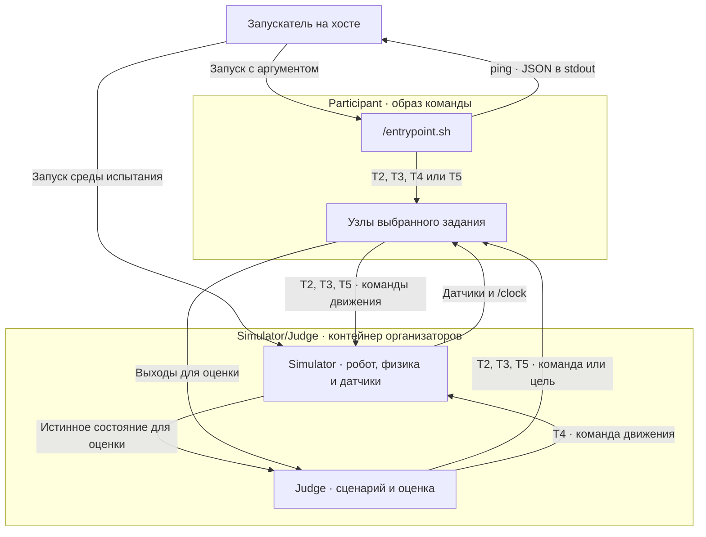
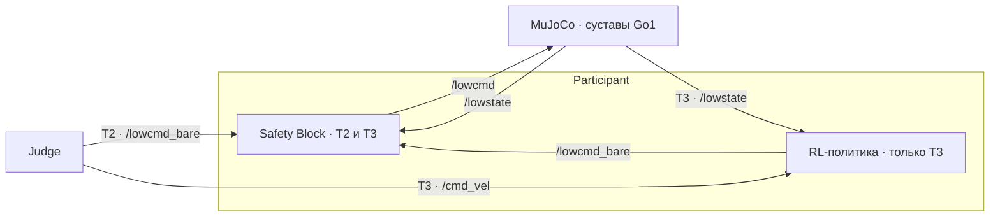
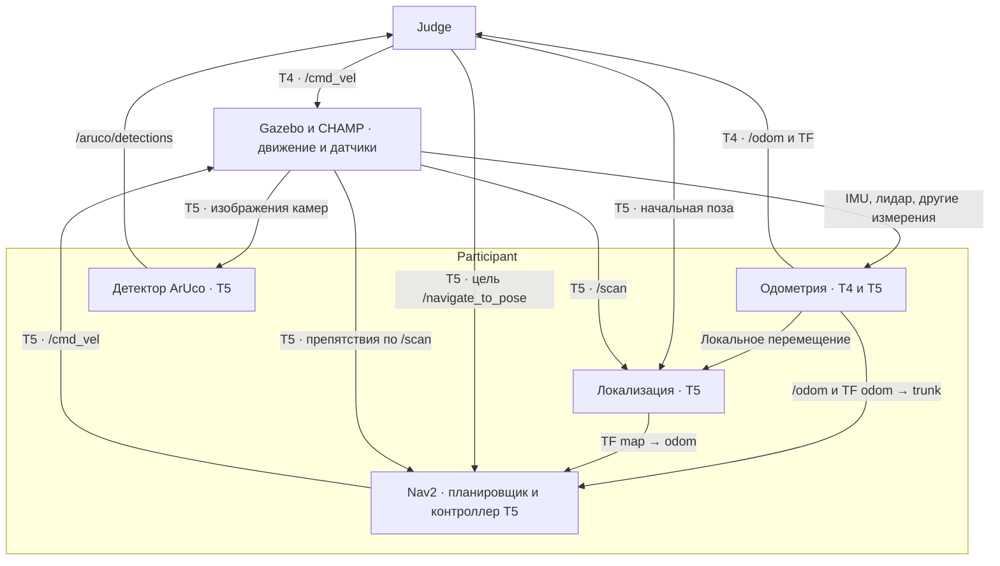

# Заочный этап Unitree Go1 — от первого запуска до сдачи

Команда сдаёт один Docker-образ Participant. Организаторы запускают его рядом со своим контейнером Simulator/Judge и передают в точку входа имя задания. **Сейчас Robohack реализует T1**. Разделы T2–T5 ниже описывают план разработки и локальные испытания будущих режимов. Алгоритмы в плане — примеры реализации. Обязательные интерфейсы, пороги и баллы взяты из ТЗ. [Код точки входа](../entrypoint.sh) · [Сводное ТЗ, разделы 2–8](HACKATHON.md#source-1)

## Как связаны задания

| Этап | Что должно заработать | Кто использует результат | Максимум по сводному ТЗ |
| --- | --- | --- | ---: |
| [T1](#t1) | Образ запускается автономно и сообщает свои возможности | Запускатель перед каждым испытанием | Допуск, 0 |
| [T2](#t2) | Защитный фильтр выдаёт безопасные команды 12 суставам | В T2 команды подаёт Judge, в T3 — политика ходьбы | 15 |
| [T3](#t3) | Робот проходит 3 м вперёд под управлением RL-политики и фильтра T2 | Отдельное испытание в MuJoCo | 30 |
| [T4](#t4) | По датчикам восстанавливается движение корпуса | Judge сравнивает траектории, в T5 её использует Nav2 | 20 |
| [T5](#t5) | Робот достигает цели в неизвестном коридоре и сообщает ID видимых меток | Judge оценивает финиш, метки и контакты | 35 |

После T1 можно параллельно разрабатывать **T2 → T3** в MuJoCo и **T4 → T5** в Gazebo. Для старта T4 не требуется походка из T3. В Gazebo движение исполняет контроллер CHAMP симулятора. Общий код удобно включать в разные режимы одного образа. Баллы за каждый режим получают в отдельном испытании.

**Расхождение источников.** На коммите организаторов `3473f086fd8a111592b4b9d822500c79f20c811a` сводное ТЗ даёт T1/T2 соответственно 0/15, отдельные файлы дают 3 балла за T1 и 12 по таблице T2, хотя заголовок T2 указывает 15. В обеих разбивках T1 обязателен для допуска, суммарный максимум за пять этапов — 100. Ниже для планирования используется разбивка сводного ТЗ. [Сводное ТЗ](HACKATHON.md#source-1) · [Отдельное ТЗ T1](HACKATHON.md#source-2) · [Отдельное ТЗ T2](HACKATHON.md#source-3)

## Архитектура решения

На одно испытание запускается одна пара контейнеров. В **Participant** работает код команды для выбранного режима. В **Simulator/Judge** симулятор рассчитывает физику и показания датчиков, а судья задаёт испытание и оценивает результат. Между контейнерами идут публичные сообщения ROS 2 через Cyclone DDS. Отдельный вызов `ping` читает возможности образа через stdout. Сегодня в репозитории реализован этот вызов. Схемы T2–T5 описывают целевую архитектуру. [Точка входа](../entrypoint.sh) · [Границы контейнеров и интерфейсы, §2 и §8](HACKATHON.md#source-1)



На локальном стенде `run_local.py` поднимает публичный Simulator и запускает Participant через `participant_runtime.py`. Входы, обозначенные на схемах стрелкой от Judge, при локальной проверке подаёт внешний тестовый узел. Он же может записывать результат рядом с эталоном. [Публичный стенд](HACKATHON.md#source-7)

### Какие компоненты включать в каждом режиме

| Аргумент точки входа | Состав Participant | Кто задаёт движение |
| --- | --- | --- |
| `ping` (T1) | Обработчик JSON, завершается после ответа | Проверка образа проходит без симулятора |
| `T2` | Safety Block | Judge задаёт цели суставов, фильтр допускает их к исполнению |
| `T3` | RL-политика и тот же Safety Block | Judge задаёт скорость, политика вычисляет цели суставов |
| `T4` | Оценка одометрии | Judge управляет CHAMP, Participant наблюдает движение |
| `T5` | Одометрия из T4, локализация, Nav2 и детектор ArUco | Judge задаёт конечную позу, Nav2 управляет CHAMP |

Общими между заданиями служат программные компоненты. Каждый запуск заново создаёт их рабочее состояние. Например, в начале эпизода T3 заново инициализируются история наблюдений политики и безопасная цель фильтра. В начале T5 оценка позы и представление трассы строятся для текущего прохода.

### MuJoCo · от команды скорости до движения сустава



**Один цикл T3.** Политика читает желаемую скорость и измеренное состояние робота, строит наблюдение для модели и переводит её выход в команду для 12 суставов. Safety Block проверяет команду и переход от последней принятой цели. Его таймер публикует безопасную цель в `/lowcmd`. После шага физики новый `/lowstate` замыкает цикл. На T2 можно испытать тот же фильтр отдельно, подставив вместо выхода политики последовательность команд Judge. Если движение расходится с ожидаемым, сравнение `/lowcmd_bare` с `/lowcmd` показывает, какую команду запросила политика и какая дошла до симулятора. [Контракты T2 и T3, §4–5](HACKATHON.md#source-1)

### Gazebo · от датчиков до навигационной цели



**T4 изолирует измерение движения.** Одометрия связывает корпус `trunk` с локальной системой `odom`. Симулятор публикует положение датчиков относительно корпуса. Из этих преобразований можно, например, перевести точку из системы лидара в `odom`. За команду скорости в этом режиме отвечает Judge.

**T5 добавляет движение к цели.** Для показанного варианта с лидарной локализацией участник оценивает положение системы `odom` относительно `map`. Теперь Nav2 через цепочку `map → odom → trunk` может сопоставить текущую позу корпуса с заданной целью. Планировщик выбирает путь с учётом препятствий, контроллер выдаёт очередную `/cmd_vel`, CHAMP исполняет её. Новые измерения обновляют позу и препятствия перед следующей командой. Параллельно детектор отправляет Judge ID меток, видимых на текущих кадрах. Это отдельный выход для оценки, поэтому навигация может обрабатывать цель даже в кадрах без меток. [Контракты T4 и T5 и дерево TF, §6–8](HACKATHON.md#source-1)

## Локальный стенд и порядок измерений

**Participant** содержит алгоритмы команды. **Simulator** публикует датчики и исполняет команды. **Judge** на официальном стенде задаёт испытания и измеряет результат. В публичной сборке роль источника тестовых команд берёт на себя команда. Истинную позу из публичной симуляции можно записывать отдельным локальным измерителем. Решение внутри сдаваемого образа должно работать только по публичным датчикам. [Описание стенда](HACKATHON.md#source-7)

1. Для стенда организаторы проверили Ubuntu 22.04 на amd64. Нужны Docker Engine, Compose с поддержкой `!reset`, Python 3.10+ и Git. Сначала из каталога **Robohack** собрать Participant по [README](../README.md#сборка-и-проверка).
2. Следующие команды выполнять **на хосте, в отдельном каталоге для стенда**. Доступ к реестру нужен при подготовке образов. На текущем T1 уже можно проверить саму симуляцию.

```bash
git clone https://github.com/Urika000/go1-simulator-public.git
cd go1-simulator-public
git checkout 3473f086fd8a111592b4b9d822500c79f20c811a
export SIM_IMAGE=registry.cookcloud.ru/go1-hackathon-remote-stage/go1-sim:v1.0
docker login registry.cookcloud.ru
docker pull --platform linux/amd64 "$SIM_IMAGE"
python3 run_local.py --task T2 --sim-only --sim-image "$SIM_IMAGE" --headless --logs
```

3. После появления нужного режима в образе остановить запуск через Ctrl+C. Из корня **go1-simulator-public** запустить пару контейнеров. В примере `PARTICIPANT_IMAGE` — локальный тег собранного решения с T2. Для T3 и T4 заменить значение `--task`. Для T5 добавить `--course-width 2.0` или `--course-width 1.0`.

```bash
export PARTICIPANT_IMAGE=go1-participant:local
python3 run_local.py --task T2 --sim-image "$SIM_IMAGE" \
  --participant-image "$PARTICIPANT_IMAGE" --headless --logs
```

4. Запускатель выводит имя контейнера Simulator и выбранный ROS-домен. Во втором терминале открыть `docker exec -it ИМЯ_СИМУЛЯТОРА bash`, выполнить `source /etc/go1_sim_env.sh`, затем `ros2 topic list --no-daemon` и `ros2 topic echo /clock --once`. Для T2/T3 должны приходить сообщения `/lowstate`, для T4/T5 — `/imu/data`, `/scan` и изображения. Если Simulator видит датчики, а Participant их не получает, сверить типы, QoS и переданные запускателем `ROS_DOMAIN_ID`, `RMW_IMPLEMENTATION`, `CYCLONEDDS_URI`. Имена топиков начинаются от корня, без префикса `/go1`. [Скрипт запуска](https://github.com/Urika000/go1-simulator-public/blob/3473f086fd8a111592b4b9d822500c79f20c811a/run_local.py) · [Инструкция по развёртыванию](HACKATHON.md#source-10)

**Два вида времени.** Проверку запуска T1 измерять обычными часами. Для поведения робота, частот и пауз использовать `/clock` и включить `use_sim_time=true` у узлов. Для T4/T5 обязателен lockstep — согласованное продвижение физики и датчиков. Одна секунда симуляции может занять больше секунды на хосте. Для повторяемых проверок записывать входы, выходы и `/clock` одного прогона вместе, отмечать версию образа и сцену. Локальные измерения дают оценку готовности, официальные баллы выставляет закрытый Judge. [Правила испытаний](HACKATHON.md#source-1)

<a id="t1"></a>

## T1. Подготовить образ к автоматическому запуску

**Результат.** Один образ `linux/amd64` с Ubuntu 22.04, ROS 2 Humble, Eclipse Cyclone DDS и `rmw_cyclonedds_cpp`. Participant работает на CPU под обычным пользователем. В Robohack базовый образ закреплён по digest, пользователь имеет UID/GID 10001. [Dockerfile](../Dockerfile) · [Стек проекта](STACK.md)

**Порядок работы и приёмки**

1. Положить исполняемый `/entrypoint.sh`, зависимости, конфигурации и веса в образ при сборке. Для каждого реализованного задания точка входа должна поднять соответствующие ROS-узлы и поддерживать их работу до остановки контейнера инфраструктурой.
2. Собрать и проверить образ по командам README. Проверить архитектуру и пользователя, затем запустить `/entrypoint.sh ping` с `--network none`. Успех — код 0 за ≤10 секунд реального времени, в stdout ровно один JSON-объект, диагностика допускается в stderr. Для сегодняшнего образа ожидается строка ниже. [Сборка и автономная проверка](../README.md#сборка-и-проверка)

   ```json
   {"protocol_version":"1.0","supported_tasks":[],"self_trained_rl":false,"preferred_speed_mps":null}
   ```

3. При добавлении каждого режима повторить автономную проверку и отдельный запуск этого режима рядом с Simulator. В `supported_tasks` перечислить работающие режимы латиницей, например `["T2"]` после готовности фильтра. При добавлении T3 согласовать скорость и признак обучения с фактическими весами. Изоляция сети в тесте `ping` проверяет автономность образа. В испытаниях T2–T5 контейнерам нужна связь между собой по ROS 2 при отсутствии интернета.
4. Допуск также требует доступности именно сдаваемого образа по SHA-256 digest. Завершить проверку по [порядку сдачи](#submission). [Условия T1](HACKATHON.md#source-1)

<a id="t2"></a>

## T2. Отфильтровать команды суставам

**Контракт.** В MuJoCo Lowlevel Judge подаёт `/lowcmd_bare` (`unitree_go/msg/LowCmd`). Узел Safety Block получает состояние из `/lowstate` (`unitree_go/msg/LowState`) и один публикует `/lowcmd` (`LowCmd`). Judge проверяет сам выход фильтра. Порядок ног — FR, FL, RR, RL, внутри каждой — hip, thigh, calf. Пределы для каждой ноги в радианах соответственно [−0,863; 0,863], [−0,686; 4,501], [−2,818; −0,888]. [Сводное ТЗ, §4](HACKATHON.md#source-1)

**Пример реализации**

1. Включить в Participant совместимые определения сообщений. Разделить приём команд, проверку кандидата и периодическую публикацию. Хранить последнюю принятую безопасную цель и время последнего входа. При старте получить состояние суставов и проверить исходную конфигурацию.
2. Проверять все поля `q, dq, kp, kd, tau` у 12 суставов. Любой NaN или ±Inf отклоняет всё сообщение. Для конечных чисел проверить диапазоны и ограничить изменение каждого целевого угла до 5° от предыдущей принятой цели.
3. Проверить конечную позу и переход. Использовать эталонные `go1.xml`, `scene.xml` и 655 проверяемых пар из 1540 в `t2_collision_pairs.csv`. В эталонной проверке шаг интерполяции по любому суставу ≤0,1°, запрещено проникновение строго глубже 1 мм. При нарушении можно удержать предыдущую безопасную цель либо подобрать безопасную коррекцию и повторно проверить переход. [Модель и перечень пар](https://github.com/Urika000/go1-simulator-public/tree/3473f086fd8a111592b4b9d822500c79f20c811a/models/mujoco/unitree_go1)
4. Продолжать публиковать по таймеру даже при потере входа. Через ≤0,5 с симуляции перейти на удержание последней **принятой цели** с `dq=0`, `tau=0` и допустимыми `kp, kd`. При движении измеренное положение может отличаться от цели.

**Локальная приёмка.** Подавать команды отдельным тестовым узлом, писать `/lowcmd_bare`, `/lowcmd` и `/clock`. Наблюдать как минимум следующие случаи.

| Что подать | Что измерить на выходе | Баллы по сводному ТЗ |
| --- | --- | ---: |
| Непрерывный поток, затем паузу | Средняя частота ≥50 Гц в окне 5 с, максимальный разрыв ≤100 мс по sim time | 4 |
| Значения у обеих границ и за границей каждого сустава | Все принятые углы лежат в диапазонах | 2 |
| Несколько разных безопасных целей, коллизионную позу и переход с коллизией только в середине | Фильтр реагирует на безопасный вход, каждый принятый шаг ≤5°, независимый перебор промежуточных поз не находит запрещённых контактов | 5 |
| Прекратить передачу во время движения | Через ≤0,5 с наступает описанное выше удержание, выход продолжается | 2 |
| По очереди внести NaN, +Inf и −Inf в управляющие поля | Команда целиком отклонена, на выходе последняя безопасная команда и только конечные числа | 2 |

**Переход к T3.** Сохранить этот набор проверок. В режиме T3 подключить политику к тому же входу фильтра и проверить частоту выхода при одновременной работе обоих узлов на CPU.

<a id="t3"></a>

## T3. Пройти 3 метра с RL-политикой

**Контракт.** В MuJoCo без камер Judge передаёт `geometry_msgs/msg/Twist` в `/cmd_vel`. Политика получает команду скорости и `/lowstate`, вычисляет цели 12 суставов и выдаёт `/lowcmd_bare`. Дальше работает Safety Block из T2. Во всех 10 эпизодах `linear.x` равна одной заявленной в `ping` скорости от 0,1 до 0,6 м/с, `linear.y` и `angular.z` равны нулю. [Условия T3](HACKATHON.md#source-4)

**Пример реализации**

1. Выбрать готовую, обученную командой или дообученную политику. Зафиксировать состав и нормализацию наблюдений, порядок суставов, исходную позу, частоту инференса и преобразование выхода модели в цели. Проверить на одном записанном состоянии, что левые и правые суставы получают свои команды.
2. Упаковать веса и CPU-среду инференса. На старте каждого эпизода заново инициализировать историю наблюдений и состояние политики. Записать вход и выход Safety Block при переходе от стойки к ходьбе. Частое отклонение целей — повод сверить масштаб действий, частоту и начальную позу.
3. Подобрать устойчивую скорость в разрешённом диапазоне и вернуть её в `preferred_speed_mps`. При собственном обучении или дообучении указать `self_trained_rl=true` и приложить веса, конфигурацию, журналы экспериментов и результаты. Для готовой сторонней политики указать `false`.

**Локальная приёмка.** Выполнить 10 запусков с одной скоростью, каждый раз пересоздавая **оба** контейнера. Из внешнего узла подать `/cmd_vel`. Отвести 1,5 с sim time на прогрев, затем до 90 с на зачёт. Для каждого запуска записать проекцию перемещения на исходное направление, время достижения 3 м и факт падения. Падение фиксировать при высоте корпуса <0,16 м, |roll| >50° или |pitch| >50°, если соответствующее нарушение длится непрерывно >0,5 с. При восстановлении сбросить отсчёт. Пройденные по дуге 3 м сами по себе не подтверждают смещение вперёд на 3 м.

**Баллы.** Хотя бы один успешный эпизод даёт 5, от семи из десяти — ещё 10. Подтверждённое собственное обучение или дообучение при хотя бы одном успехе даёт ещё 15. Таким образом, готовая политика может принести до 15, подтверждённая собственная — до 30. Сохранить таблицу десяти эпизодов рядом с версией весов, чтобы при сдаче связать результат с конкретным образом.

<a id="t4"></a>

## T4. Оценить фактическую траекторию

**Контракт.** В Gazebo Highlevel с lockstep команды `/cmd_vel` подаёт Judge. Participant оценивает движение по IMU, лидару, суставам, фронтальной RGB-D камере и другим доступным публичным измерениям. Выходы — `/odom` типа `nav_msgs/msg/Odometry` и динамическое преобразование TF `odom → trunk`. Оба должны описывать одну позу в одно время с частотой ≥20 Гц по `/clock`. [Условия T4](HACKATHON.md#source-5)

**Пример реализации**

1. Сверить временные метки `/imu/data` и `/scan`, проверить TF от датчиков до корпуса. Как отправную точку можно взять изменение ориентации по гироскопу и оценку смещения сопоставлением соседних сканов. При слабых геометрических ориентирах проверить, помогает ли фронтальная камера.
2. Объединить измерения в оценку позы, обновлять её между сканами по IMU. Из одного состояния публиковать `/odom` с `header.frame_id="odom"`, `child_frame_id="trunk"` и соответствующий TF. Проверять конечность значений и единичную норму кватерниона. Стартовую позу можно выбрать нулевой, при оценке начальные позы совмещаются.
3. Отдельно отладить остановку. На неподвижных данных оценить смещение нуля IMU и проверить, что шум датчиков не накапливается как движение. На прямом участке сверять поворот по датчикам — у модели Gazebo заметен увод курса даже при нулевой заданной угловой скорости.

**Локальная приёмка.** Внешний узел командует сценарием «стойка → четыре прямых по 0,2 м/с с четырьмя поворотами на 90° по 0,3 рад/с → остановка → 10 с покоя». Записать `/odom`, `/tf`, `/clock` и отдельно доступную в публичном Gazebo `/odom/ground_truth`. Совместить начальные позы и сравнить оценки в одни и те же моменты.

| Проверка | Как считать | Баллы |
| --- | --- | ---: |
| Выходной контракт | Для одометрии и TF проверить ≥20 Гц sim time, фреймы, согласованность поз и меток времени | 3 |
| Относительная ошибка перемещения (RPE) | Разбить **фактический путь** на последовательные участки около 1 м. На каждом взять норму разности оценённого и истинного векторов перемещения в согласованных координатах, разделить на фактическую длину участка. Усреднить | ≤50% — 5, ≤20% — ещё 6 |
| Дрейф | После переходной фазы сравнить начало и конец 10 с покоя. Смещение ≤0,10 м **и** изменение ориентации ≤5° | 6 |

**Переход к T5.** Перенести издателя `odom → trunk` и узел оценки без изменений контракта. Проверить одометрию на поворотах узкого коридора. Ошибка курса на этом этапе затем проявится как расхождение между целью Nav2 и физическим положением робота.

<a id="t5"></a>

## T5. Пройти неизвестную трассу и распознать метки

**Контракт.** Один непрерывный проход в Gazebo Course с CHAMP и lockstep. Judge задаёт начальную позу и передаёт цель в `map` клиентом `/navigate_to_pose` типа `nav2_msgs/action/NavigateToPose`. В Participant обязателен сервер Nav2. Старт — (0, 0), yaw 0°, вперёд вдоль +X. Готовой карты скрытой трассы и отдельной разведки нет. [Условия T5](HACKATHON.md#source-6)

| Часть решения | Что получает | Что выдаёт |
| --- | --- | --- |
| Одометрия T4 | Датчики движения | `/odom`, TF `odom → trunk` |
| Локализация и представление препятствий | Одометрия, лидар, начальная поза | TF `map → odom` и данные для планирования. Возможный вариант — SLAM во время движения |
| Nav2 | Цель, TF `map → odom → trunk`, карты стоимости | План и `/cmd_vel` для CHAMP |
| Детектор ArUco | Изображения камер | `/aruco/detections` типа `std_msgs/msg/String`, поле `data` содержит JSON текущих наблюдений |

**Порядок интеграции**

1. Запустить одометрию, локализацию и Nav2. Настроить базовый фрейм `trunk`. До отправки цели проверить доступность `map → trunk` по TF на времени датчика и готовность action-сервера (`ros2 action info /navigate_to_pose`). У каждого динамического преобразования должен быть один издатель.
2. Начать с публичной трассы шириной 2 м. Отправить тестовую цель в `map`, убедиться, что Nav2 строит путь и CHAMP исполняет `/cmd_vel`. Затем перейти на 1 м — это ширина проходов скрытой трассы. Настроить габарит робота, запас до стен и скорость в поворотах. При уводе курса корректировать движение по оценённой позе. Judge в T5 курс не исправляет.
3. Подключить камеры `/camera`, `/camera_chin`, `/camera_left`, `/camera_right`, `/camera_rearDown`. Для префикса доступен RGB `image_raw` в `rgb8`, глубина `depth/image_raw` в `32FC1` и соответствующие `camera_info`. Фронтальная камера даёт 640×480 при 15 Гц, остальные — 464×400 при 10 Гц sim time. Сверить QoS с симулятором. [Справочник камер, §8.4](HACKATHON.md#source-1)
4. Детектировать словарь `DICT_4X4_50`. Полная сторона метки — 0,25 м, чёрной области — 0,1875 м, центр на высоте 0,36 м. Публиковать увиденные сейчас ID, например `{"ids":[3,7]}`. При пустом кадре допустимы отсутствие сообщения или `{"ids":[]}`. Judge сам накапливает уникальные ID и проверяет видимость в момент регистрации. Подбор ID аннулирует баллы за метки.
5. Повторить полный проход из чистого старта на обеих трассах с включёнными пятью камерами на CPU. Сверять кадр и момент публикации детекций. Очередь старых кадров может дать правильный ID слишком поздно. Проверить несколько целей и поворотов, чтобы маршрут строился по датчикам при изменении обстановки.

**Локальная приёмка и баллы**

| Критерий | Проверка после прохода | Баллы |
| --- | --- | ---: |
| Финиш | По фактической позе одновременно ошибка положения ≤0,5 м и ошибка yaw ≤30°. Записать обе ошибки вместе со статусом action | 15 |
| Метки | Разделить число уникальных верно зарегистрированных видимых ID на число уникальных меток трассы. Повторы одного ID считать один раз | ≥50% — 5, ≥80% — ещё 7, независимо от финиша |
| Контакты | Финиш достигнут, за весь проход нет недопустимого контакта по критерию ниже | 8 |

Для проверки контактов на локальном стенде нужны данные физики Gazebo. Для каждой пары коллизионных объектов сложить модули сил по точкам контакта за один шаг, считая каждую силу один раз. Порог — ≥5 Н непрерывно ≥0,02 с sim time, при снижении ниже порога отсчёт начинается заново. Стопы могут касаться разрешённого пола. Учитываются удары о стены и препятствия любой частью робота и касание пола другими частями тела. Самоколлизии из этой метрики исключены. Если записаны только видео и топики Nav2, по ним можно найти подозрительное место, но количественный критерий контактов остаётся непроверенным.

<a id="submission"></a>

## Сдача одного проверенного образа

1. Зафиксировать исходники, Dockerfile, конфигурации и инструкцию сборки в публичном GitHub-репозитории. Для бонуса T3 приложить материалы обучения. Сохранить ссылку на конкретный коммит вида `https://github.com/<команда>/<репозиторий>/commit/<полный_SHA>`.
2. Из этого коммита собрать Participant под `linux/amd64` и опубликовать в назначенный проект Harbor по командам проекта. Получить SHA-256 digest из `docker buildx imagetools inspect`. [Команды публикации](../README.md#публикация)
3. Скачать образ по digest, на этой версии повторить автономный `ping` и локальный запуск каждого режима из `supported_tasks`. Сверить заявленную скорость и происхождение весов T3. Для собственной сводки сохранить версию образа и результаты проверок T2–T5.
4. В личный кабинет передать **два значения** — ссылку на Git-коммит и полную команду загрузки с реальными именами проекта, репозитория и digest. Формат второго поля — `docker pull --platform linux/amd64 registry.cookcloud.ru/<team>/<team>@sha256:<digest>`. Проверить, что ссылка открывается, а команда загружает отправленную версию. [Инструкция организаторов по сдаче](HACKATHON.md#source-11)
