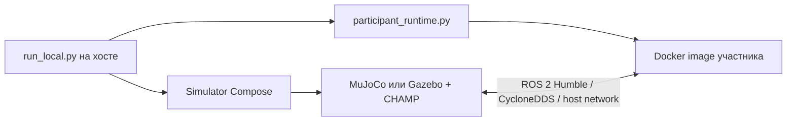

# Хакатон Unitree Go1 — задание и документация организаторов

В этом репозитории разрабатывается программное обеспечение для четвероногого робота Unitree Go1 в рамках заочного этапа хакатона. Задача — подготовить решение по техническому заданию организаторов, испытать его в предоставленной виртуальной среде и сдать в виде Docker-образа.

Репозиторий организаторов: <https://github.com/Urika000/go1-simulator-public>.
Версия документов: `3473f086fd8a111592b4b9d822500c79f20c811a`.

## Документы организаторов

| ID | Документ | Полный текст в этом файле |
| --- | --- | --- |
| [1] | [docs/Техническое_задание_заочный_этап.docx](https://github.com/Urika000/go1-simulator-public/blob/3473f086fd8a111592b4b9d822500c79f20c811a/docs/%D0%A2%D0%B5%D1%85%D0%BD%D0%B8%D1%87%D0%B5%D1%81%D0%BA%D0%BE%D0%B5_%D0%B7%D0%B0%D0%B4%D0%B0%D0%BD%D0%B8%D0%B5_%D0%B7%D0%B0%D0%BE%D1%87%D0%BD%D1%8B%D0%B9_%D1%8D%D1%82%D0%B0%D0%BF.docx) | [Открыть](#source-1) |
| [2] | [docs/parts_of_tz/ТЗ_T1.docx](https://github.com/Urika000/go1-simulator-public/blob/3473f086fd8a111592b4b9d822500c79f20c811a/docs/parts_of_tz/%D0%A2%D0%97_T1.docx) | [Открыть](#source-2) |
| [3] | [docs/parts_of_tz/ТЗ_T2.docx](https://github.com/Urika000/go1-simulator-public/blob/3473f086fd8a111592b4b9d822500c79f20c811a/docs/parts_of_tz/%D0%A2%D0%97_T2.docx) | [Открыть](#source-3) |
| [4] | [docs/parts_of_tz/ТЗ_T3.docx](https://github.com/Urika000/go1-simulator-public/blob/3473f086fd8a111592b4b9d822500c79f20c811a/docs/parts_of_tz/%D0%A2%D0%97_T3.docx) | [Открыть](#source-4) |
| [5] | [docs/parts_of_tz/ТЗ_T4.docx](https://github.com/Urika000/go1-simulator-public/blob/3473f086fd8a111592b4b9d822500c79f20c811a/docs/parts_of_tz/%D0%A2%D0%97_T4.docx) | [Открыть](#source-5) |
| [6] | [docs/parts_of_tz/ТЗ_T5.docx](https://github.com/Urika000/go1-simulator-public/blob/3473f086fd8a111592b4b9d822500c79f20c811a/docs/parts_of_tz/%D0%A2%D0%97_T5.docx) | [Открыть](#source-6) |
| [7] | [README.md](https://github.com/Urika000/go1-simulator-public/blob/3473f086fd8a111592b4b9d822500c79f20c811a/README.md) | [Открыть](#source-7) |
| [8] | [docs/docker-praktikum.md](https://github.com/Urika000/go1-simulator-public/blob/3473f086fd8a111592b4b9d822500c79f20c811a/docs/docker-praktikum.md) | [Открыть](#source-8) |
| [9] | [docs/go1-nvidia-instructions.md](https://github.com/Urika000/go1-simulator-public/blob/3473f086fd8a111592b4b9d822500c79f20c811a/docs/go1-nvidia-instructions.md) | [Открыть](#source-9) |
| [10] | [docs/Гайд_по_развертке_и_запуску_симуляции.md](https://github.com/Urika000/go1-simulator-public/blob/3473f086fd8a111592b4b9d822500c79f20c811a/docs/%D0%93%D0%B0%D0%B9%D0%B4_%D0%BF%D0%BE_%D1%80%D0%B0%D0%B7%D0%B2%D0%B5%D1%80%D1%82%D0%BA%D0%B5_%D0%B8_%D0%B7%D0%B0%D0%BF%D1%83%D1%81%D0%BA%D1%83_%D1%81%D0%B8%D0%BC%D1%83%D0%BB%D1%8F%D1%86%D0%B8%D0%B8.md) | [Открыть](#source-10) |
| [11] | [docs/Инструкция_по_загрузке_решения.md](https://github.com/Urika000/go1-simulator-public/blob/3473f086fd8a111592b4b9d822500c79f20c811a/docs/%D0%98%D0%BD%D1%81%D1%82%D1%80%D1%83%D0%BA%D1%86%D0%B8%D1%8F_%D0%BF%D0%BE_%D0%B7%D0%B0%D0%B3%D1%80%D1%83%D0%B7%D0%BA%D0%B5_%D1%80%D0%B5%D1%88%D0%B5%D0%BD%D0%B8%D1%8F.md) | [Открыть](#source-11) |
| [12] | [docs/найтройка_графики_NVIDIA_для_симуляции.txt](https://github.com/Urika000/go1-simulator-public/blob/3473f086fd8a111592b4b9d822500c79f20c811a/docs/%D0%BD%D0%B0%D0%B9%D1%82%D1%80%D0%BE%D0%B9%D0%BA%D0%B0_%D0%B3%D1%80%D0%B0%D1%84%D0%B8%D0%BA%D0%B8_NVIDIA_%D0%B4%D0%BB%D1%8F_%D1%81%D0%B8%D0%BC%D1%83%D0%BB%D1%8F%D1%86%D0%B8%D0%B8.txt) | [Открыть](#source-12) |
| [13] | [licenses/README.md](https://github.com/Urika000/go1-simulator-public/blob/3473f086fd8a111592b4b9d822500c79f20c811a/licenses/README.md) | [Открыть](#source-13) |
| [14] | [LICENSE](https://github.com/Urika000/go1-simulator-public/blob/3473f086fd8a111592b4b9d822500c79f20c811a/LICENSE) | [Открыть](#source-14) |
| [15] | [docs/parts_of_tz/ТЗ_T1.pdf](https://github.com/Urika000/go1-simulator-public/blob/3473f086fd8a111592b4b9d822500c79f20c811a/docs/parts_of_tz/%D0%A2%D0%97_T1.pdf) | [Открыть](#source-15) |
| [16] | [docs/parts_of_tz/ТЗ_T2.pdf](https://github.com/Urika000/go1-simulator-public/blob/3473f086fd8a111592b4b9d822500c79f20c811a/docs/parts_of_tz/%D0%A2%D0%97_T2.pdf) | [Открыть](#source-16) |
| [17] | [docs/parts_of_tz/ТЗ_T3.pdf](https://github.com/Urika000/go1-simulator-public/blob/3473f086fd8a111592b4b9d822500c79f20c811a/docs/parts_of_tz/%D0%A2%D0%97_T3.pdf) | [Открыть](#source-17) |
| [18] | [docs/parts_of_tz/ТЗ_T4.pdf](https://github.com/Urika000/go1-simulator-public/blob/3473f086fd8a111592b4b9d822500c79f20c811a/docs/parts_of_tz/%D0%A2%D0%97_T4.pdf) | [Открыть](#source-18) |
| [19] | [docs/parts_of_tz/ТЗ_T5.pdf](https://github.com/Urika000/go1-simulator-public/blob/3473f086fd8a111592b4b9d822500c79f20c811a/docs/parts_of_tz/%D0%A2%D0%97_T5.pdf) | [Открыть](#source-19) |
| [20] | [docs/Техническое_задание_заочный_этап.pdf](https://github.com/Urika000/go1-simulator-public/blob/3473f086fd8a111592b4b9d822500c79f20c811a/docs/%D0%A2%D0%B5%D1%85%D0%BD%D0%B8%D1%87%D0%B5%D1%81%D0%BA%D0%BE%D0%B5_%D0%B7%D0%B0%D0%B4%D0%B0%D0%BD%D0%B8%D0%B5_%D0%B7%D0%B0%D0%BE%D1%87%D0%BD%D1%8B%D0%B9_%D1%8D%D1%82%D0%B0%D0%BF.pdf) | [Открыть](#source-20) |

---

<a id="source-1"></a>

## Источник [1]: docs/Техническое_задание_заочный_этап.docx

Источник: [docs/Техническое_задание_заочный_этап.docx](https://github.com/Urika000/go1-simulator-public/blob/3473f086fd8a111592b4b9d822500c79f20c811a/docs/%D0%A2%D0%B5%D1%85%D0%BD%D0%B8%D1%87%D0%B5%D1%81%D0%BA%D0%BE%D0%B5_%D0%B7%D0%B0%D0%B4%D0%B0%D0%BD%D0%B8%D0%B5_%D0%B7%D0%B0%D0%BE%D1%87%D0%BD%D1%8B%D0%B9_%D1%8D%D1%82%D0%B0%D0%BF.docx).

<!-- BEGIN SOURCE 1: docs/Техническое_задание_заочный_этап.docx -->

Техническое задание — заочный этап Hackathon Go1

### 1. Общие сведения о заочном этапе

Заочный этап хакатона посвящён разработке программного обеспечения для четвероногого робота Unitree Go1. Участники разрабатывают и испытывают свои решения в виртуальной среде. Использование физического робота для участия в заочном этапе не требуется.

Результатом работы команды является собственное программное решение, подготовленное в виде Docker-образа для проверки организаторами.

#### 1.1. Материалы для участников

Организаторы предоставляют командам:

Контейнер публичной симуляции Unitree Go1 с тестовыми сценами.

Описание доступных интерфейсов взаимодействия с роботом.

Инструкции по запуску и использованию симуляции.

Публичный запускатель run_local.py для совместного локального запуска Simulator и контейнера Participant.

Описание заданий, критериев оценивания и порядка сдачи решения.

### 2. Общие правила испытаний

#### 2.1. Организация испытаний

Официальные испытания проводятся на сервере организаторов с использованием двух Docker-контейнеров:

Контейнер участника (Participant) — содержит программное решение команды и необходимые зависимости.

Контейнер симуляции (Simulator/Judge) — содержит эталонную модель Unitree Go1, среду моделирования и систему автоматической проверки заданий (Judge).

Взаимодействие между контейнерами осуществляется через предусмотренные техническим заданием публичные интерфейсы ROS 2.

Judge управляет ходом испытаний, подаёт тестовые команды и цели, контролирует выполнение заданий и формирует результаты оценивания.

Для локальной разработки предусматривается запускатель run_local.py: публичная симуляция запускается через Docker Compose, а контейнер участника создаётся через Docker CLI с использованием модуля participant_runtime.py.

Официальные испытания запускаются существующей системой Judge, использующей собственный Python-запускатель на основе Docker CLI. Локальный запускатель не содержит закрытого Judge и не заменяет официальную проверку.

#### 2.2. Публичная и судейская симуляции

Участникам предоставляется публичная версия симуляции для локальной разработки и отладки. Официальные испытания проводятся на судейской версии.

Обе версии используют одинаковую физическую модель робота и согласованные публичные интерфейсы ROS 2. Судейская версия дополнительно содержит систему оценивания и скрытые испытательные сценарии.

Участники могут изменять локальную симуляцию для собственных экспериментов. Эти изменения не переносятся в официальную среду испытаний.

Доступ к ground truth:

В публичной симуляции истинное состояние робота (ground truth) доступно для локальной отладки и проверки алгоритмов.

В официальных испытаниях контейнер участника не имеет доступа к ground truth, приватным данным Judge и закрытой конфигурации испытательных сценариев.

Judge использует приватные данные для оценивания, не передавая их участнику.

Во время официального испытания участник может получать сведения об окружающей среде через предусмотренные публичные датчики робота.

#### 2.3. Порядок проведения испытаний

Каждое испытание выполняется в изолированном окружении.

1. Организаторы создают новую пару контейнеров Participant и Simulator/Judge.

2. Выполняется запуск решения и проверка готовности необходимых интерфейсов.

3. Judge проводит испытание в соответствии с условиями выбранного задания.

4. По завершении испытания или достижении установленного тайм-аута контейнеры останавливаются, результаты фиксируются.

5. Для следующего запуска создаётся новая пара контейнеров.

Для T3 каждый из 10 эпизодов проводится с полным пересозданием обоих контейнеров. Результаты и состояние предыдущего эпизода не должны влиять на следующий.

Порядок подготовки и проверки Docker-образа описан в задании T1.

#### 2.4. Среды моделирования и время

Для различных заданий используются следующие режимы симуляции:

| Задание | Среда моделирования | Условия |
| --- | --- | --- |
| T2, T3 | MuJoCo Lowlevel | Без камер; Gazebo lockstep не применяется |
| T4 | Gazebo Highlevel | Обязательный lockstep; фронтальная RGB-D камера |
| T5 | Gazebo Course | Обязательный lockstep; пять RGB-D камер |

В режимах Gazebo Highlevel и Course механизм lockstep обязателен как в публичной, так и в судейской симуляции. Он обеспечивает согласованное продвижение физики и датчиков по симуляционному времени.

При этом различаются:

Sim time — время внутри симуляции, используемое для определения продолжительности сценариев и физических процессов.

Wall time — фактически прошедшее время выполнения испытания, используемое для инфраструктурных ограничений и тайм-аутов.

Lockstep не гарантирует, что симуляционное время будет идти с той же скоростью, что и реальное.

Конкретные ограничения по времени устанавливаются в условиях соответствующих заданий и регламенте запуска.

#### 2.5. Особенности управления в Gazebo

В симуляции Gazebo присутствует систематическое отклонение курса робота при прямолинейном движении. При команде linear.x = 0.2 м/с, angular.z = 0 наблюдался поворот приблизительно на 82–92° за 25 секунд симуляционного времени.

Поэтому команды /cmd_vel не гарантируют идеального следования заданной траектории.

При разработке автономной навигации T5 участникам необходимо учитывать фактическое поведение робота. Для коррекции курса могут использоваться настройки контроллеров Nav2 или собственные алгоритмы управления. Конкретный способ компенсации не предписывается.

В T4 участник отвечает только за оценку фактического движения робота. Judge вправе корректировать курс по приватному истинному состоянию симулятора, но такая коррекция не является обязательным условием испытания.

### 3. T1 — Подготовка и сдача решения (0 баллов)

Цель задания: подготовить программное решение команды к автоматизированному запуску и проверке на инфраструктуре организаторов.

T1 является обязательным условием допуска к остальным заданиям. Баллы за него не начисляются.

#### 3.1. Требования к Docker-образу

Команда должна подготовить самодостаточный Docker/OCI-образ со следующими характеристиками:

| Параметр | Требование |
| --- | --- |
| Архитектура | linux/amd64 |
| Операционная система | Ubuntu 22.04 LTS (Jammy) |
| ROS 2 | Humble Hawksbill |
| DDS | Eclipse Cyclone DDS |
| RMW | rmw_cyclonedds_cpp |
| Вычислительные ресурсы | Только CPU, без доступа к GPU |
| Права пользователя | Запуск без прав root |
| Интернет | Недоступен во время испытаний |

Образ должен содержать все зависимости, конфигурации, исполняемые файлы, модели и веса, необходимые для выполнения заявленных заданий. Загрузка дополнительных компонентов из интернета во время официальных испытаний не допускается.

#### 3.2. Контракт запуска

Контейнер Participant запускается инфраструктурой организаторов. Внутри Docker-образа в корневом каталоге файловой системы обязательно должен находиться исполняемый файл /entrypoint.sh (абсолютный путь /entrypoint.sh). Файл принимает аргумент ping или идентификатор реализованного задания T2, T3, T4 или T5.

Для запуска контейнера Participant в рамках хакатона собственный Docker Compose не используется. Контейнер создаёт и запускает штатный Python-запускатель; участник не должен запускать его через собственный compose.yaml в рамках испытания.

| Команда | Назначение |
| --- | --- |
| /entrypoint.sh ping | Проверка совместимости и получение сведений о решении |
| /entrypoint.sh T2 | Запуск блока безопасности низкоуровневого управления |
| /entrypoint.sh T3 | Запуск RL-политики и блока безопасности |
| /entrypoint.sh T4 | Запуск системы оценки одометрии |
| /entrypoint.sh T5 | Запуск навигации, одометрии и распознавания ArUco |

Команда должна реализовать режим ping и режимы для выполненных заданий.

При запуске режимов T2–T5 программа должна запустить необходимые ROS 2-узлы и обеспечивать их работу до завершения испытания. Завершение и остановка контейнера выполняются инфраструктурой организаторов.

#### 3.3. Протокол ping

При вызове /entrypoint.sh ping контейнер должен в течение 10 секунд реального времени с момента начала запуска завершиться с кодом 0 и вывести в стандартный поток stdout ровно один корректный JSON-объект с установленными полями протокола.

Никакой дополнительный текст в stdout не допускается, за исключением пробельных символов. Диагностические сообщения допускаются исключительно в stderr.

Обязательные поля JSON:

| Поле | Тип | Значение |
| --- | --- | --- |
| protocol_version | string | Фиксированное значение "1.0" |
| supported_tasks | array[string] | Перечень реализованных заданий: T2, T3, T4, T5 |
| self_trained_rl | boolean | true, если RL-политика самостоятельно обучена или дообучена командой; иначе false |
| preferred_speed_mps | number/null | Рекомендуемая скорость движения для T3 в м/с; null, если T3 не реализовано |

Пример корректного ответа:

{

  "protocol_version": "1.0",

  "supported_tasks": ["T2", "T3", "T4", "T5"],

  "self_trained_rl": true,

  "preferred_speed_mps": 0.3

}

Значение 0.3 м/с приведено исключительно для примера. Допустимые скорости и условия испытания T3 определяются в соответствующем задании.

Идентификаторы заданий записываются с использованием латинской буквы T.

#### 3.4. Проверка допуска

Организаторы автоматически проверяют:

1. Доступность Docker-образа по указанному SHA-256 digest и соответствие архитектуре linux/amd64.

2. Корректное выполнение /entrypoint.sh ping, включая формат и время работы.

3. Работу без подключения к интернету и загрузки внешних зависимостей.

При невыполнении хотя бы одного обязательного условия T1 решение не допускается к оцениванию остальных заданий.

#### 3.5. Сдача решения

Для официальной проверки команда предоставляет:

Ссылку на публичный GitHub-репозиторий с исходным кодом решения и указанием конкретного Git-коммита.

Ссылку на Docker-образ в CookCloud Registry, зафиксированный по неизменяемому SHA-256 digest.

Репозиторий должен содержать исходный код решения и описание способа сборки Docker-образа. Структуру каталогов и инструменты сборки команда определяет самостоятельно. Собственный Compose-файл для запуска Participant в испытаниях не используется. Материалы, подтверждающие самостоятельное обучение или дообучение RL-политики, предоставляются согласно требованиям T3.

Порядок публикации образа, формат передачи ссылок и команды проверки описываются в отдельной «Инструкции по подготовке и сдаче решения».

### 4. T2 — Безопасность низкоуровневого управления (15 баллов)

Цель задания: разработать блок безопасности, который проверяет управляющие команды для 12 суставов Unitree Go1 и предотвращает передачу опасных команд в симулятор.

#### 4.1. Что необходимо реализовать

Команда должна разработать ROS 2-узел Safety Block, выполняющий следующие функции:

Проверка корректности входных команд.

Ограничение целевых углов суставов.

Предотвращение самоколлизий робота в целевых конфигурациях и при переходах между ними.

Безопасная обработка недопустимых команд.

Сохранение безопасного управления при потере входного потока.

Задание выполняется в среде MuJoCo Lowlevel.

#### 4.2. Контракт взаимодействия

| Интерфейс | Тип сообщения | Назначение |
| --- | --- | --- |
| /lowcmd_bare | unitree_go/msg/LowCmd | Входные команды для проверки |
| /lowcmd | unitree_go/msg/LowCmd | Безопасные команды на актуаторы |
| /lowstate | unitree_go/msg/LowState | Телеметрия состояния робота |

Последовательность взаимодействия:

1. Judge публикует тестовые команды в /lowcmd_bare.

2. Safety Block проверяет входную команду.

3. Safety Block публикует безопасную команду в /lowcmd.

4. Симулятор применяет команду к актуаторам робота.

Сообщения LowCmd содержат целевые положения q, скорости dq, коэффициенты регуляторов kp, kd и моменты tau для 12 суставов.

Judge оценивает непосредственно выход /lowcmd. Срабатывание встроенных защит симулятора не заменяет выполнение требований Safety Block.

#### 4.3. Ограничения суставов

В сообщениях LowCmd используется следующий порядок суставов:

FR → FL → RR → RL, для каждой ноги: hip → thigh → calf.

Для проверки T2 используется модель Unitree Go1 из MuJoCo Menagerie, revision 0059d4335f8156206f63a35662313385f7ad6d74 (MuJoCo 3.3.7). SHA-256 эталонного файла go1.xml: d5a7466784c8e72fd174cc7fa5a92754a1a0a6d458a1dec79e7ca0abc9525c4a. Для 12 суставов установлены следующие диапазоны целевых углов:

| № | Сустав | q_min, рад | q_max, рад |
| --- | --- | --- | --- |
| 1 | FR_hip | −0,863 | 0,863 |
| 2 | FR_thigh | −0,686 | 4,501 |
| 3 | FR_calf | −2,818 | −0,888 |
| 4 | FL_hip | −0,863 | 0,863 |
| 5 | FL_thigh | −0,686 | 4,501 |
| 6 | FL_calf | −2,818 | −0,888 |
| 7 | RR_hip | −0,863 | 0,863 |
| 8 | RR_thigh | −0,686 | 4,501 |
| 9 | RR_calf | −2,818 | −0,888 |
| 10 | RL_hip | −0,863 | 0,863 |
| 11 | RL_thigh | −0,686 | 4,501 |
| 12 | RL_calf | −2,818 | −0,888 |

Соблюдение угловых ограничений само по себе не гарантирует отсутствия самоколлизий.

#### 4.4. Требования к безопасности

Ограничение целевых положений и переходов

Safety Block должен обеспечивать выполнение следующих условий:

Все целевые углы находятся в разрешённых диапазонах.

Изменение целевого угла каждого сустава между последовательными принятыми безопасными командами не превышает 5°.

Целевые конфигурации и переходы между ними не вызывают запрещённых самоколлизий.

Для проверки переходов Judge анализирует начальную, конечную и промежуточные конфигурации. Максимальное изменение любого сустава между соседними проверяемыми конфигурациями составляет 0,1°. То есть Judge проверяет все конфигурации между двумя положениями с дискретностью 0,1°.

Запрещённой самоколлизией считается проникновение коллизионных геометрий робота на глубину строго более 1 мм.

Из 1540 возможных пар коллизионных геометрий робота для проверки самоколлизий используются 655 пар. Из перечня исключаются контакты с полом, пары геометрий одного жёсткого тела или жёсткой группы (*welded body*), пары непосредственно связанных звеньев, отфильтрованные правилами MuJoCo, и пары с несовместимыми масками contype и conaffinity. Контакты стоп с другими частями робота не исключаются автоматически.

Организаторы публикуют вместе с публичной симуляцией файлы go1.xml (эталонная модель робота), scene.xml (сцена MuJoCo) и t2_collision_pairs.csv (перечень всех 1540 пар с указанием 655 проверяемых пар и причин исключения остальных). Перечень пар соответствует опубликованной версии модели и одинаков для публичной симуляции и судейской проверки. Участники самостоятельно реализуют алгоритм предотвращения самоколлизий; готовая реализация не предоставляется.

Шаг 0,1° применяется для эталонной проверки Judge и не устанавливает обязательный внутренний алгоритм Safety Block. Участники вправе использовать любой алгоритм, обеспечивающий необходимую частоту публикации сообщений.

Обработка опасных команд

Если входная команда нарушает требования безопасности, Safety Block может:

1. Отклонить команду и продолжить удержание последней принятой безопасной цели.

2. Скорректировать команду до безопасного значения, обеспечив безопасный переход к нему.

Оба способа допускаются. Судья оценивает безопасность выходного потока и корректную реакцию на допустимые входные команды.

Постоянное удержание одной конфигурации вместо обработки безопасных команд не считается выполнением задания.

Обработка некорректных числовых значений

При наличии NaN, +Inf или −Inf хотя бы в одном управляющем поле сообщение считается некорректным целиком.

Такое сообщение должно быть отклонено. Safety Block продолжает публиковать последнюю принятую безопасную команду.

Некорректные числовые значения не должны попадать в /lowcmd.

Потеря входного потока

Если сообщения /lowcmd_bare перестают поступать, Safety Block должен не позднее чем через 0,5 секунды симуляционного времени обеспечить безопасное удержание последней принятой целевой конфигурации.

При удержании используются:

q — последняя принятая безопасная целевая конфигурация;

dq = 0;

tau = 0;

допустимые коэффициенты kp и kd.

Выходной поток /lowcmd должен продолжаться. Удержание последней целевой конфигурации не следует путать с удержанием последнего измеренного положения суставов.

#### 4.5. Порядок проверки и оценивание

Judge последовательно проверяет работу Safety Block, подавая безопасные, опасные и некорректные команды, а также моделируя потерю входного потока.

Частота публикации `/lowcmd`, длительность 5-секундного окна измерения и максимальный интервал между сообщениями измеряются по симуляционному времени.

| Критерий | Баллы |
| --- | --- |
| Выход /lowcmd: средняя частота не ниже 50 Гц за 5 секунд симуляционного времени, максимальный интервал между сообщениями не более 100 мс симуляционного времени | 4 |
| Соблюдение угловых ограничений всех 12 суставов | 2 |
| Отсутствие запрещённых самоколлизий и корректная обработка безопасных и опасных команд | 5 |
| Безопасное удержание при потере входного потока через 0,5 с симуляционного времени | 2 |
| Отсутствие некорректных числовых значений в выходных командах | 2 |
| Итого | 15 |

Баллы начисляются по результатам работы блока безопасности. Конкретный алгоритм его реализации не предписывается.

### 5. T3 — Ходьба с RL-политикой (30 баллов)

Цель задания: реализовать управление ходьбой Unitree Go1 с использованием RL-политики, преобразующей заданную скорость движения в низкоуровневые команды суставам.

#### 5.1. Что необходимо реализовать

Команда должна интегрировать готовую RL-политику, самостоятельно обученную новую или дообученную существующую. Подразумевается, что команды, обучавшие свою нейросеть, могут на очном этапе её использовать для реализации движения. Но на очном этапе требования к качеству ходьбы будут более строгие.

Программное решение должно обеспечивать:

Получение заданной скорости движения.

Формирование низкоуровневых команд для 12 суставов робота.

Передачу команд через блок безопасности Safety Block.

Устойчивую ходьбу без падения на заданное расстояние.

Задание выполняется в среде MuJoCo Lowlevel. Использование камер не предусмотрено.

#### 5.2. Контракт взаимодействия

| Интерфейс | Тип сообщения | Назначение |
| --- | --- | --- |
| /cmd_vel | geometry_msgs/msg/Twist | Заданная скорость от Judge |
| /lowstate | unitree_go/msg/LowState | Состояние робота из симулятора |
| /lowcmd_bare | unitree_go/msg/LowCmd | Команды RL-политики |
| /lowcmd | unitree_go/msg/LowCmd | Безопасные команды для актуаторов |
| /clock | rosgraph_msgs/msg/Clock | Симуляционное время |

Последовательность взаимодействия:

1. Judge публикует заданную скорость в /cmd_vel.

2. RL-политика получает команду скорости и доступное состояние робота из /lowstate.

3. RL-политика формирует команды суставам и публикует их в /lowcmd_bare.

4. Safety Block проверяет команды и публикует безопасный результат в /lowcmd.

5. Симулятор применяет команды к актуаторам робота.

Использование Safety Block обязательно. Его реализация должна соответствовать требованиям T2, однако баллы за T2 и T3 начисляются по результатам отдельных испытаний.

#### 5.3. Сценарий испытания

Judge проводит 10 независимых эпизодов. Для каждого эпизода полностью пересоздаются контейнер участника и контейнер Simulator/Judge.

Перед началом испытания команда указывает желаемую скорость движения в поле preferred_speed_mps протокола ping.

Допустимый диапазон скорости: от 0,1 до 0,6 м/с.

Во всех десяти эпизодах используется одно и то же заявленное значение скорости.

Judge публикует команду /cmd_vel со следующими параметрами:

| Параметр | Значение |
| --- | --- |
| linear.x | preferred_speed_mps |
| linear.y | 0 |
| angular.z | 0 |

Робот должен двигаться вперёд, не выполняя заданных поворотов.

Каждый эпизод состоит из двух фаз:

1. Прогрев — 1,5 секунды симуляционного времени. Предоставляется для инициализации алгоритмов и стабилизации управления.

2. Зачётное движение — не более 90 секунд симуляционного времени. Робот должен пройти вперёд не менее 3 метров без падения.

Отсчёт зачётного времени начинается после окончания прогрева.

Условия успешного эпизода

Эпизод считается успешным, если робот переместился не менее чем на 3 метра вперёд относительно своего начального направления за установленное время и не упал.

Фактическое перемещение определяется Judge по приватному истинному состоянию симулятора, а не по командам скорости или расчётам участника.

Падение фиксируется, если выполняется хотя бы одно из условий:

Высота основного корпуса робота становится менее 0,16 м.

Абсолютный угол крена (roll) превышает 50°.

Абсолютный угол тангажа (pitch) превышает 50°.

Для фиксации падения соответствующее нарушение должно непрерывно сохраняться более 0,5 секунды симуляционного времени.

Если робот возвращается в допустимое состояние до истечения этого интервала, отсчёт нарушения сбрасывается. Кратковременный выход за установленные пределы сам по себе не считается падением.

#### 5.4. Подтверждение самостоятельного обучения

Для выполнения задания допускаются готовые, самостоятельно обученные и дообученные RL-политики.

Дополнительные баллы за обучение начисляются только командам, подтвердившим самостоятельное обучение новой политики либо дообучение существующей.

Для подтверждения команда предоставляет:

Веса полученной модели.

Конфигурацию обучения или дообучения.

Журналы экспериментов и результаты обучения.

Материалы проверяются организаторами. Значение self_trained_rl=true в ответе ping является заявлением команды, но само по себе не подтверждает факт обучения.

Для получения дополнительных 15 баллов достаточно подтвердить самостоятельное обучение или дообучение политики и успешно пройти хотя бы один из десяти эпизодов.

#### 5.5. Критерии оценивания

| Критерий | Баллы |
| --- | --- |
| Не менее одного успешного эпизода: 3 м вперёд без падения за установленное время | 5 |
| Не менее 7 успешных эпизодов из 10 | 10 |
| Подтверждённое самостоятельное обучение или дообучение RL-политики при наличии хотя бы одного успешного эпизода | 15 |
| Итого | 30 |

Критерии начисляются независимо при выполнении указанных условий.

Готовая политика без подтверждённого обучения или дообучения командой может получить до 15 баллов за успешное движение.

Самостоятельно обученная или дообученная политика может получить 20 баллов при одном успешном эпизоде либо 30 баллов при успешном прохождении не менее 7 эпизодов из 10.

### 6. T4 — Оценка движения робота (20 баллов)

Цель задания: разработать алгоритм одометрии, позволяющий оценивать положение и ориентацию Unitree Go1 по доступным датчикам робота.

#### 6.1. Описание задания

Команда должна разработать ROS 2-узел, который оценивает фактическое движение робота и публикует результаты в виде одометрии. Для оценки допускается использовать любые доступные участнику датчики, включая IMU, лидар, RGB-D камеру, состояния суставов и контактную информацию.

Испытание проводится в среде Gazebo Classic Highlevel с управлением через CHAMP и обязательным режимом lockstep. Участникам доступна одна фронтальная RGB-D камера, четыре дополнительные камеры отключены.

Движением робота управляет Judge, публикующий команды в /cmd_vel. Участник не формирует управляющие команды и не отвечает за точность следования заданной траектории. Его задача — оценивать фактическое движение робота независимо от возникающих отклонений.

Рисунок 1 - Полигон для проверки одометрии в Gazebo.

#### 6.2. Контракт взаимодействия

Взаимодействие между Judge, симулятором и алгоритмом одометрии осуществляется через публичные интерфейсы ROS 2.

| Интерфейс | Тип сообщения | Назначение |
| --- | --- | --- |
| /cmd_vel | geometry_msgs/msg/Twist | Команды движения от Judge |
| /joint_states | sensor_msgs/msg/JointState | Состояния суставов |
| /imu/data | sensor_msgs/msg/Imu | Данные инерциального датчика |
| /scan | sensor_msgs/msg/LaserScan | Данные лидара |
| Фронтальная RGB-D камера | Image, CameraInfo | Изображения, глубина и параметры камеры |
| /odom | nav_msgs/msg/Odometry | Одометрия участника |
| /tf | TF2 | Преобразование odom → trunk |
| /clock | rosgraph_msgs/msg/Clock | Симуляционное время |

Judge задаёт движение через /cmd_vel, после чего симулятор применяет команды и публикует данные датчиков. Используя эти данные, алгоритм участника должен оценивать положение и ориентацию робота, публикуя результаты в /odom и TF odom → trunk. Judge сравнивает полученную оценку с фактическим движением робота по приватному истинному состоянию симулятора. В сообщении /odom должны быть указаны header.frame_id = "odom" и child_frame_id = "trunk".

Частота публикации `/odom` и TF должна составлять не менее 20 Гц симуляционного времени. Положение и ориентация в обоих интерфейсах должны быть согласованы, а сообщения — содержать корректные временные метки и системы координат. Значения NaN, Inf и некорректные кватернионы не допускаются.

Начальное положение и ориентация системы одометрии могут быть произвольными. При оценивании Judge совмещает начальную оценённую позу с фактической, поэтому участнику не требуется знать глобальные координаты робота.

#### 6.3. Сценарий испытания

Judge задаёт движение по траектории в форме квадрата. Испытание начинается с неподвижной фазы, после которой робот выполняет четыре прямолинейных участка с заданной скоростью 0,2 м/с и четыре поворота на 90° с угловой скоростью 0,3 рад/с.

После завершения движения предусмотрена переходная фаза, в течение которой робот останавливается. Затем начинается заключительный неподвижный интервал, предназначенный для проверки дрейфа одометрии.

Фактическая траектория робота может отличаться от заданного квадрата из-за особенностей физической модели. Judge вправе применять замкнутую коррекцию курса по приватной ground truth, не используя одометрию участника. Такая коррекция применяется на одинаковых условиях для всех команд, а её наличие или отсутствие не влияет на критерии оценивания.

Участник должен оценивать именно фактическое движение робота, а не восстанавливать заранее известную командную траекторию. Испытательный полигон содержит визуальные текстуры и ориентиры, позволяющие применять визуальные и лидарные методы одометрии.

#### 6.4. Оценка точности одометрии

Точность оценивается с помощью Relative Pose Error (RPE) — ошибки относительного перемещения. Для этого Judge разделяет фактически пройденный роботом путь на последовательные участки длиной приблизительно 1 метр и сравнивает относительное перемещение по одометрии участника с истинным перемещением робота на каждом участке.

Ошибка вычисляется как длина векторной разницы этих перемещений, делённая на фактическую длину участка. Полученные относительные ошибки усредняются по всем оцениваемым участкам. Например, если на участке длиной 1 метр ошибка перемещения составляет 0,2 метра, относительная ошибка равна 20%.

При расчёте RPE используется фактическая траектория робота, а не заданная последовательность команд. Поэтому отклонения робота от командного квадрата сами по себе не ухудшают оценку одометрии.

Проверка дрейфа

После остановки робота Judge оценивает стабильность одометрии в течение 10 секунд. Для этого сравниваются оценённые положение и ориентация в начале и конце неподвижного интервала. Критерий считается выполненным, если изменение положения не превышает 0,10 м, а изменение ориентации — 5°.

Максимальные промежуточные отклонения внутри этого интервала отдельно не оцениваются.

#### 6.5. Критерии оценивания

| Критерий | Баллы |
| --- | --- |
| Корректная публикация /odom и TF с частотой не ниже 20 Гц | 3 |
| Средняя относительная ошибка RPE не более 50% | 5 |
| Средняя относительная ошибка RPE не более 20% | 6 дополнительно |
| Дрейф за 10 секунд: не более 0,10 м по положению и 5° по ориентации | 6 |
| Итого | 20 |

Баллы за точность RPE суммируются: при ошибке не более 20% участник получает 11 баллов за точность одометрии. Оценивание производится по фактическому движению робота независимо от отклонений его траектории от заданной.

### 7. T5 — Автономная навигация и ArUco (35 баллов)

Цель задания: разработать систему автономной навигации, позволяющую роботу Unitree Go1 самостоятельно добраться до заданной цели по неизвестной трассе и распознать расположенные на ней ArUco-метки.

#### 7.1. Описание задания

Команда должна разработать навигационную систему на базе Nav2, способную самостоятельно управлять роботом в неизвестном окружении. Решение должно получать навигационную цель, оценивать положение робота, планировать движение, обнаруживать и обходить препятствия. Дополнительно необходимо реализовать распознавание ArUco-меток по изображениям камер и передачу их идентификаторов в установленном формате.

Использование Nav2 обязательно. Его замена произвольным навигационным стеком не допускается. Испытание проводится в Gazebo Classic Course с управлением через CHAMP и обязательным режимом lockstep. Участникам доступны пять RGB-D камер, лидар, IMU и другие публичные датчики робота.

Испытание представляет собой один непрерывный проход от стартовой позиции до заданной цели. После запуска навигационной системы Judge передаёт инициализационную позу робота, а затем навигационную цель. Предварительного исследования трассы или отдельного этапа картографирования не предусмотрено.

Готовая карта скрытой трассы участникам не предоставляется. Команды самостоятельно выбирают способ навигации и могут, например, использовать SLAM для одновременного построения карты и движения к цели. Публикация и сохранение карты не требуются: оценивается результат автономной навигации, а не наличие определённого алгоритма картографирования.

Управление движением полностью осуществляется системой участника. Judge не корректирует курс робота по приватному истинному состоянию симулятора (ground truth) и не подменяет команды управления.

Рисунок 2 - Рисунок 1 - Полигон с проходами 1 м для проверки навигации в Gazebo.

Рисунок 3 - Рисунок 1 - Карта полигона с проходами 1 м для проверки навигации в Gazebo.

#### 7.2. Контракт взаимодействия

Взаимодействие между Judge, навигационной системой участника и симулятором осуществляется через публичные интерфейсы ROS 2.

| Интерфейс | Тип сообщения | Назначение |
| --- | --- | --- |
| /navigate_to_pose | nav2_msgs/action/NavigateToPose | Навигационная цель от Judge |
| /cmd_vel | geometry_msgs/msg/Twist | Команды движения от Nav2 |
| /odom | nav_msgs/msg/Odometry | Одометрия участника |
| /tf, /tf_static | TF2 | Преобразования систем координат |
| /scan | sensor_msgs/msg/LaserScan | Данные лидара |
| /imu/data | sensor_msgs/msg/Imu | Данные IMU |
| RGB-D камеры | Image, CameraInfo | Изображения, глубина и параметры камер |
| /aruco/detections | std_msgs/msg/String | Идентификаторы обнаруженных ArUco-меток |
| /clock | rosgraph_msgs/msg/Clock | Симуляционное время |

Judge выступает клиентом ROS 2 Action /navigate_to_pose типа nav2_msgs/action/NavigateToPose, а соответствующий Action-сервер должен работать в контейнере участника. После получения цели Nav2 использует данные датчиков и одометрию для формирования управляющих команд /cmd_vel, которые выполняются симулятором. Параллельно алгоритм распознавания обрабатывает изображения камер и публикует обнаруженные идентификаторы ArUco.

Навигационная цель задаётся в системе координат map. Начальная позиция робота принимается за (0, 0), начальная ориентация — yaw = 0°, а направление вперёд соответствует оси +X. Участник должен обеспечить корректную цепочку TF map → odom → trunk, включая преобразование map → odom, публикуемое его системой локализации. Базовый фрейм робота в конфигурации Nav2 — trunk.

Для выполнения T5 необходима работоспособная одометрия, соответствующая требованиям T4. При этом задания оцениваются независимо: наличие одометрии в составе навигационной системы само по себе не означает начисления баллов за T4.

#### 7.3. Сценарий испытания

Официальное испытание проводится на скрытой трассе организаторов. Для локальной разработки участникам предоставляются публичные варианты трассы с проходами шириной 1 и 2 метра. Скрытая трасса имеет проходы шириной 1 метр и сопоставимую сложность, но отличается расположением поворотов, препятствий и ArUco-меток.

В начале испытания симулятор размещает робота на стартовой позиции. После подготовки программного решения Judge передаёт инициализационную позу и навигационную цель через /navigate_to_pose. Робот самостоятельно движется к цели, обходит препятствия и распознаёт встречающиеся метки. Judge оценивает фактический результат движения, а не только сообщения навигационной системы.

Цель считается достигнутой при одновременном выполнении двух условий: ошибка положения робота составляет не более 0,5 м, а ошибка ориентации по углу yaw не превышает 30°. Проверка выполняется Judge по приватному истинному состоянию симулятора, поэтому статус SUCCEEDED, возвращаемый Nav2, сам по себе не подтверждает достижение цели.

Финишная область располагается таким образом, чтобы выполнить указанные условия было невозможно из соседнего коридора или через препятствие.

#### 7.4. Распознавание ArUco

В сценах T5 используются ArUco-метки словаря DICT_4X4_50. Полный размер маркера составляет 0,25 × 0,25 м, размер чёрной области — 0,1875 × 0,1875 м. Маркеры неподвижны, располагаются вертикально, на высоте центра 0,36 м. Для распознавания доступны пять RGB-D камер:

Для распознавания доступны пять RGB-D камер:

| Камеры | Разрешение | Номинальная частота |
| --- | --- | --- |
| Фронтальная RGB-D | 640 × 480 | 15 Гц |
| Четыре дополнительные RGB-D | 464 × 400 | 10 Гц |

Частоты указаны в симуляционном времени. RGB-изображения передаются с кодировкой rgb8, изображения глубины — 32FC1, а параметры камер доступны через сообщения CameraInfo.

Результаты распознавания публикуются в топик /aruco/detections типа std_msgs/msg/String. Поле data должно содержать JSON-объект с массивом идентификаторов меток, обнаруженных в текущий момент. Например:

```json
{
  "ids": [3, 7, 12]
}
```

В сообщении передаются текущие обнаружения, а не накопленный список всех ранее встреченных меток. Публикация может выполняться непосредственно при обнаружении метки; обязательная минимальная частота сообщений не устанавливается. Если система публикует сообщение при отсутствии обнаруженных меток, используется пустой массив: {"ids": []}.

Judge самостоятельно учитывает уникальные корректно распознанные идентификаторы. Обнаружение засчитывается, если опубликованный ID существует на скрытой трассе, а соответствующая метка находилась в допустимой области видимости робота в момент регистрации. Повторные обнаружения одного ID не увеличивают результат, а ошибочные идентификаторы не засчитываются.

Запрещается подменять распознавание меток подбором идентификаторов. В частности, недопустима систематическая публикация всех возможных ID словаря или массовых списков меток, которые фактически не наблюдались роботом. Если Judge устанавливает такую схему по опубликованным сообщениям и данным о фактической видимости меток, это считается попыткой обхода проверки и приводит к аннулированию всех баллов за распознавание ArUco (до 12 баллов).

Единичные ошибочные распознавания не считаются мошенничеством и не приводят к аннулированию результатов, однако соответствующие ID не засчитываются.

#### 7.5. Критерий отсутствия столкновений

Помимо достижения цели, Judge оценивает безопасность прохождения трассы по физическим контактам робота с окружающими объектами. Недопустимым столкновением считается контакт с препятствием или недопустимой поверхностью, при котором суммарная величина контактных сил одной пары коллизионных объектов составляет не менее 5 Н непрерывно в течение 0,02 секунды симуляционного времени.

Суммарная величина определяется как сумма модулей сил отдельных контактных точек соответствующей пары за один шаг физики Gazebo. Силы двух взаимодействующих тел повторно не суммируются. Если сила для рассматриваемой пары падает ниже установленного порога, отсчёт непрерывной длительности начинается заново.

Допустимыми считаются контакты четырёх стоп робота с разрешённой поверхностью пола (floor, ground_plane), а также с другими допустимыми поверхностями. Контакты любой части робота со стенами и препятствиями считаются недопустимыми при достижении установленного порога. Аналогичное правило применяется к контактам корпуса и других частей робота, кроме стоп, с поверхностью пола. Самоколлизии между частями робота в данном критерии T5 не учитываются.

Если в течение прохода произошло хотя бы одно недопустимое столкновение, участник не получает 8 баллов за безопасное прохождение трассы. Эти баллы начисляются только в случае физического достижения конечной цели.

#### 7.6. Критерии оценивания

Результат T5 оценивается по достижению навигационной цели, количеству корректно распознанных ArUco-меток и отсутствию недопустимых столкновений.

| Критерий | Баллы |
| --- | --- |
| Физическое достижение конечной цели с ошибкой положения ≤0,5 м и ошибкой yaw ≤30° | 15 |
| Обнаружение не менее 50% уникальных ArUco-меток | 5 |
| Обнаружение не менее 80% уникальных ArUco-меток | 7 дополнительно |
| Достижение цели без недопустимых столкновений | 8 |
| Итого | 35 |

Баллы за ArUco суммируются: при обнаружении не менее 80% уникальных меток начисляются 12 баллов независимо от достижения цели. Баллы за отсутствие столкновений начисляются только после достижения цели.

### 8. Справочник публичных интерфейсов ROS 2

В справочнике приведены направления обмена и типы публичных интерфейсов. Требования к алгоритмам, сценариям и начислению баллов определяются разделами T2–T5. Здесь повторяются только данные, необходимые для подключения решения к симуляции.

#### 8.1. Общие параметры

| Параметр | Требование |
| --- | --- |
| Платформа | Ubuntu 22.04 · linux/amd64 · ROS 2 Humble |
| RMW/DDS | rmw_cyclonedds_cpp / Eclipse Cyclone DDS |
| Время | use_sim_time=true; источник времени — /clock (rosgraph_msgs/msg/Clock) |
| Режимы | MuJoCo Lowlevel для T2/T3; Gazebo Classic Highlevel для T4; Gazebo Classic Course для T5 |
| Сетевое взаимодействие | Публичные ROS 2-интерфейсы между контейнерами; доступ к приватной ground truth в официальном испытании отсутствует |

Направления: «Simulator → Participant» — публикация из симуляции; «Participant → Simulator/Judge» — выход решения; «Judge → Participant» — тестовое воздействие. Внутренние связи между узлами Participant отмечены отдельно.

#### 8.2. T2 и T3 — MuJoCo Lowlevel

| Интерфейс | Тип | Роль / направление |
| --- | --- | --- |
| /lowstate | unitree_go/msg/LowState | Simulator → Participant; телеметрия 12 суставов |
| /lowcmd | unitree_go/msg/LowCmd | Participant (Safety) → Simulator; безопасные команды |
| /lowcmd_bare | unitree_go/msg/LowCmd | T2: Judge → Safety. T3: RL → Safety внутри Participant |
| /cmd_vel | geometry_msgs/msg/Twist | Только T3: Judge → RL-политика Participant |

LowCmd содержит 12 motor_cmd в порядке FR, FL, RR, RL; для каждой ноги — hip, thigh, calf. Для управления используются поля q, dq, kp, kd и tau. Пределы суставов и проверки безопасности приведены в T2.

#### 8.3. T4 и T5 — Gazebo Classic

| Интерфейс | Тип | T4 / T5: источник и назначение |
| --- | --- | --- |
| /cmd_vel | geometry_msgs/msg/Twist | T4: Judge → Simulator; T5: Nav2 Participant → Simulator |
| /joint_states | sensor_msgs/msg/JointState | Simulator → Participant; суставы |
| /imu/data | sensor_msgs/msg/Imu | Simulator → Participant; инерциальные данные |
| /scan | sensor_msgs/msg/LaserScan | Simulator → Participant; лидар |
| RGB-D камеры | sensor_msgs/msg/Image + CameraInfo | Simulator → Participant; T4 одна камера, T5 пять |
| /odom | nav_msgs/msg/Odometry | Participant → Judge/Nav2; оценка движения |
| /tf и /tf_static | tf2_msgs/msg/TFMessage | Публичная трансформация фреймов, включая одометрию участника |
| /navigate_to_pose | nav2_msgs/action/NavigateToPose | Только T5: Judge (Action-клиент) → Participant (Action-сервер) |
| /aruco/detections | std_msgs/msg/String | Только T5: Participant → Judge; JSON с текущими ArUco ID |

Базовым фреймом робота является trunk. В T4 участник публикует TF odom → trunk и /odom с child_frame_id = "trunk". В T5 дополнительно публикуется map → odom, формируя цепочку map → odom → trunk. Симулятор публикует TF дерева корпуса, суставов и датчиков, но не предоставляет odom → trunk и map → odom. Фрейм base_link в публичной модели отсутствует и не требуется.

#### 8.4. Камеры и данные изображения

| Камеры | Разрешение | Номинальная частота |
| --- | --- | --- |
| Фронтальная RGB-D | 640 × 480 | 15 Гц по sim time |
| Четыре дополнительные RGB-D в T5 | 464 × 400 | 10 Гц по sim time |

Формат RGB — rgb8; глубина — 32FC1; калибровочные параметры — sensor_msgs/msg/CameraInfo. Номинальная частота камер не означает гарантированный интервал между кадрами в реальном времени.

Имена камер и соответствующих оптических фреймов в публичной симуляции:

| Префикс топиков камеры | Оптический frame_id |
| --- | --- |
| /camera | camera_depth_optical_frame |
| /camera_chin | camera_optical_chin |
| /camera_left | camera_optical_left |
| /camera_right | camera_optical_right |
| /camera_rearDown | camera_optical_rearDown |

Для каждого префикса P доступны следующие топики:

| Топик | Тип и данные |
| --- | --- |
| P/image_raw | sensor_msgs/msg/Image, RGB (rgb8) |
| P/depth/image_raw | sensor_msgs/msg/Image, Depth (32FC1) |
| P/camera_info | sensor_msgs/msg/CameraInfo, калибровка RGB |
| P/depth/camera_info | sensor_msgs/msg/CameraInfo, калибровка Depth |

Базовые параметры QoS одинаковы для всех 20 перечисленных топиков камер:

| Параметр QoS | Значение |
| --- | --- |
| Reliability | RELIABLE |
| Durability | VOLATILE |
| History | KEEP_LAST |
| Depth | 5; для P/depth/camera_info — 1 |

В T4 публикуется только фронтальная камера /camera; в T5 доступны все пять камер.

#### 8.5. Сетевые параметры ROS 2 при локальном запуске

При локальном запуске run_local.py автоматически выбирает ROS_DOMAIN_ID в диапазоне 100–229 с учётом своего механизма резервирования доменов. Для явного выбора предусмотрен аргумент --domain N. Оба контейнера получают одинаковое значение ROS_DOMAIN_ID. Участник должен сохранять переданные переменные ROS_DOMAIN_ID, RMW_IMPLEMENTATION и CYCLONEDDS_URI. В публичной локальной сборке используется Cyclone DDS с сетевым интерфейсом lo; глобальный namespace /go1 отсутствует.

<!-- END SOURCE 1 -->

<a id="source-2"></a>

## Источник [2]: docs/parts_of_tz/ТЗ_T1.docx

Источник: [docs/parts_of_tz/ТЗ_T1.docx](https://github.com/Urika000/go1-simulator-public/blob/3473f086fd8a111592b4b9d822500c79f20c811a/docs/parts_of_tz/%D0%A2%D0%97_T1.docx).

<!-- BEGIN SOURCE 2: docs/parts_of_tz/ТЗ_T1.docx -->

Техническое задание — заочный этап Hackathon Go1

### 1. Общие сведения о заочном этапе

Заочный этап хакатона посвящён разработке программного обеспечения для четвероногого робота Unitree Go1. Участники разрабатывают и испытывают свои решения в виртуальной среде. Использование физического робота для участия в заочном этапе не требуется.

Результатом работы команды является собственное программное решение, подготовленное в виде Docker-образа для проверки организаторами.

#### 1.1. Материалы для участников

Организаторы предоставляют командам:

Контейнер публичной симуляции Unitree Go1 с тестовыми сценами.

Описание доступных интерфейсов взаимодействия с роботом.

Инструкции по запуску и использованию симуляции.

Публичный запускатель run_local.py для совместного локального запуска Simulator и контейнера Participant.

Описание заданий, критериев оценивания и порядка сдачи решения.

### 2. Общие правила испытаний

#### 2.1. Организация испытаний

Официальные испытания проводятся на сервере организаторов с использованием двух Docker-контейнеров:

Контейнер участника (Participant) — содержит программное решение команды и необходимые зависимости.

Контейнер симуляции (Simulator/Judge) — содержит эталонную модель Unitree Go1, среду моделирования и систему автоматической проверки заданий (Judge).

Взаимодействие между контейнерами осуществляется через предусмотренные техническим заданием публичные интерфейсы ROS 2.

Judge управляет ходом испытаний, подаёт тестовые команды и цели, контролирует выполнение заданий и формирует результаты оценивания.

Для локальной разработки предусматривается запускатель run_local.py: публичная симуляция запускается через Docker Compose, а контейнер участника создаётся через Docker CLI с использованием модуля participant_runtime.py.

Официальные испытания запускаются существующей системой Judge, использующей собственный Python-запускатель на основе Docker CLI. Локальный запускатель не содержит закрытого Judge и не заменяет официальную проверку.

#### 2.2. Публичная и судейская симуляции

Участникам предоставляется публичная версия симуляции для локальной разработки и отладки. Официальные испытания проводятся на судейской версии.

Обе версии используют одинаковую физическую модель робота и согласованные публичные интерфейсы ROS 2. Судейская версия дополнительно содержит систему оценивания и скрытые испытательные сценарии.

Участники могут изменять локальную симуляцию для собственных экспериментов. Эти изменения не переносятся в официальную среду испытаний.

Доступ к ground truth:

В публичной симуляции истинное состояние робота (ground truth) доступно для локальной отладки и проверки алгоритмов.

В официальных испытаниях контейнер участника не имеет доступа к ground truth, приватным данным Judge и закрытой конфигурации испытательных сценариев.

Judge использует приватные данные для оценивания, не передавая их участнику.

Во время официального испытания участник может получать сведения об окружающей среде через предусмотренные публичные датчики робота.

#### 2.3. Порядок проведения испытаний

Каждое испытание выполняется в изолированном окружении.

1. Организаторы создают новую пару контейнеров Participant и Simulator/Judge.

2. Выполняется запуск решения и проверка готовности необходимых интерфейсов.

3. Judge проводит испытание в соответствии с условиями выбранного задания.

4. По завершении испытания или достижении установленного тайм-аута контейнеры останавливаются, результаты фиксируются.

5. Для следующего запуска создаётся новая пара контейнеров.

Для T3 каждый из 10 эпизодов проводится с полным пересозданием обоих контейнеров. Результаты и состояние предыдущего эпизода не должны влиять на следующий.

Порядок подготовки и проверки Docker-образа описан в задании T1.

#### 2.4. Среды моделирования и время

Для различных заданий используются следующие режимы симуляции:

| Задание | Среда моделирования | Условия |
| --- | --- | --- |
| T2, T3 | MuJoCo Lowlevel | Без камер; Gazebo lockstep не применяется |
| T4 | Gazebo Highlevel | Обязательный lockstep; фронтальная RGB-D камера |
| T5 | Gazebo Course | Обязательный lockstep; пять RGB-D камер |

В режимах Gazebo Highlevel и Course механизм lockstep обязателен как в публичной, так и в судейской симуляции. Он обеспечивает согласованное продвижение физики и датчиков по симуляционному времени.

При этом различаются:

		Sim time — время внутри симуляции, используемое для определения продолжительности сценариев и физических процессов.

Wall time — фактически прошедшее время выполнения испытания, используемое для инфраструктурных ограничений и тайм-аутов.

Lockstep не гарантирует, что симуляционное время будет идти с той же скоростью, что и реальное.

Конкретные ограничения по времени устанавливаются в условиях соответствующих заданий и регламенте запуска.

#### 2.5. Особенности управления в Gazebo

В симуляции Gazebo присутствует систематическое отклонение курса робота при прямолинейном движении. При команде linear.x = 0.2 м/с, angular.z = 0 наблюдался поворот приблизительно на 82–92° за 25 секунд симуляционного времени.

Поэтому команды /cmd_vel не гарантируют идеального следования заданной траектории.

При разработке автономной навигации T5 участникам необходимо учитывать фактическое поведение робота. Для коррекции курса могут использоваться настройки контроллеров Nav2 или собственные алгоритмы управления. Конкретный способ компенсации не предписывается.

В T4 участник отвечает только за оценку фактического движения робота. Judge вправе корректировать курс по приватному истинному состоянию симулятора, но такая коррекция не является обязательным условием испытания.

### 3. T1 — Подготовка сдачи решения (3 балла)

Цель задания: подготовить программное решение команды к автоматизированному запуску и проверке на инфраструктуре организаторов.

T1 является обязательным условием допуска к остальным заданиям.

#### 3.1. Требования к Docker-образу

Команда должна подготовить самодостаточный Docker образ со следующими характеристиками:

| Параметр | Требование |
| --- | --- |
| Архитектура | linux/amd64 |
| Операционная система | Ubuntu 22.04 LTS (Jammy) |
| ROS 2 | Humble Hawksbill |
| DDS | Eclipse Cyclone DDS |
| RMW | rmw_cyclonedds_cpp |
| Вычислительные ресурсы | Только CPU, без доступа к GPU |
| Права пользователя | Запуск без прав root |
| Интернет | Недоступен во время испытаний |

Образ должен содержать все зависимости, конфигурации, исполняемые файлы, модели и веса, необходимые для выполнения заявленных заданий. Загрузка дополнительных компонентов из интернета во время официальных испытаний не допускается.

#### 3.2. Контракт запуска

Контейнер Participant запускается инфраструктурой организаторов. Внутри Docker-образа в корневом каталоге файловой системы обязательно должен находиться исполняемый файл entrypoint.sh (абсолютный путь /entrypoint.sh). Файл принимает аргумент ping или идентификатор реализованного задания T2, T3, T4 или T5.

	Во время тестирования в инфрастуктуре организаторов контейнер участников создаётся и запускается благодаря штатному Python-запускателю, compose.yaml участников, даже если он предоставлен, использваться не будет.

| Команда | Назначение |
| --- | --- |
| /entrypoint.sh ping | Проверка совместимости и получение сведений о решении |
| /entrypoint.sh T2 | Запуск блока безопасности низкоуровневого управления |
| /entrypoint.sh T3 | Запуск RL-политики и блока безопасности |
| /entrypoint.sh T4 | Запуск системы оценки одометрии |
| /entrypoint.sh T5 | Запуск навигации, одометрии и распознавания ArUco |

Команда должна реализовать режим ping и режимы для выполненных заданий.

При запуске режимов T2–T5 программа должна запустить необходимые ROS 2-узлы и обеспечивать их работу до завершения испытания. Завершение и остановка контейнера выполняются инфраструктурой организаторов.

#### 3.3. Протокол ping

При вызове entrypoint.sh ping контейнер должен в течение 10 секунд реального времени с момента начала запуска завершиться с кодом 0 и вывести в стандартный поток stdout ровно один корректный JSON-объект с установленными полями протокола.

Никакой дополнительный текст в stdout не допускается, за исключением пробельных символов. Диагностические сообщения допускаются исключительно в stderr.

Обязательные поля JSON:

| Поле | Тип | Значение |
| --- | --- | --- |
| protocol_version | string | Фиксированное значение "1.0" |
| supported_tasks | array[string] | Перечень реализованных заданий: T2, T3, T4, T5 |
| self_trained_rl | boolean | true, если RL-политика самостоятельно обучена или дообучена командой; иначе false |
| preferred_speed_mps | number/null | Рекомендуемая скорость движения для T3 в м/с; null, если T3 не реализовано |

Пример корректного ответа:

{

  "protocol_version": "1.0",

  "supported_tasks": ["T2", "T3", "T4", "T5"],

  "self_trained_rl": true,

  "preferred_speed_mps": 0.3

}

Значение 0.3 м/с приведено исключительно для примера. Допустимые скорости и условия испытания T3 определяются в соответствующем задании.

Идентификаторы заданий записываются с использованием латинской буквы T.

#### 3.4. Проверка и оценивание

Организаторы автоматически проверяют:

| Критерий | Баллы |
| --- | --- |
| Доступность Docker-образа по указанному SHA-256 digest и соответствие архитектуре linux/amd64 | 1 |
| орректное выполнение /entrypoint.sh ping, включая формат и время работы. | 1 |
| Работу без подключения к интернету и загрузки внешних зависимостей. | 1 |
| Итого | 3 |

	При невыполнении хотя бы одного обязательного условия T1 решение не допускается к оцениванию остальных заданий.

#### 3.5. Сдача решения

Для официальной проверки команда предоставляет:

Ссылку на публичный GitHub-репозиторий с исходным кодом решения и указанием конкретного Git-коммита.

Ссылку на Docker-образ в CookCloud Registry, зафиксированный по неизменяемому SHA-256 digest.

Репозиторий должен содержать исходный код решения и описание способа сборки Docker-образа. Структуру каталогов и инструменты сборки команда определяет самостоятельно. Собственный Compose-файл для запуска Participant в испытаниях не используется. Материалы, подтверждающие самостоятельное обучение или дообучение RL-политики, предоставляются согласно требованиям T3.

Порядок публикации образа, формат передачи ссылок и команды проверки описываются в отдельном документе «Инструкции по подготовке и сдаче решения».

<!-- END SOURCE 2 -->

<a id="source-3"></a>

## Источник [3]: docs/parts_of_tz/ТЗ_T2.docx

Источник: [docs/parts_of_tz/ТЗ_T2.docx](https://github.com/Urika000/go1-simulator-public/blob/3473f086fd8a111592b4b9d822500c79f20c811a/docs/parts_of_tz/%D0%A2%D0%97_T2.docx).

<!-- BEGIN SOURCE 3: docs/parts_of_tz/ТЗ_T2.docx -->

### 4. T2 — Безопасность низкоуровневого управления (15 баллов)

Цель задания: разработать блок безопасности, который проверяет управляющие команды для 12 суставов Unitree Go1 и предотвращает передачу опасных команд в симулятор.

#### 4.1. Что необходимо реализовать

Команда должна разработать ROS 2-узел Safety Block, выполняющий следующие функции:

Проверка корректности входных команд.

Ограничение целевых углов суставов.

Предотвращение самоколлизий робота в целевых конфигурациях и при переходах между ними.

Безопасная обработка недопустимых команд.

Сохранение безопасного управления при потере входного потока.

Задание выполняется в среде MuJoCo Lowlevel.

#### 4.2. Контракт взаимодействия

| Интерфейс | Тип сообщения | Назначение |
| --- | --- | --- |
| /lowcmd_bare | unitree_go/msg/LowCmd | Входные команды для проверки |
| /lowcmd | unitree_go/msg/LowCmd | Безопасные команды на актуаторы |
| /lowstate | unitree_go/msg/LowState | Телеметрия состояния робота |

Последовательность взаимодействия:

1. Judge публикует тестовые команды в /lowcmd_bare.

2. Safety Block проверяет входную команду.

3. Safety Block публикует безопасную команду в /lowcmd.

4. Симулятор применяет команду к актуаторам робота.

Judge оценивает непосредственно выход /lowcmd. Срабатывание встроенных защит симулятора не заменяет выполнение требований Safety Block.

Сообщение unitree_go/msg/LowCmd содержит массив motor_cmd фиксированной длины 20 элементов. Для управления 12 суставами Unitree Go1 используются только элементы с индексами 0–11. Аналогично, в массиве motor_state сообщения unitree_go/msg/LowState состояние этих суставов передаётся в первых 12 элементах. Остальные восемь элементов не соответствуют дополнительным приводам Go1 и публичным симулятором для управления роботом не используются.

Порядок элементов одинаков в командах и телеметрии:

| Индексы<br> | Нога<br> | Порядок суставов<br> |
| --- | --- | --- |
| 0-2 | FR — передняя правая | hip, thigh, calf |
| 3-5 | FL — передняя левая | hip, thigh, calf |
| 6-8 | RR — задняя правая | hip, thigh, calf |
| 9-11 | RL — задняя левая | hip, thigh, calf |

Каждый используемый элемент motor_cmd содержит поле режима mode, целевое положение q, целевую скорость dq, коэффициенты регулятора kp, kd и добавочный момент tau.

Для управления суставом с применением этих полей необходимо установить motor_cmd[i].mode = 0x0A — десятичное значение 10. В этом режиме симулятор рассчитывает управляющий момент по закону:

τ = tau + kp · (q − q_измеренное) + kd · (dq − dq_измеренное).

Полученный момент ограничивается встроенными пределами симулятора. Эти ограничения не заменяют проверки Safety Block.

При любом значении mode, отличном от 0x0A, публичный симулятор применяет пассивное демпфирование сустава вместо указанного закона управления. В частности, значение mode = 0, остающееся по умолчанию, не включает позиционное управление даже при заполненных q и kp.

#### 4.3. Ограничения суставов

В сообщениях LowCmd используется следующий порядок суставов:

FR → FL → RR → RL, для каждой ноги: hip → thigh → calf.

Для проверки T2 используется модель Unitree Go1 из MuJoCo Menagerie, revision 0059d4335f8156206f63a35662313385f7ad6d74 (MuJoCo 3.3.7).

| № | Сустав | q_min, рад | q_max, рад |
| --- | --- | --- | --- |
| 1 | FR_hip | −0,863 | 0,863 |
| 2 | FR_thigh | −0,686 | 4,501 |
| 3 | FR_calf | −2,818 | −0,888 |
| 4 | FL_hip | −0,863 | 0,863 |
| 5 | FL_thigh | −0,686 | 4,501 |
| 6 | FL_calf | −2,818 | −0,888 |
| 7 | RR_hip | −0,863 | 0,863 |
| 8 | RR_thigh | −0,686 | 4,501 |
| 9 | RR_calf | −2,818 | −0,888 |
| 10 | RL_hip | −0,863 | 0,863 |
| 11 | RL_thigh | −0,686 | 4,501 |
| 12 | RL_calf | −2,818 | −0,888 |

Соблюдение угловых ограничений само по себе не гарантирует отсутствия самоколлизий.

#### 4.4. Требования к безопасности

Ограничение целевых положений и переходов

	Safety Block должен обеспечивать выполнение следующих условий:

Все целевые углы находятся в разрешённых диапазонах.

Изменение целевого угла каждого сустава между последовательными принятыми безопасными командами не превышает 5°.

Целевые конфигурации и переходы между ними не вызывают запрещённых самоколлизий.

Для проверки переходов Judge анализирует начальную, конечную и промежуточные конфигурации. Максимальное изменение любого сустава между соседними проверяемыми конфигурациями составляет 0,1°. То есть Judge проверяет все конфигурации между двумя положениями с дискретностью 0,1°.

Запрещённой самоколлизией считается проникновение коллизионных геометрий робота на глубину строго более 1 мм.

Из 1540 возможных пар коллизионных геометрий робота для проверки самоколлизий используются 655 пар. Из перечня исключаются контакты с полом, пары геометрий одного жёсткого тела или жёсткой группы (*welded body*), пары непосредственно связанных звеньев, отфильтрованные правилами MuJoCo, и пары с несовместимыми масками contype и conaffinity. Контакты стоп с другими частями робота не исключаются автоматически.

Организаторы на github в папке публикуют вместе с публичной симуляцией файлы go1.xml (эталонная модель робота), scene.xml (сцена MuJoCo) и t2_collision_pairs.csv (перечень всех 1540 пар с указанием 655 проверяемых пар и причин исключения остальных). Перечень пар соответствует опубликованной версии модели и одинаков для публичной симуляции и судейской проверки. Участники самостоятельно реализуют алгоритм предотвращения самоколлизий; готовая реализация не предоставляется.

Шаг 0,1° применяется для эталонной проверки Judge и не устанавливает обязательный внутренний алгоритм Safety Block. Участники вправе использовать любой алгоритм, обеспечивающий необходимую частоту публикации сообщений.

Обработка опасных команд

Если входная команда нарушает требования безопасности, Safety Block может:

1. Отклонить команду и продолжить удержание последней принятой безопасной цели.

2. Скорректировать команду до безопасного значения, обеспечив безопасный переход к нему.

Оба способа допускаются. Судья оценивает безопасность выходного потока и корректную реакцию на допустимые входные команды.

Постоянное удержание одной конфигурации вместо обработки безопасных команд не считается выполнением задания.

Обработка некорректных числовых значений

	При наличии NaN, +Inf или −Inf хотя бы в одном управляющем поле сообщение считается некорректным целиком.

	Такое сообщение должно быть отклонено. Safety Block продолжает публиковать последнюю принятую безопасную команду.

Некорректные числовые значения не должны попадать в /lowcmd.

Потеря входного потока

Если сообщения /lowcmd_bare перестают поступать, Safety Block должен не позднее чем через 0,5 секунды симуляционного времени обеспечить безопасное удержание последней принятой целевой конфигурации.

При удержании используются:

q — последняя принятая безопасная целевая конфигурация;

dq = 0;

tau = 0;

допустимые коэффициенты kp и kd.

Выходной поток /lowcmd должен продолжаться. Удержание последней целевой конфигурации не следует путать с удержанием последнего измеренного положения суставов.

#### 4.5. Порядок проверки и оценивание

Judge последовательно проверяет работу Safety Block, подавая безопасные, опасные и некорректные команды, а также моделируя потерю входного потока.

Частота публикации `/lowcmd`, длительность 5-секундного окна измерения и максимальный интервал между сообщениями измеряются по симуляционному времени.

| Критерий | Баллы |
| --- | --- |
| Выход /lowcmd: средняя частота не ниже 50 Гц за 5 секунд симуляционного времени, максимальный интервал между сообщениями не более 100 мс симуляционного времени | 3 |
| Соблюдение угловых ограничений всех 12 суставов | 2 |
| Отсутствие запрещённых самоколлизий и корректная обработка безопасных и опасных команд | 3 |
| Безопасное удержание при потере входного потока через 0,5 с симуляционного времени | 2 |
| Отсутствие некорректных числовых значений (NaN, Inf) в выходных командах | 2 |
| Итого | 12 |

Баллы начисляются по результатам работы блока безопасности. Конкретный алгоритм его реализации не предписывается.

<!-- END SOURCE 3 -->

<a id="source-4"></a>

## Источник [4]: docs/parts_of_tz/ТЗ_T3.docx

Источник: [docs/parts_of_tz/ТЗ_T3.docx](https://github.com/Urika000/go1-simulator-public/blob/3473f086fd8a111592b4b9d822500c79f20c811a/docs/parts_of_tz/%D0%A2%D0%97_T3.docx).

<!-- BEGIN SOURCE 4: docs/parts_of_tz/ТЗ_T3.docx -->

### 5. T3 — Ходьба с RL-политикой (30 баллов)

Цель задания: реализовать управление ходьбой Unitree Go1 с использованием RL-политики, преобразующей заданную скорость движения в низкоуровневые команды суставам.

#### 5.1. Что необходимо реализовать

Команда должна интегрировать готовую RL-политику, самостоятельно обученную новую или дообученную существующую. На очном этапе участники также должны будут реализовать движение робота с помощью RL-политики, организаторами предоставляется возможность использовать самостоятельно обученную или дообученную политику из заочного этапа за дополнительные баллы. Но стоит учитывать, что на очном этапе требования к качеству ходьбы будут более строгие, чем просто отсутсвие падения робота.

Программное решение должно обеспечивать:

Получение заданной скорости движения.

Формирование низкоуровневых команд для 12 суставов робота.

Передачу команд через блок безопасности Safety Block.

Устойчивую ходьбу без падения на заданное расстояние.

Задание выполняется в среде MuJoCo Lowlevel. Использование камер не предусмотрено.

#### 5.2. Контракт взаимодействия

| Интерфейс | Тип сообщения | Назначение |
| --- | --- | --- |
| /cmd_vel | geometry_msgs/msg/Twist | Заданная скорость от Judge |
| /lowstate | unitree_go/msg/LowState | Состояние робота из симулятора |
| /lowcmd_bare | unitree_go/msg/LowCmd | Команды RL-политики |
| /lowcmd | unitree_go/msg/LowCmd | Безопасные команды для актуаторов |
| /clock | rosgraph_msgs/msg/Clock | Симуляционное время |

Последовательность взаимодействия:

1. Judge публикует заданную скорость в /cmd_vel.

2. RL-политика получает команду скорости и доступное состояние робота из /lowstate.

3. RL-политика формирует команды суставам и публикует их в /lowcmd_bare.

4. Safety Block проверяет команды и публикует безопасный результат в /lowcmd.

5. Симулятор применяет команды к актуаторам робота.

Использование Safety Block обязательно. Его реализация должна соответствовать требованиям T2, однако баллы за T2 и T3 начисляются по результатам отдельных испытаний.

#### 5.3. Сценарий испытания

Judge проводит 10 независимых эпизодов. Для каждого эпизода полностью пересоздаются контейнер участника и контейнер Simulator/Judge.

Перед началом испытания команда указывает желаемую скорость движения в поле preferred_speed_mps протокола ping.

Допустимый диапазон скорости: от 0,1 до 0,6 м/с.

Во всех десяти эпизодах используется одно и то же заявленное значение скорости.

Judge публикует команду /cmd_vel со следующими параметрами:

| Параметр | Значение |
| --- | --- |
| linear.x | preferred_speed_mps |
| linear.y | 0 |
| angular.z | 0 |

Робот должен двигаться вперёд, не выполняя заданных поворотов.

Каждый эпизод состоит из двух фаз:

1. Прогрев — 1,5 секунды симуляционного времени. Предоставляется для инициализации алгоритмов и стабилизации управления.

2. Зачётное движение — не более 90 секунд симуляционного времени. Робот должен пройти вперёд не менее 3 метров без падения.

Отсчёт зачётного времени начинается после окончания прогрева.

Условия успешного эпизода

Эпизод считается успешным, если робот переместился не менее чем на 3 метра вперёд относительно своего начального направления за установленное время и не упал.

Фактическое перемещение определяется Judge по приватному истинному состоянию симулятора, а не по командам скорости или расчётам участника.

Падение фиксируется, если выполняется хотя бы одно из условий:

Высота основного корпуса робота становится менее 0,16 м.

Абсолютный угол крена (roll) превышает 50°.

Абсолютный угол тангажа (pitch) превышает 50°.

Для фиксации падения соответствующее нарушение должно непрерывно сохраняться более 0,5 секунды симуляционного времени.

Если робот возвращается в допустимое состояние до истечения этого интервала, отсчёт нарушения сбрасывается. Кратковременный выход за установленные пределы сам по себе не считается падением.

#### 5.4. Подтверждение самостоятельного обучения

Для выполнения задания допускаются готовые, самостоятельно обученные и дообученные RL-политики.

Дополнительные баллы за обучение начисляются только командам, подтвердившим самостоятельное обучение новой политики либо дообучение существующей.

Для подтверждения команда предоставляет:

Веса полученной модели.

Конфигурацию обучения или дообучения.

Журналы экспериментов и результаты обучения.

Материалы проверяются организаторами. Значение self_trained_rl=true в ответе ping является заявлением команды, но само по себе не подтверждает факт обучения.

Для получения дополнительных 15 баллов достаточно подтвердить самостоятельное обучение или дообучение политики и успешно пройти хотя бы один из десяти эпизодов.

#### 5.5. Критерии оценивания

| Критерий | Баллы |
| --- | --- |
| Не менее одного успешного эпизода: 3 м вперёд без падения за установленное время | 5 |
| Не менее 7 успешных эпизодов из 10 | 10 |
| Подтверждённое самостоятельное обучение или дообучение RL-политики при наличии хотя бы одного успешного эпизода | 15 |
| Итого | 30 |

Критерии начисляются независимо при выполнении указанных условий.

Готовая политика без подтверждённого обучения или дообучения командой может получить до 15 баллов за успешное движение.

Самостоятельно обученная или дообученная политика может получить 20 баллов при одном успешном эпизоде либо 30 баллов при успешном прохождении не менее 7 эпизодов из 10.

<!-- END SOURCE 4 -->

<a id="source-5"></a>

## Источник [5]: docs/parts_of_tz/ТЗ_T4.docx

Источник: [docs/parts_of_tz/ТЗ_T4.docx](https://github.com/Urika000/go1-simulator-public/blob/3473f086fd8a111592b4b9d822500c79f20c811a/docs/parts_of_tz/%D0%A2%D0%97_T4.docx).

<!-- BEGIN SOURCE 5: docs/parts_of_tz/ТЗ_T4.docx -->

### 6. T4 — Оценка движения робота (20 баллов)

Цель задания: разработать алгоритм оценки одометрии, позволяющий оценивать положение и ориентацию Unitree Go1 по доступным датчикам робота.

#### 6.1. Описание задания

Команда должна разработать ROS2-узел, который оценивает фактическое движение робота и публикует результаты в топик одометрии. Для оценки допускается использовать любые доступные участнику датчики, включая IMU, лидар, RGB-D камеру, состояния суставов и контактную информацию.

Испытание проводится в среде Gazebo Classic Highlevel с управлением через CHAMP и обязательным режимом lockstep. Участникам доступна одна фронтальная RGB-D камера, четыре дополнительные камеры отключены.

Движением робота управляет Judge, публикующий команды в /cmd_vel. Участник не формирует управляющие команды и не отвечает за точность следования заданной траектории. Его задача — оценивать фактическое движение робота независимо от возникающих отклонений.

Рисунок 1 - Полигон для проверки одометрии в Gazebo.

#### 6.2. Контракт взаимодействия

Взаимодействие между Judge, симулятором и алгоритмом одометрии осуществляется через публичные интерфейсы ROS 2.

| Интерфейс | Тип сообщения | Назначение |
| --- | --- | --- |
| /cmd_vel | geometry_msgs/msg/Twist | Команды движения от Judge |
| /joint_states | sensor_msgs/msg/JointState | Состояния суставов |
| /imu/data | sensor_msgs/msg/Imu | Данные инерциального датчика |
| /scan | sensor_msgs/msg/LaserScan | Данные лидара |
| Фронтальная RGB-D камера | sensor_msgs/msg/Image, sensor_msgs/msg/CameraInfo | Изображения, глубина и параметры камеры |
| /odom | nav_msgs/msg/Odometry | Одометрия участника |
| /tf | TF2 | Преобразование odom → trunk |
| /clock | rosgraph_msgs/msg/Clock | Симуляционное время |

Judge задаёт движение через /cmd_vel, после чего симулятор применяет команды и публикует данные датчиков. Используя эти данные, алгоритм участника должен оценивать положение и ориентацию робота, публикуя результаты в /odom и TF odom → trunk. Judge сравнивает полученную оценку с фактическим движением робота по приватному истинному состоянию симулятора. В сообщении /odom должны быть указаны header.frame_id = "odom" и child_frame_id = "trunk".

Частота публикации `/odom` и TF должна составлять не менее 20 Гц симуляционного времени. Положение и ориентация в обоих интерфейсах должны быть согласованы, а сообщения — содержать корректные временные метки и системы координат. Значения NaN, Inf и некорректные кватернионы не допускаются.

Начальное положение и ориентация системы одометрии могут быть произвольными. При оценивании Judge совмещает начальную оценённую позу с фактической, поэтому участнику не требуется знать глобальные координаты робота.

#### 6.3. Сценарий испытания

Judge задаёт движение по траектории в форме квадрата. Испытание начинается с неподвижной фазы, после которой робот выполняет четыре прямолинейных участка с заданной скоростью 0,2 м/с и четыре поворота на 90° с угловой скоростью 0,3 рад/с.

После завершения движения предусмотрена переходная фаза, в течение которой робот останавливается. Затем начинается заключительный неподвижный интервал, предназначенный для проверки дрейфа одометрии.

Фактическая траектория робота может отличаться от заданного квадрата из-за особенностей физической модели. Judge вправе применять замкнутую коррекцию курса по приватной ground truth, не используя одометрию участника. Такая коррекция применяется на одинаковых условиях для всех команд, а её наличие или отсутствие не влияет на критерии оценивания.

Участник должен оценивать именно фактическое движение робота, а не восстанавливать заранее известную командную траекторию. Испытательный полигон содержит визуальные текстуры и ориентиры, позволяющие применять визуальные и лидарные методы одометрии.

#### 6.4. Оценка точности одометрии

Точность оценивается с помощью Relative Pose Error (RPE) — ошибки относительного перемещения. Для этого Judge разделяет фактически пройденный роботом путь на последовательные участки длиной приблизительно 1 метр и сравнивает относительное перемещение по одометрии участника с истинным перемещением робота на каждом участке.

Ошибка вычисляется как длина векторной разницы этих перемещений, делённая на фактическую длину участка. Полученные относительные ошибки усредняются по всем оцениваемым участкам. Например, если на участке длиной 1 метр ошибка перемещения составляет 0,2 метра, относительная ошибка равна 20%.

При расчёте RPE используется фактическая траектория робота, а не заданная последовательность команд. Поэтому отклонения робота от командного квадрата сами по себе не ухудшают оценку одометрии.

Проверка дрейфа

После остановки робота Judge оценивает стабильность одометрии в течение 10 секунд. Для этого сравниваются оценённые положение и ориентация в начале и конце неподвижного интервала. Критерий считается выполненным, если изменение положения не превышает 0,10 м, а изменение ориентации — 5°.

Максимальные промежуточные отклонения внутри этого интервала отдельно не оцениваются.

#### 6.5. Критерии оценивания

| Критерий | Баллы |
| --- | --- |
| Корректная публикация /odom и TF с частотой не ниже 20 Гц | 3 |
| Средняя относительная ошибка RPE не более 50% | 5 |
| Средняя относительная ошибка RPE не более 20% | 6 дополнительно |
| Дрейф за 10 секунд: не более 0,10 м по положению и 5° по ориентации | 6 |
| Итого | 20 |

Баллы за точность RPE суммируются: при ошибке не более 20% участник получает 11 баллов за точность одометрии. Оценивание производится по фактическому движению робота независимо от отклонений его траектории от заданной.

<!-- END SOURCE 5 -->

<a id="source-6"></a>

## Источник [6]: docs/parts_of_tz/ТЗ_T5.docx

Источник: [docs/parts_of_tz/ТЗ_T5.docx](https://github.com/Urika000/go1-simulator-public/blob/3473f086fd8a111592b4b9d822500c79f20c811a/docs/parts_of_tz/%D0%A2%D0%97_T5.docx).

<!-- BEGIN SOURCE 6: docs/parts_of_tz/ТЗ_T5.docx -->

### 7. T5 — Автономная навигация и ArUco (35 баллов)

Цель задания: разработать систему автономной навигации, позволяющую роботу Unitree Go1 самостоятельно добраться до заданной цели по неизвестной трассе и распознать расположенные на ней ArUco-метки.

#### 7.1. Описание задания

Команда должна разработать навигационную систему на базе Nav2, способную самостоятельно управлять роботом в неизвестном окружении. Решение должно получать навигационную цель, оценивать положение робота, планировать движение, обнаруживать и обходить препятствия. Дополнительно необходимо реализовать распознавание ArUco-меток по изображениям камер и передачу их идентификаторов в установленном формате.

Использование Nav2 обязательно. Его замена произвольным навигационным стеком не допускается. Испытание проводится в Gazebo Classic Course с управлением через CHAMP и обязательным режимом lockstep. Участникам доступны пять RGB-D камер, лидар, IMU и другие публичные датчики робота.

Испытание представляет собой один непрерывный проход от стартовой позиции до заданной цели. После запуска навигационной системы Judge передаёт инициализационную позу робота, а затем навигационную цель. Предварительного исследования трассы или отдельного этапа картографирования не предусмотрено.

Готовая карта скрытой трассы участникам не предоставляется. Команды самостоятельно выбирают способ навигации и могут, например, использовать SLAM для одновременного построения карты и движения к цели. Публикация и сохранение карты не требуются: оценивается результат автономной навигации, а не наличие определённого алгоритма картографирования.

Управление движением полностью осуществляется системой участника. Judge не корректирует курс робота по приватному истинному состоянию симулятора (ground truth) и не подменяет команды управления.

Рисунок 2  - Полигон с проходами 1 м для проверки навигации в Gazebo.

Рисунок 3 - Карта полигона с проходами 1 м для проверки навигации в Gazebo.

#### 7.2. Контракт взаимодействия

Взаимодействие между Judge, навигационной системой участника и симулятором осуществляется через публичные интерфейсы ROS 2.

| Интерфейс | Тип сообщения | Назначение |
| --- | --- | --- |
| /navigate_to_pose | nav2_msgs/action/NavigateToPose | Навигационная цель от Judge |
| /cmd_vel | geometry_msgs/msg/Twist | Команды движения от Nav2 |
| /odom | nav_msgs/msg/Odometry | Одометрия участника |
| /tf, /tf_static | TF2 | Преобразования систем координат |
| /scan | sensor_msgs/msg/LaserScan | Данные лидара |
| /imu/data | sensor_msgs/msg/Imu | Данные IMU |
| RGB-D камеры | sensor_msgs/msg/Image, sensor_msgs/msg/CameraInfo | Изображения, глубина и параметры камер |
| /aruco/detections | std_msgs/msg/String | Идентификаторы обнаруженных ArUco-меток |
| /clock | rosgraph_msgs/msg/Clock | Симуляционное время |

Judge выступает клиентом ROS 2 Action /navigate_to_pose типа nav2_msgs/action/NavigateToPose, а соответствующий Action-сервер должен работать в контейнере участника. После получения цели Nav2 использует данные датчиков и одометрию для формирования управляющих команд /cmd_vel, которые выполняются симулятором. Параллельно алгоритм распознавания обрабатывает изображения камер и публикует обнаруженные идентификаторы ArUco.

Навигационная цель задаётся в системе координат map. Начальная позиция робота принимается за (0, 0), начальная ориентация — yaw = 0°, а направление вперёд соответствует оси +X. Участник должен обеспечить корректную цепочку TF map → odom → trunk, включая преобразование map → odom, публикуемое его системой локализации. Базовый фрейм робота в конфигурации Nav2 — trunk.

Для выполнения T5 необходима работоспособная одометрия, соответствующая требованиям T4. При этом задания оцениваются независимо: наличие одометрии в составе навигационной системы само по себе не означает начисления баллов за T4.

#### 7.3. Сценарий испытания

Официальное испытание проводится на скрытой трассе организаторов. Для локальной разработки участникам предоставляются публичные варианты трассы с проходами шириной 1 и 2 метра. Скрытая трасса имеет проходы шириной 1 метр и сопоставимую сложность, но отличается расположением поворотов, препятствий и ArUco-меток.

В начале испытания симулятор размещает робота на стартовой позиции. После подготовки программного решения Judge передаёт инициализационную позу и навигационную цель через /navigate_to_pose. Робот самостоятельно движется к цели, обходит препятствия и распознаёт встречающиеся метки. Judge оценивает фактический результат движения, а не только сообщения навигационной системы.

Цель считается достигнутой при одновременном выполнении двух условий: ошибка положения робота составляет не более 0,5 м, а ошибка ориентации по углу yaw не превышает 30°. Проверка выполняется Judge по приватному истинному состоянию симулятора, поэтому статус SUCCEEDED, возвращаемый Nav2, сам по себе не подтверждает достижение цели.

Финишная область располагается таким образом, чтобы выполнить указанные условия было невозможно из соседнего коридора или через препятствие.

#### 7.4. Распознавание ArUco

В сценах T5 используются ArUco-метки словаря DICT_4X4_50. Полный размер маркера составляет 0,25 × 0,25 м, размер чёрной области — 0,1875 × 0,1875 м. Маркеры неподвижны, располагаются вертикально, на высоте центра 0,36 м.

Для распознавания доступны пять RGB-D камер:

| Камеры | Разрешение | Номинальная частота |
| --- | --- | --- |
| Фронтальная RGB-D | 640 × 480 | 15 Гц |
| Четыре дополнительные RGB-D | 464 × 400 | 10 Гц |

Частоты указаны в симуляционном времени. RGB-изображения передаются с кодировкой rgb8, изображения глубины — 32FC1, а параметры камер доступны через сообщения CameraInfo.

Результаты распознавания публикуются в топик /aruco/detections типа std_msgs/msg/String. Поле data должно содержать JSON-объект с массивом идентификаторов меток, обнаруженных в текущий момент. Например:

```json
{
  "ids": [3, 7, 12]
}
```

В сообщении передаются текущие обнаружения, а не накопленный список всех ранее встреченных меток. Публикация может выполняться непосредственно при обнаружении метки; обязательная минимальная частота сообщений не устанавливается. Если система публикует сообщение при отсутствии обнаруженных меток, используется пустой массив: {"ids": []}.

Judge самостоятельно учитывает уникальные корректно распознанные идентификаторы. Обнаружение засчитывается, если опубликованный ID существует на скрытой трассе, а соответствующая метка находилась в допустимой области видимости робота в момент регистрации. Повторные обнаружения одного ID не увеличивают результат, а ошибочные идентификаторы не засчитываются.

Запрещается подменять распознавание меток подбором идентификаторов. В частности, недопустима систематическая публикация всех возможных ID словаря или массовых списков меток, которые фактически не наблюдались роботом. Если Judge устанавливает такую схему по опубликованным сообщениям и данным о фактической видимости меток, это считается попыткой обхода проверки и приводит к аннулированию всех баллов за распознавание ArUco (до 12 баллов).

Единичные ошибочные распознавания не считаются жульничеством и не приводят к аннулированию результатов, однако соответствующие ID не засчитываются.

#### 7.5. Критерий отсутствия столкновений

Помимо достижения цели, Judge оценивает безопасность прохождения трассы по физическим контактам робота с окружающими объектами. Недопустимым столкновением считается контакт с препятствием или недопустимой поверхностью, при котором суммарная величина контактных сил одной пары коллизионных объектов составляет не менее 5 Н непрерывно в течение 0,02 секунды симуляционного времени.

Суммарная величина определяется как сумма модулей сил отдельных контактных точек соответствующей пары за один шаг физики Gazebo. Силы двух взаимодействующих тел повторно не суммируются. Если сила для рассматриваемой пары падает ниже установленного порога, отсчёт непрерывной длительности начинается заново.

Допустимыми считаются контакты четырёх стоп робота с разрешённой поверхностью пола (floor, ground_plane), а также с другими допустимыми поверхностями. Контакты любой части робота со стенами и препятствиями считаются недопустимыми при достижении установленного порога. Аналогичное правило применяется к контактам корпуса и других частей робота, кроме стоп, с поверхностью пола. Самоколлизии между частями робота в данном критерии T5 не учитываются.

Если в течение прохода произошло хотя бы одно недопустимое столкновение, участник не получает 8 баллов за безопасное прохождение трассы. Эти баллы начисляются только в случае физического достижения конечной цели.

#### 7.6. Критерии оценивания

Результат T5 оценивается по достижению навигационной цели, количеству корректно распознанных ArUco-меток и отсутствию недопустимых столкновений.

| Критерий | Баллы |
| --- | --- |
| Физическое достижение конечной цели с ошибкой положения ≤0,5 м и ошибкой yaw ≤30° | 15 |
| Обнаружение не менее 50% уникальных ArUco-меток | 5 |
| Обнаружение не менее 80% уникальных ArUco-меток | 7 дополнительно |
| Достижение цели без недопустимых столкновений | 8 |
| Итого | 35 |

Баллы за ArUco суммируются: при обнаружении не менее 80% уникальных меток начисляются 12 баллов независимо от достижения цели. Баллы за отсутствие столкновений начисляются только после достижения цели.

### 8. Справочник публичных интерфейсов ROS 2

В справочнике приведены направления обмена и типы публичных интерфейсов. Требования к алгоритмам, сценариям и начислению баллов определяются разделами T2–T5. Здесь повторяются только данные, необходимые для подключения решения к симуляции.

#### 8.1. Общие параметры

| Параметр | Требование |
| --- | --- |
| Платформа | Ubuntu 22.04 · linux/amd64 · ROS 2 Humble |
| RMW/DDS | rmw_cyclonedds_cpp / Eclipse Cyclone DDS |
| Время | use_sim_time=true; источник времени — /clock (rosgraph_msgs/msg/Clock) |
| Режимы | MuJoCo Lowlevel для T2/T3; Gazebo Classic Highlevel для T4; Gazebo Classic Course для T5 |
| Сетевое взаимодействие | Публичные ROS 2-интерфейсы между контейнерами; доступ к приватной ground truth в официальном испытании отсутствует |

Направления: «Simulator → Participant» — публикация из симуляции; «Participant → Simulator/Judge» — выход решения; «Judge → Participant» — тестовое воздействие. Внутренние связи между узлами Participant отмечены отдельно.

#### 8.2. T2 и T3 — MuJoCo Lowlevel

| Интерфейс | Тип | Роль / направление |
| --- | --- | --- |
| /lowstate | unitree_go/msg/LowState | Simulator → Participant; телеметрия 12 суставов |
| /lowcmd | unitree_go/msg/LowCmd | Participant (Safety) → Simulator; безопасные команды |
| /lowcmd_bare | unitree_go/msg/LowCmd | T2: Judge → Safety. T3: RL → Safety внутри Participant |
| /cmd_vel | geometry_msgs/msg/Twist | Только T3: Judge → RL-политика Participant |

Массивы motor_cmd сообщения LowCmd и motor_state сообщения LowState содержат по 20 элементов. Для Unitree Go1 используются первые 12 элементов в порядке FR, FL, RR, RL; для каждой ноги — hip, thigh, calf. Для активного управления через поля q, dq, kp, kd и tau необходимо устанавливать motor_cmd[i].mode = 0x0A (10). Назначение полей и поведение режимов описаны в разделе 4.2, пределы суставов — в разделе 4.3, требования безопасности — в разделе 4.4.

#### 8.3. T4 и T5 — Gazebo Classic

| Интерфейс | Тип | T4 / T5: источник и назначение |
| --- | --- | --- |
| /cmd_vel | geometry_msgs/msg/Twist | T4: Judge → Simulator; T5: Nav2 Participant → Simulator |
| /joint_states | sensor_msgs/msg/JointState | Simulator → Participant; суставы |
| /imu/data | sensor_msgs/msg/Imu | Simulator → Participant; инерциальные данные |
| /scan | sensor_msgs/msg/LaserScan | Simulator → Participant; лидар |
| RGB-D камеры | sensor_msgs/msg/Image + CameraInfo | Simulator → Participant; T4 одна камера, T5 пять |
| /odom | nav_msgs/msg/Odometry | Participant → Judge/Nav2; оценка движения |
| /tf и /tf_static | tf2_msgs/msg/TFMessage | Публичная трансформация фреймов, включая одометрию участника |
| /navigate_to_pose | nav2_msgs/action/NavigateToPose | Только T5: Judge (Action-клиент) → Participant (Action-сервер) |
| /aruco/detections | std_msgs/msg/String | Только T5: Participant → Judge; JSON с текущими ArUco ID |

Базовым фреймом робота является trunk. В T4 участник публикует TF odom → trunk и /odom с child_frame_id = "trunk". В T5 дополнительно публикуется map → odom, формируя цепочку map → odom → trunk. Симулятор публикует TF дерева корпуса, суставов и датчиков, но не предоставляет odom → trunk и map → odom. Фрейм base_link в публичной модели отсутствует и не требуется.

#### 8.4. Камеры и данные изображения

| Камеры | Разрешение | Номинальная частота |
| --- | --- | --- |
| Фронтальная RGB-D | 640 × 480 | 15 Гц по sim time |
| Четыре дополнительные RGB-D в T5 | 464 × 400 | 10 Гц по sim time |

Формат RGB — rgb8; глубина — 32FC1; калибровочные параметры — sensor_msgs/msg/CameraInfo. Номинальная частота камер не означает гарантированный интервал между кадрами в реальном времени.

Имена камер и соответствующих оптических фреймов в публичной симуляции:

| Префикс топиков камеры | Оптический frame_id |
| --- | --- |
| /camera | camera_depth_optical_frame |
| /camera_chin | camera_optical_chin |
| /camera_left | camera_optical_left |
| /camera_right | camera_optical_right |
| /camera_rearDown | camera_optical_rearDown |

Для каждого префикса P доступны следующие топики:

| Топик | Тип и данные |
| --- | --- |
| P/image_raw | sensor_msgs/msg/Image, RGB (rgb8) |
| P/depth/image_raw | sensor_msgs/msg/Image, Depth (32FC1) |
| P/camera_info | sensor_msgs/msg/CameraInfo, калибровка RGB |
| P/depth/camera_info | sensor_msgs/msg/CameraInfo, калибровка Depth |

Базовые параметры QoS одинаковы для всех 20 перечисленных топиков камер:

| Параметр QoS | Значение |
| --- | --- |
| Reliability | RELIABLE |
| Durability | VOLATILE |
| History | KEEP_LAST |
| Depth | 5; для P/depth/camera_info — 1 |

В T4 публикуется только фронтальная камера /camera; в T5 доступны все пять камер.

#### 8.5. Сетевые параметры ROS 2 при локальном запуске

При совместном запуске Simulator и контейнера решения скрипт run_local.py автоматически настраивает их взаимодействие через ROS 2 и Cyclone DDS. Дополнительная настройка сети и ROS-домена пользователю не требуется.

При необходимости ROS-домен можно указать вручную с помощью --domain N.

Для разработчиков Docker-образов: не переопределяйте переменные ROS 2, которые передаются запускателем, иначе связь с симуляцией может нарушиться.

<!-- END SOURCE 6 -->

<a id="source-7"></a>

## Источник [7]: README.md

Источник: [README.md](https://github.com/Urika000/go1-simulator-public/blob/3473f086fd8a111592b4b9d822500c79f20c811a/README.md).

<!-- BEGIN SOURCE 7: README.md -->

### Hackathon Go1 Simulator

**[Подробная инструкция запуска Simulator: три способа, T2–T5, Harbor и ROS 2](https://github.com/Urika000/go1-simulator-public/blob/3473f086fd8a111592b4b9d822500c79f20c811a/docs/SIMULATOR_LAUNCH_GUIDE_RU.md)**

Локальная среда разработки для Unitree Go1: MuJoCo Lowlevel (T2/T3),
Gazebo Classic + CHAMP Highlevel (T4), Course шириной 1 и 2 м (T5), Shell.
Включены модели Go1, source-built IMU plugin, пять RGB-D камер и ROS 2 API.
LOCAL предназначен для разработки и **не воспроизводит закрытое оценивание Judge**.
Официального Judge, scoring, скрытых сценариев и закрытого ground truth здесь нет.
Публичный `/odom/ground_truth` служит только для локальной диагностики.



### Go1 Simulator — руководство по развёртыванию и запуску

Для участников хакатона · Публичная симуляция Unitree Go1 · Ubuntu 22.04, amd64 · графический запуск

#### Что даёт это руководство

С помощью этого руководства вы получите публичный Simulator из GitHub и Harbor, запустите роботизированную сцену для своего задания и при необходимости подключите собственный Docker-образ с программой управления. Для обычного запуска не нужны ROS 2 на хосте и сборка Simulator из исходников: ROS 2 Humble, MuJoCo и Gazebo находятся внутри готового образа.

Simulator моделирует робота, окружение и датчики и предоставляет ROS 2-интерфейсы. Он не оценивает решения, не выставляет баллы, не содержит судейскую систему и не предоставляет готовую навигацию участника. Запуск симуляции сам по себе не означает, что робот начнёт двигаться.

В этой инструкции стандартный способ работы — с графическим окном MuJoCo (T2/T3) или Gazebo Classic (T4/T5). Окно выводится на рабочий стол вашего Linux-компьютера по X11, а сама симуляция выполняется внутри Docker-контейнера.

Порядок работы: сначала один раз подготовьте окружение (раздел 1), затем выберите один из трёх независимых вариантов запуска (разделы 3–5). Проходить их последовательно не нужно. Команды отмечены, где они выполняются: на хосте или внутри контейнера.

#### 1. Однократная подготовка окружения

##### 1.1. Убедитесь, что компьютер подходит

Цель: проверить архитектуру и подготовить необходимые инструменты. Практически проверенная платформа — Ubuntu 22.04, x86_64/amd64. Нужны Git, Bash, Python 3.10+, Docker Engine и Docker Compose plugin с поддержкой !reset. Потребуется доступ к GitHub, Harbor и интернету для первоначальной установки. Для запуска с окном необходим действующий графический сеанс X11 (или XWayland с доступным X11-сокетом), установленный в системе графический драйвер и доступ к X-серверу; подключение только по SSH без доступного X-дисплея не подходит для описанного здесь способа. NVIDIA не обязателен, но производительность рендеринга зависит от оборудования и драйверов. Точные минимальные RAM/диск пока не нормированы; Gazebo с пятью камерами может потреблять заметные ресурсы.

Хост:

```bash
# Проверяем архитектуру процессора и ОС.
uname -m
dpkg --print-architecture
```

Ожидаем: соответственно x86_64 и amd64. Команда dpkg относится к Ubuntu/Debian.

Если Docker и остальные инструменты уже установлены, не устанавливайте их повторно — сразу переходите к проверке версий ниже.

Если установлены конфликтующие старые пакеты Docker, сначала используйте официальную инструкцию Docker для Ubuntu и её раздел об удалении конфликтующих пакетов. Не удаляйте существующий Docker вслепую.

Для новой Ubuntu 22.04 установите Git и Docker из официального apt-репозитория:

```bash
# Базовые инструменты.
sudo apt update
sudo apt install -y ca-certificates curl git bash python3 x11-xserver-utils

# Ключ и репозиторий Docker для вашей версии Ubuntu.
sudo install -m 0755 -d /etc/apt/keyrings
sudo curl -fsSL https://download.docker.com/linux/ubuntu/gpg -o /etc/apt/keyrings/docker.asc
sudo chmod a+r /etc/apt/keyrings/docker.asc
sudo tee /etc/apt/sources.list.d/docker.sources <<EOF_DOCKER
Types: deb
URIs: https://download.docker.com/linux/ubuntu
Suites: $(. /etc/os-release && echo "${UBUNTU_CODENAME:-$VERSION_CODENAME}")
Components: stable
Architectures: $(dpkg --print-architecture)
Signed-By: /etc/apt/keyrings/docker.asc
EOF_DOCKER

# Docker Engine и Compose plugin.
sudo apt update
sudo apt install -y docker-ce docker-ce-cli containerd.io docker-buildx-plugin docker-compose-plugin
sudo systemctl enable --now docker
```

Для запуска без sudo при необходимости добавьте текущего пользователя в группу Docker:

```bash
sudo groupadd -f docker
sudo usermod -aG docker "$USER"
```

Ожидаем: после выхода из сеанса Ubuntu и повторного входа команды ниже выполняются без sudo. Членство в группе docker предоставляет практически root-доступ к хосту; используйте его только на доверенной машине.

Хост — проверка установки:

```bash
# Проверяем наличие инструментов и соединение с Docker Engine.
python3 --version
git --version
docker version
docker compose version
docker info
```

Ожидаем: Python версии не ниже 3.10; docker version показывает Client и Server, docker info выполняется без ошибки доступа. Если Docker недоступен, проверьте sudo systemctl status docker и id -nG.

Хост — подготовка X11 (один раз перед графическим запуском): Если команда xhost отсутствует, установите x11-xserver-utils через sudo apt install -y x11-xserver-utils.

```bash
# Проверяем, что терминал открыт в графическом сеансе и X11 доступен.
printf 'DISPLAY=%s\n' "${DISPLAY:-<не задан>}"
ls -ld /tmp/.X11-unix
xhost

# Разрешаем доступ локальным процессам с UID вашего пользователя.
xhost +si:localuser:"$(id -un)"
```

Ожидаем: DISPLAY содержит адрес вида :0 или :1, каталог /tmp/.X11-unix существует, а xhost подключается к X-серверу без ошибки. Если DISPLAY пуст, графический сеанс не настроен: войдите в рабочий стол Ubuntu или выберите запуск без окна. В сеансе Wayland для этого способа должен работать XWayland.

Штатный Compose проекта передаёт в контейнер DISPLAY, подключает X11-сокет /tmp/.X11-unix и устройство /dev/dri.Поэтому отдельно добавлять docker run -e DISPLAY ... -v ... к run_local.py не нужно. Если вход по X11 отклонён из-за различия UID контейнера и хоста, см. раздел с неполадками — не используйте sudo xhost.

Безопасность: не используйте без необходимости широкое правило xhost +local:: оно разрешает подключение к дисплею всем локальным процессам. Точечное правило выше предпочтительнее; после работы его можно отменить командой xhost -si:localuser:"$(id -un)".

##### 1.2. Скачайте исходники и скрипты запуска с GitHub

Цель: получить run_local.py, Compose-файлы, ROS-конфигурацию и документацию. Сам Docker-образ Simulator находится не в GitHub, а в Harbor.

Хост — первый раз:

```bash
# Получаем публичный репозиторий, затем переходим в его корень.
git clone https://github.com/Urika000/go1-simulator-public.git
cd go1-simulator-public
```

Ожидаем: создан каталог go1-simulator-public, внутри него находятся run_local.py, docker-compose.yml и docker-compose.headless.yml. Все следующие команды запуска выполняются из этого каталога.

Если проект уже скачан, вместо клонирования используйте только обновление из его корня (сначала сохраните свои локальные изменения):

```bash
# Обновляем существующую копию без автоматического merge.
git pull --ff-only origin main
```

##### 1.3. Получите Docker-образ Simulator — выберите один путь

Для обычного использования рекомендуется путь A. Путь B нужен только тем, кто собирается изменять исходники Simulator. Выполнять оба пути не нужно.

Путь A. Готовый образ из Harbor (рекомендуется)

Хост, корень проекта:

```bash
# Запоминаем имя релиза и скачиваем готовый образ.
export SIM_IMAGE=registry.cookcloud.ru/go1-hackathon-remote-stage/go1-sim:v1.0
docker pull "$SIM_IMAGE"

# Проверяем платформу и фактически полученный digest.
docker image inspect "$SIM_IMAGE" --format '{{.Os}}/{{.Architecture}}'
docker image inspect "$SIM_IMAGE" --format '{{range .RepoDigests}}{{println .}}{{end}}'

# Авторизуемся учётной записью Harbor, выданной организаторами. НУЖНО ТОЛЬКО ДЛЯ PUSH (отправки образа).
docker login registry.cookcloud.ru
```

Ожидаем: строку linux/amd64 и следующий digest релиза (он подтверждён для опубликованного образа v1.0):

registry.cookcloud.ru/go1-hackathon-remote-stage/go1-sim@sha256:c79ddbece6cc7d00f114a9a9a09be0bae061ebb35ca722bcbe51bf75fce1b2e3

Если digest отличается, уточните версию образа у организаторов; не считайте другой digest проверенным v1.0. Сборка из исходников после этого не требуется.

Путь B. Собрать Simulator самостоятельно (необязательно)

Хост, корень проекта:

```bash
# Получаем базовый образ и закреплённые исходные зависимости.
# Авторизация не обязательна, чтобы загружать образа из registry.
docker pull registry.cookcloud.ru/base_images/ros2-base-humble-amd64:v1.0.1
bash scripts/prepare-standalone-cache.sh

# Собираем собственный образ; BUILD_JOBS=1 уменьшает пиковую нагрузку на RAM.
SIM_IMAGE=go1-sim:public BUILD_JOBS=1 bash build_image.sh
export SIM_IMAGE=go1-sim:public
docker image inspect "$SIM_IMAGE" --format '{{.Os}}/{{.Architecture}} {{.Id}}'

# Чтобы выгружать образа (docker push) в registry - авторизуйтесь.
docker login registry.cookcloud.ru
```
Логин и пароль организаторы пришлют по почте, вводите их интерактивно и не сохраняйте в исходниках проекта.

Ожидаем: локальный образ go1-sim:public платформы linux/amd64. Время сборки и загрузки зависимостей зависит от ресурсов и сети. Подробнее — README, раздел о подготовке и сборке. Самостоятельный образ не следует отождествлять с официальным digest из пути A.

##### 1.4. Проверьте готовность и переходите к запуску

Хост, корень проекта:

```bash
# Убеждаемся, что образ виден Docker, Compose принимает конфигурацию,
# а Python-запускатель доступен.
docker image inspect "$SIM_IMAGE" --format '{{.Os}}/{{.Architecture}}'
SIM_IMAGE="$SIM_IMAGE" docker compose -f docker-compose.yml config --quiet
python3 run_local.py --help
```

Ожидаем: архитектура linux/amd64, отсутствие ошибок основной (графической) конфигурации Compose и справка с --task, --sim-only, --sim-image, --gui. Если всё так, подготовка закончена. Переменная SIM_IMAGE действует только в текущем терминале: в новом терминале повторите export SIM_IMAGE=... (повторно скачивать образ не нужно).

#### 2. Выберите способ запуска — это альтернативы, а не этапы

| Способ                                                   | Что хотите сделать                                             | Что запускается                                        |
|----------------------------------------------------------|----------------------------------------------------------------|--------------------------------------------------------|
| **А. Автоматический запуск только Simulator** → раздел 3 | Посмотреть сцену, датчики, ROS 2 без кода команды              | Один контейнер Simulator; `run_local.py --sim-only`    |
| **Б. Ручной запуск из контейнера** → раздел 4            | Изучать и самостоятельно выбирать ROS 2 launch и его аргументы | Один интерактивный контейнер; `ros2 launch` вручную    |
| **В. Simulator вместе со своим решением** → раздел 5     | Запустить собственную программу управления рядом с симуляцией  | Два контейнера; `run_local.py --participant-image ...` |

Выберите один способ и выполняйте только его команды. Все основные команды ниже используют графический режим: MuJoCo или Gazebo должен открыть окно на вашем рабочем столе. Каждый способ показывает отдельные варианты T2, T3, T4 и T5. Не запускайте несколько Gazebo одновременно: при hosсамостоятельное обучение или дообучение RL-политикиt network они могут конфликтовать по портам Gazebo master. После каждого сценария остановите его, прежде чем начинать другой.

#### Если вам нужен запуск симуляции с использованием карты NVIDEA или если mujoco симуляция фризит
Возможность использования встроеной графики добавлена по умолчанию.
Что бы симуляция Mujoco и Gazebo использовали дискретную карту для отрисовки графики [выполните эту иснтрукцию](https://github.com/Urika000/go1-simulator-public/blob/main/docs/go1-nvidia-instructions.md)

Так же для ускорения отрисовки mujoco можно отключить тени (shadow) и отражения (reflection) в настройках OpenGL Effects. Это делает mujoco комфортной без использования какой-либо gpu.


Если проблема с фризами симулятора для вас не решилась, напишите в чат организоторов - посмотрим решения под ваш случай. Возможно вам нужно обратить внимание на настройки OpenGL.

#### 3. Способ А — запустить только Simulator одной командой

Зачем: быстро включить физику, сцену и датчики без программы управления и увидеть окно симулятора. Внешний run_local.py самостоятельно создаёт один контейнер, подключает его к X11 хоста через Compose, запускает нужный сценарий, подбирает ROS_DOMAIN_ID и ждёт готовности Simulator.

Хост, корень проекта. Выберите ОДНУ команду:

T2 — MuJoCo Lowlevel, управление суставами через /lowcmd:

```bash
# Только симуляция T2; без подключённого решения робот не получает команды управления.
python3 run_local.py --task T2 --sim-only \
  --sim-image "$SIM_IMAGE" --gui --logs
```

T3 — тот же MuJoCo Lowlevel, что и в T2:

```bash
# Физика и ROS-интерфейс те же; T3 отличается задачей участника, а не сценой.
python3 run_local.py --task T3 --sim-only \
  --sim-image "$SIM_IMAGE" --gui --logs
```

T4 — Gazebo Classic + CHAMP, передняя RGB-D камера:

```bash
# Высокоуровневое управление /cmd_vel; включён Gazebo lockstep.
python3 run_local.py --task T4 --sim-only \
  --sim-image "$SIM_IMAGE" --gui --logs
```

T5 — Course, проход шириной 1 м, пять RGB-D камер:

```bash
python3 run_local.py --task T5 --sim-only \
  --sim-image "$SIM_IMAGE" --course-width 1.0 --gui --logs
```

T5 — Course, проход шириной 2 м, пять RGB-D камер:

```bash
python3 run_local.py --task T5 --sim-only \
  --sim-image "$SIM_IMAGE" --course-width 2.0 --gui --logs
```

Ожидаем: на рабочем столе откроется окно MuJoCo для T2/T3 или Gazebo Classic для T4/T5. В терминале появятся логи загрузки и сообщение Simulator started. Для T2/T3 доступны /clock и /lowstate; для T4/T5 — /go1_ready, IMU, LiDAR и камеры. Окно показывает сцену, но без внешних команд робот не обязан двигаться. Данные ROS 2 можно проверить по разделу 7.

Как остановить: нажмите Ctrl+C в терминале с run_local.py. Запускатель должен остановить и удалить принадлежащий ему контейнер. Режимы T4/T5 уже включают нужный lockstep и набор камер; вручную задавать эти параметры в способе А не нужно.

#### 4. Способ Б — открыть контейнер и самому запускать ROS 2 launch

Зачем: работать с ROS 2 напрямую — выбирать сценарий, менять параметры launch и наблюдать внутренние узлы, не пересобирая Docker-образ. Контейнер запускается без симуляции, но с подключённым X11 хоста; ros2 launch вы вызываете внутри него самостоятельно, после чего окно симулятора появляется на рабочем столе.

##### Шаг 1. Откройте интерактивный контейнер

Хост, терминал 1:

```bash
# Запускаем контейнер с Bash через GUI Compose (он пробрасывает X11 и /dev/dri).
# ROS-домен 151 — пример; убедитесь, что его не использует другая симуляция.
SIM_IMAGE="$SIM_IMAGE" \
DISPLAY="$DISPLAY" \
ROS_DOMAIN_ID=151 \
GO1_DDS_LOCAL=1 \
GO1_SIM_CYCLONEDDS_URI=file:///home/ros/ros2_custom_config_setup/cyclonedds_local.xml \
docker compose -f docker-compose.yml \
  run --rm --no-deps --pull never --name go1-manual shell
```

Ожидаем: вместо терминала хоста появляется приглашение Bash внутри контейнера go1-manual. Симуляция ещё не запущена. Контейнер получает переменную DISPLAY, необходимую для вывода окна на хост. Убедитесь, что домен 151 и имя контейнера go1-manual не заняты другим запуском.

##### Шаг 2. Подготовьте ROS 2 environment внутри контейнера

Внутри go1-manual:

```bash
# Если вы вносили измнения в пакеты, подключаем ROS 2, собранный workspace и пути моделей/плагинов Gazebo.
# По умолчанию эти команды уже выпонены в контейнересамостоятельное обучение или дообучение RL-политики
source /opt/ros/humble/setup.bash
source /home/ros/go1_ws/install/setup.bash
source /etc/go1_sim_env.sh

# Проверяем, что launch-пакет доступен, а DISPLAY передан в контейнер.
ros2 pkg prefix go1_simulation
printf 'DISPLAY=%s\n' "${DISPLAY:-<не задан>}"
ls -ld /tmp/.X11-unix
```

Ожидаем: команда ros2 pkg prefix возвращает путь установленного пакета без ошибки, DISPLAY не пуст, а сокет X11 доступен в контейнере.

##### Шаг 3. Выберите и запустите ОДИН сценарий

Внутри go1-manual:

T2 или T3 — MuJoCo Lowlevel (одна и та же команда Simulator):

```bash
# Запускаем MuJoCo с графическим окном на хосте.
ros2 launch go1_simulation scenario.launch.py scenario:=lowlevel gui:=true
```

T4 — Gazebo Highlevel, CHAMP, передняя камера:

```bash
ros2 launch go1_simulation scenario.launch.py \
  scenario:=highlevel gui:=true cameras:=false lockstep:=true
```

T5, проход шириной 1 м:

```bash
ros2 launch go1_simulation scenario.launch.py \
  scenario:=course width:=1.0 gui:=true cameras:=true lockstep:=true
```

T5, проход шириной 2 м:

```bash
ros2 launch go1_simulation scenario.launch.py \
  scenario:=course width:=2.0 gui:=true cameras:=true lockstep:=true
```

Что происходит: scenario.launch.py запускает MuJoCo (T2/T3) или Gazebo Classic с CHAMP, контроллерами и датчиками (T4/T5). gui:=true включает графическое окно соответствующего симулятора; X11 проброшен в контейнер через основной Compose. cameras:=false в T4 оставляет переднюю RGB-D, cameras:=true в T5 включает остальные четыре; lockstep:=true задаёт режим синхронизации Gazebo.

Ожидаем: на рабочем столе откроется окно MuJoCo для T2/T3 или Gazebo для T4/T5; в терминале появятся сообщения запуска ROS 2 и начнут публиковаться /clock и профильные топики. Если топики есть, но окна нет, проверьте X11 в разделе 9. Для проверки ROS 2 можно открыть второй терминал на хосте:

```bash
# Хост, терминал 2: подключаемся к УЖЕ работающему контейнеру.
docker exec -it go1-manual bash
```

Во втором shell повторите три source из шага 2 (в новой оболочке окружение нужно подключить заново), затем выполните ros2 topic list --no-daemon. Ожидайте /lowstate в T2/T3 или /imu/data, /scan, /camera/image_raw в T4/T5. Подробные диагностические команды — раздел 7.

##### Шаг 4. Остановите симуляцию

В терминале с ros2 launch нажмите Ctrl+C. После возврата в Bash выполните exit во всех открытых оболочках контейнера. Благодаря --rm контейнер удалится; его отсутствие можно проверить на хосте командой docker ps -a --filter name=go1-manual. В некоторых окружениях Gazebo при прерывании может выводить ошибки дочерних процессов; если контейнер не остановился, используйте docker stop go1-manual на хосте.

#### 5. Способ В — запустить Simulator вместе с Docker-образом своей команды

Зачем: отлаживать взаимодействие собственной программы с датчиками и актуаторами робота через публичный ROS 2 API и одновременно наблюдать робота в окне симулятора. Это запуск двух контейнеров для разработки, не автоматическая проверка или оценивание решения.

В Docker-образе команды должен быть исполняемый /entrypoint.sh, который принимает аргумент T2, T3, T4 или T5. Контракт ping и требования к содержимому образа задаются отдельным ТЗ хакатона; эта инструкция не заменяет их. Образу нужны совместимые ROS 2 Humble, типы сообщений и CycloneDDS; приложение должно использовать окружение, переданное запускателем, и не поднимать второй Simulator. Команда самостоятельно собирает этот образ; примерное решение из репозитория не требуется.

##### Шаг 1. Укажите образ своей команды

Хост, корень проекта:

```bash
# Вводим готовый локальный тег или адрес собственного Docker-образа.
read -r -p 'Docker image вашей команды: ' PARTICIPANT_IMAGE

# Проверяем, что образ доступен в локальном Docker и имеет linux/amd64.
docker image inspect "$PARTICIPANT_IMAGE" --format '{{.Os}}/{{.Architecture}}'
```

Ожидаем: linux/amd64. Если образ находится только в registry и ещё не скачан, сначала выполните docker pull "$PARTICIPANT_IMAGE", затем повторите проверку. Образ участника здесь не создаётся и не оценивается.

##### Шаг 2. Запустите ОДИН нужный режим

Хост, корень проекта:

T2:

```bash
python3 run_local.py --task T2 \
  --sim-image "$SIM_IMAGE" --participant-image "$PARTICIPANT_IMAGE" \
  --gui --logs
```

T3:

```bash
python3 run_local.py --task T3 \
  --sim-image "$SIM_IMAGE" --participant-image "$PARTICIPANT_IMAGE" \
  --gui --logs
```

T4:

```bash
python3 run_local.py --task T4 \
  --sim-image "$SIM_IMAGE" --participant-image "$PARTICIPANT_IMAGE" \
  --gui --logs
```

T5, проход 1 м:

```bash
python3 run_local.py --task T5 --course-width 1.0 \
  --sim-image "$SIM_IMAGE" --participant-image "$PARTICIPANT_IMAGE" \
  --gui --logs
```

T5, проход 2 м:

```bash
python3 run_local.py --task T5 --course-width 2.0 \
  --sim-image "$SIM_IMAGE" --participant-image "$PARTICIPANT_IMAGE" \
  --gui --logs
```

Что происходит: скрипт сначала создаёт Simulator через Compose, дожидается его готовности и затем запускает образ участника через Docker CLI. Оба контейнера получают один ROS_DOMAIN_ID и совместимые настройки CycloneDDS. Программа команды получает датчики Simulator и может отправлять команды управления в публичные ROS 2-топики.

Ожидаем: откроется окно MuJoCo (T2/T3) или Gazebo (T4/T5), а в терминале после Simulator started появится Pair started; работают два контейнера. Это подтверждает запуск, а не выполнение критериев задания. Управление роботом зависит от кода команды. Остановка — Ctrl+C в терминале с run_local.py; оба контейнера должны быть удалены.

Особенности T4/T5. Базовый TF-фрейм Simulator — trunk. Если ваше решение создаёт одометрию, согласуйте /odom и собственное преобразование odom → trunk с публичным ТЗ. В Course может публиковаться вспомогательная цель PoseStamped через /goal_pose; это не Nav2 Action /navigate_to_pose и не механизм оценивания. Если программа принимает только Action, этот вспомогательный топик не запустит её навигацию автоматически.

#### 6. Как убедиться, что Simulator действительно работает

Проверка ROS 2 необязательна для каждого запуска. Она полезна, если сцена загрузилась, но вы хотите увидеть доступные датчики или выяснить, почему программа не получает сообщения.

Для способа А или В откройте второй терминал на хосте и скопируйте имя контейнера из строки Simulator=... в сообщении запускателя:

```bash
# Подключаемся к уже запущенному Simulator.
read -r -p 'Имя контейнера из Simulator=: ' SIM_CONTAINER # ВОзможны альтернативные команды для задания SIM_CONTAINER
docker exec -it "$SIM_CONTAINER" bash
```

Для ручного способа Б вы уже находитесь внутри go1-manual или можете открыть туда терминал через docker exec -it go1-manual bash.

Внутри контейнера Simulator:

```bash
# Подключаем ROS-окружение; печатаем узлы и топики.
source /opt/ros/humble/setup.bash
source /home/ros/go1_ws/install/setup.bash
source /etc/go1_sim_env.sh
ros2 node list --no-daemon
ros2 topic list --no-daemon
ros2 topic echo /clock --once --qos-reliability best_effort
```

Ожидаем: список работающих ROS-узлов и топиков, а /clock возвращает сообщение симуляционного времени. Если команда echo --once ждёт долго, проверьте состояние Simulator и при необходимости прервите её Ctrl+C.

Для MuJoCo T2/T3:

```bash
# Проверяем публикацию состояния робота.
ros2 topic echo /lowstate --once --qos-reliability best_effort
```

Ожидаем: сообщение unitree_go/msg/LowState с состоянием приводов. Без внешней программы команды /lowcmd могут отсутствовать.

Для Gazebo T4/T5:

```bash
# Проверяем готовность и получение данных датчиков.
ros2 topic echo /go1_ready --once --qos-durability transient_local --qos-reliability reliable
ros2 topic echo /imu/data --once --qos-reliability best_effort
ros2 topic info /camera/image_raw --verbose
ros2 topic echo /camera/image_raw --once --field header --qos-reliability reliable
```

Ожидаем: готовность /go1_ready=true, данные IMU и заголовок RGB-изображения передней камеры. В T5 дополнительно доступны /camera_chin/image_raw, /camera_left/image_raw, /camera_right/image_raw, /camera_rearDown/image_raw; в T4 эти дополнительные камеры выключены. Большие кадры лучше читать с RELIABLE QoS. При нехватке ресурсов кадры могут появляться медленнее, чем ожидается по sim-time.

Выход из диагностического Bash — exit. Не завершайте контейнер целиком, если основной Simulator ещё используется.

#### 7. Краткий справочник параметров run_local.py

Полный актуальный список покажет python3 run_local.py --help (на хосте, из корня проекта).

| Аргумент                    | Для чего                                      | Значение по умолчанию / особенность                                                             |
|-----------------------------|-----------------------------------------------|-------------------------------------------------------------------------------------------------|
| `--task T2\\|T3\|T4\|T5`    | Выбрать режим                                 | Обязателен                                                                                      |
| `--sim-only`                | Создать только Simulator                      | Выключен; без Participant                                                                       |
| `--sim-image IMAGE`         | Образ Simulator                               | `$SIM_IMAGE`, иначе локальный `go1-sim:public`                                                  |
| `--participant-image IMAGE` | Подключить свой образ                         | Используйте явно в способе В; в `--sim-only` игнорируется                                       |
| `--gui` / `--headless`      | С окном / без окна MuJoCo или Gazebo          | CLI по умолчанию headless; в этом руководстве **явно используется** `--gui`. Флаги несовместимы |
| `--course-width 1.0\\|2.0`  | Ширина Course                                 | 1.0; только T5                                                                                  |
| `--domain N`                | Указать ROS_DOMAIN_ID вручную                 | Автоматически выбирается из 100–229; вручную 1–232                                              |
| `--timeout N`               | Сколько ждать готовности Simulator            | 90 секунд; **не** время выполнения задания                                                      |
| `--logs`                    | Показать непрерывные логи                     | Выключен                                                                                        |
| `--gpus all`                | Передать GPU в контейнер команды              | Только способ В, требует NVIDIA runtime                                                         |
| `--mount type=bind,...`     | Подключить каталог хоста к контейнеру команды | Только способ В, задаётся явно                                                                  |

При выборе --domain обе стороны получают один ROS domain. В автоматическом режиме параметры DDS задаёт запускатель — их не нужно подменять в приложении. В режиме без Participant аргументы --participant-image, --gpus и --mount не влияют на запуск.

#### 8. Остановка и типичные неполадки

Штатная остановка: для способов А и В нажмите Ctrl+C в терминале запускателя; для Б сначала Ctrl+C у ros2 launch, затем выйдите из Bash через exit. Перед новым запуском убедитесь, что предыдущий завершён.

| Ситуация                                                      | Что делать                                                                                                                                                                                                                                                                             |
|---------------------------------------------------------------|----------------------------------------------------------------------------------------------------------------------------------------------------------------------------------------------------------------------------------------------------------------------------------------|
| `denied` / `unauthorized` в Harbor                            | Повторите `docker login`; проверьте права выданной учётной записи                                                                                                                                                                                                                      |
| Docker сообщает `permission denied`                           | Проверьте `docker info` и членство в группе `docker`                                                                                                                                                                                                                                   |
| Не найден Docker image                                        | Проверьте `SIM_IMAGE` и выполните `docker pull` нужного образа                                                                                                                                                                                                                         |
| Compose не распознаёт `!reset`                                | Установите подходящую версию Docker Compose plugin                                                                                                                                                                                                                                     |
| `Readiness timeout`                                           | Посмотрите `--logs`, загрузку CPU/RAM; при медленном старте увеличьте `--timeout`                                                                                                                                                                                                      |
| Окно MuJoCo/Gazebo не появилось при `--gui`                   | На хосте проверьте `echo "$DISPLAY"`, `xhost` и `/tmp/.X11-unix`; запустите из графического сеанса, а не из обычного SSH. Для ручного запуска используйте только `docker-compose.yml`, без headless-надстройки                                                                         |
| X11 сообщает `Authorization required` / `cannot open display` | Сначала проверьте точечное разрешение `xhost +si:localuser:"$(id -un)"` на хосте. При несовпадении UID контейнера может потребоваться отдельная настройка Xauthority; временное `xhost +local:` допустимо **только на доверенной машине** и отменяется `xhost -local:` после остановки |
| ROS 2 не видит топики                                         | Проверьте `source` ROS-окружения, домен и не запущена ли другая симуляция                                                                                                                                                                                                              |
| Камера не присылает кадры                                     | Проверьте `RELIABLE` reader, загрузку системы и время ожидания                                                                                                                                                                                                                         |
| Случайно остался ручной контейнер                             | На хосте: `docker stop go1-manual` и `docker ps -a --filter name=go1-manual`                                                                                                                                                                                                           |

Не используйте глобальные команды очистки вроде docker system prune или массовой остановки контейнеров: они могут затронуть чужие контейнеры и данные.

<!-- END SOURCE 7 -->

<a id="source-8"></a>

## Источник [8]: docs/docker-praktikum.md

Источник: [docs/docker-praktikum.md](https://github.com/Urika000/go1-simulator-public/blob/3473f086fd8a111592b4b9d822500c79f20c811a/docs/docker-praktikum.md).

<!-- BEGIN SOURCE 8: docs/docker-praktikum.md -->

### Практикум по Docker: компактная версия

| Где ты    | Приглашение терминала                            | Что здесь выполняется                                         |
|-----------|--------------------------------------------------|---------------------------------------------------------------|
| Хост      | `имя@компьютер:~$`                               | почти все команды `docker ...`, `git`, `xhost`, `cd`, `mkdir` |
| Контейнер | `root@3f2a1b4c5d6e:/#` (после `@` ID контейнера) | `apt`, `xclock`, `go1-sim`, `ros2 ...`                        |

Выйти из контейнера на хост: `exit` или `Ctrl+D`.

Текст в угловых скобках, например `<Ваша фамилия>`, это заглушка: подставь своё значение, а скобки убери.

#### Часть 0. Подготовка окружения

Все команды выполняются на хосте, кроме шага 3 в пункте 0.3.

##### 0.1. Установка Docker Engine и Compose (Ubuntu/Debian)

В стандартных репозиториях Ubuntu лежит устаревший `docker.io`, поэтому подключаем официальный репозиторий Docker.

```bash
# 1. Удаляем старые версии (если их не было, apt напишет "is not installed")
sudo apt remove docker docker-engine docker.io containerd runc

# 2. Зависимости
sudo apt update
sudo apt install -y ca-certificates curl gnupg

# 3. GPG-ключ
sudo install -m 0755 -d /etc/apt/keyrings
curl -fsSL https://download.docker.com/linux/ubuntu/gpg | \
  sudo gpg --dearmor -o /etc/apt/keyrings/docker.gpg
sudo chmod a+r /etc/apt/keyrings/docker.gpg

# 4. Репозиторий (архитектура и имя релиза подставляются автоматически)
echo "deb [arch=$(dpkg --print-architecture) signed-by=/etc/apt/keyrings/docker.gpg] \
https://download.docker.com/linux/ubuntu $(. /etc/os-release && echo "$VERSION_CODENAME") stable" | \
sudo tee /etc/apt/sources.list.d/docker.list > /dev/null

# 5. Установка
sudo apt update
sudo apt install -y docker-ce docker-ce-cli containerd.io \
  docker-buildx-plugin docker-compose-plugin
```

Если у тебя Debian, в шагах 3 и 4 замени `ubuntu` на `debian`.

Что ставится: `docker-ce` (демон, фоновая служба), `docker-ce-cli` (команда `docker`), `containerd.io` (запускает контейнеры), `docker-buildx-plugin` (сборка образов), `docker-compose-plugin` (команда `docker compose`).

**Проверка**

```bash
sudo systemctl status docker     # ожидаем: Active: active (running); выход из окна: q
docker compose version           # ожидаем: Docker Compose version v2.x.x
```

Если служба не запущена: `sudo systemctl start docker`.

##### 0.2. Доступ без sudo

Доступ к демону есть у root и у группы `docker`, поэтому добавляем себя в неё.

```bash
sudo usermod -aG docker $USER
newgrp docker      # применить группу в этом терминале (или перелогиниться)
docker run hello-world
```

**Ожидаемый вывод:** строка `Unable to find image ... locally`, затем `Hello from Docker!`.

Если видишь `permission denied while trying to connect to the Docker daemon socket`, группа не применилась: выполни `newgrp docker` ещё раз или выйди из учётной записи на хосте и зайди в неё снова.

Членство в группе `docker` фактически даёт права root. Для общих серверов используют Rootless mode, на личном компьютере это нормально.

##### 0.3. Проброс X Server (для GUI-приложений)

У контейнера нет своего экрана. Чтобы окно программы из контейнера появилось у тебя, нужны три вещи: `xhost +local:docker` (разрешает Docker подключаться к экрану), `-e DISPLAY=$DISPLAY` (говорит, на какой экран рисовать) и `-v /tmp/.X11-unix:/tmp/.X11-unix` (пробрасывает сокет X Server). Это понадобится для симулятора в Части 2.

**Шаги 1 и 2. На хосте**

```bash
xhost +local:docker
docker run -it --rm \
  -e DISPLAY=$DISPLAY \
  -v /tmp/.X11-unix:/tmp/.X11-unix \
  ubuntu:latest bash
```

Флаги: `-it` даёт интерактивный терминал внутри контейнера, `--rm` удалит контейнер после выхода. Приглашение сменится на `root@<ID>:/#`: ты внутри контейнера.

**Шаг 3. В контейнере**

```bash
apt update && apt install -y x11-apps && xclock
```

**Ожидаемый результат:** на рабочем столе открывается окно с часами (терминал при этом занят ими).

**Шаг 4. Выход**

Закрой окно часов, введи `exit`. Контейнер удалится сам, ты снова на хосте. После работы можно закрыть доступ обратно командой `xhost -local:docker`. Пока открыт доступ, любой локальный контейнер может видеть твой экран.

##### 0.4. Проверка готовности

```bash
docker --version
docker compose version
SURNAME=<Ваша фамилия>                   # нужен только для МК
echo $SURNAME
```

`docker --version` должен вывести версию, `docker compose version` версию `v2.x.x`, `echo $SURNAME` твою фамилию.

`SURNAME` это переменная окружения. Правила: скобки `< >` убери (`SURNAME=ivanova`), пиши латиницей, без пробелов и **без пробелов вокруг** `=`. Фамилия в теге нужна, чтобы твои образы в общем registry не затирали образы других участников.

Переменная живёт только в том терминале, где её задали. Чтобы не задавать заново, на время практикума добавь в конец файла `~/.bashrc` строку `export SURNAME=ivanova` и открой новый терминал.

#### Часть 1. Основной практикум

Цель: полный цикл «скачать, пометить, запустить, залить на сервер, запустить через Compose, собрать свой образ, залить». Все команды на хосте.

Понятия:

| Понятие       | Что это                                                                                                                                                                            |
|---------------|------------------------------------------------------------------------------------------------------------------------------------------------------------------------------------|
| Образ (image) | готовый шаблон: файлы и программы, упакованные вместе, только для чтения                                                                                                           |
| Контейнер     | запущенный экземпляр образа                                                                                                                                                        |
| Тег (tag)     | метка на образе, например `latest` или `ivanova`. Теги нужны в том числе для того, чтобы потом отправить образ на сервер (`push`): для этого его помечают именем с адресом сервера |
| Registry      | сервер для хранения образов: сюда `push`, отсюда `pull`                                                                                                                            |
| Compose       | описание запуска в файле `compose.yaml` вместо длинной команды                                                                                                                     |

##### Шаг 1. Pull и смена тега

```bash
docker pull hello-world
docker tag hello-world some_new_tag/hello-world:$SURNAME
docker images | grep hello-world
```

`pull` скачивает образ из Docker Hub (без тега берётся `latest`). `tag` вешает на него второе имя. Формат имени: `[сервер/][репозиторий/]имя:тег`.

**Ожидаемый вывод:** две строки, `hello-world latest` и `some_new_tag/hello-world ivanova`, с **одинаковым** `IMAGE ID`. Если тег пустой, не задана `SURNAME`.

##### Шаг 2. Запуск через docker run

**Одноразовый запуск**

```bash
docker run --rm hello-world
docker ps
```

`docker ps` показывает запущенные сейчас контейнеры. **Ожидаемо:** `Hello from Docker!` и пустая таблица, потому что процесс напечатал фразу и завершился, а `--rm` удалил контейнер. Без `--rm` он остался бы в состоянии `Exited`.

**Контейнер, который продолжает работать**

Контейнер живёт, пока работает его главный процесс. У `bash` процесс сам не завершается: он принимает команды одну за другой, пока ты не введёшь `exit`, поэтому контейнер остаётся.

```bash
# терминал 1
docker run --rm -it ubuntu bash

# терминал 2 (на хосте)
docker ps
```

**Ожидаемо:** в `docker ps` одна строка с `IMAGE ubuntu`, `COMMAND "bash"`, `STATUS Up ...` и случайным именем в `NAMES`. После `exit` в терминале 1 контейнер исчезает.

##### Шаг 3. Push в свой registry

```bash
docker tag hello-world registry.cookcloud.ru/master-class-repo/hello-world:$SURNAME
docker login registry.cookcloud.ru
docker push registry.cookcloud.ru/master-class-repo/hello-world:$SURNAME
# Login: [УДАЛЕНО: учебные учётные данные не переносятся в репозиторий команды]
# Password: [УДАЛЕНО: учебные учётные данные не переносятся в репозиторий команды]
```

Имя образа содержит адрес сервера (`registry.cookcloud.ru`), раздел (`master-class-repo`), имя и тег: по нему Docker понимает, куда отправлять.

Без `login` `push` завершится ошибкой вроде `no basic auth credentials`: сервер не знает, кто ты.

**Ожидаемо:** `Login Succeeded` (может быть предупреждение про хранение данных без шифрования, для учебного аккаунта это допустимо), затем при `push` строки `Pushed` по слоям и итоговая `ivanova: digest: sha256:... size: ...`.

Вместо `Pushed` у слоёв может быть `Layer already exists`: такой слой уже есть на сервере. В конце может появиться строка `Info → Not all multiplatform-content is present and only the available single-platform image was pushed`. Это не ошибка: образ `hello-world` содержит варианты под разные архитектуры процессора, а залился только тот, который скачан на твой компьютер. Для практикума это не важно.

##### Шаг 4. Запуск через Compose

Compose запускает сервисы по описанию в файле: вместо длинной команды `docker run` с флагами достаточно `docker compose up`. Compose понадобится и в Части 2.

```bash
mkdir mc_project
cd mc_project
echo 'SURNAME='$SURNAME > .env
```

`.env` Compose читает автоматически и подставляет значения в `compose.yaml`. Проверка: `cat .env` выводит `SURNAME=ivanova`.

Создай рядом файл `compose.yaml`:

```yaml
services:
  hello:
    image: registry.cookcloud.ru/master-class-repo/hello-world:$SURNAME
```

`services` это список сервисов, `hello` имя сервиса (любое), `image` образ. Отступы только пробелами.

Запускаем сервис, смотрим его вывод и убираем:

```bash
docker compose up -d
docker compose logs
docker compose down
```

| Команда                | Что делает                                       | Ожидаемый вывод                                              |
|------------------------|--------------------------------------------------|--------------------------------------------------------------|
| `docker compose up -d` | создаёт и запускает сервис в фоне                | `Container mc_project-hello-1 Started`. `-d` значит «в фоне» |
| `docker compose logs`  | показывает всё, что сервис напечатал             | `hello-1  \\| Hello from Docker!`                            |
| `docker compose down`  | останавливает и удаляет контейнер и сеть проекта | строки `Container ... Removed`, `Network ... Removed`        |

Особенность Compose: если нужного образа нет на компьютере, он скачает его сам с указанного в названии образа сервера. Чтобы это увидеть, перед `docker compose up -d` удали локальные имена образа: `docker rmi hello-world some_new_tag/hello-world:$SURNAME registry.cookcloud.ru/master-class-repo/hello-world:$SURNAME`. В выводе `up` тогда появятся строки `Pulling` и `Pulled`.

##### Шаг 5. Свой Dockerfile и сборка

Схема: **Dockerfile** (инструкция) → `docker build` → **образ** → `docker run` → **контейнер**.

Создай файл `Dockerfile` (без расширения, с большой буквы) в любой пустой папке и запиши в него:

```dockerfile
FROM alpine:3.20
CMD ["echo", "Привет от моего первого образа!"]
```

`FROM` задаёт базовый образ (крошечный Linux Alpine), `CMD` команду, которая выполняется при запуске контейнера.

```bash
docker build -t my-hello:$SURNAME .
docker run --rm my-hello:$SURNAME
```

Точка в конце означает «Dockerfile лежит в текущей папке», не забудь её. **Ожидаемо:** сборка заканчивается строкой вида `naming to docker.io/library/my-hello:ivanova`, а запуск печатает `Привет от моего первого образа!` и сразу завершается.

##### Шаг 6. Push своего образа

```bash
docker tag my-hello:$SURNAME registry.cookcloud.ru/master-class-repo/my-hello:$SURNAME
docker push registry.cookcloud.ru/master-class-repo/my-hello:$SURNAME
```

**Ожидаемо:** как в Шаге 3, `Pushed` по слоям и итоговая строка `digest: sha256:...`. Заново входить на сервер не нужно.

####

<!-- END SOURCE 8 -->

<a id="source-9"></a>

## Источник [9]: docs/go1-nvidia-instructions.md

Источник: [docs/go1-nvidia-instructions.md](https://github.com/Urika000/go1-simulator-public/blob/3473f086fd8a111592b4b9d822500c79f20c811a/docs/go1-nvidia-instructions.md).

<!-- BEGIN SOURCE 9: docs/go1-nvidia-instructions.md -->

#### 1. Проверить драйвер

```bash
nvidia-smi
```

Если драйвера нет — нужно скачать его по официальной документации NVIDIA:

[Драйверы NVIDIA](https://www.nvidia.com/en-us/drivers/?utm_source=chatgpt.com)
[Инструкция Ubuntu по установке драйверов NVIDIA](https://ubuntu.com/server/docs/how-to/graphics/install-nvidia-drivers/?utm_source=chatgpt.com)

#### 2. Установить и настроить NVIDIA Container Toolkit

```bash
bash -euo pipefail <<'SH'
sudo apt-get update
sudo apt-get install -y ca-certificates curl gnupg

curl -fsSL https://nvidia.github.io/libnvidia-container/gpgkey \
  | sudo gpg --batch --yes --dearmor \
      -o /usr/share/keyrings/nvidia-container-toolkit-keyring.gpg

curl -fsSL https://nvidia.github.io/libnvidia-container/stable/deb/nvidia-container-toolkit.list \
  | sed 's#deb https://#deb [signed-by=/usr/share/keyrings/nvidia-container-toolkit-keyring.gpg] https://#g' \
  | sudo tee /etc/apt/sources.list.d/nvidia-container-toolkit.list

sudo apt-get update
sudo apt-get install -y nvidia-container-toolkit
sudo nvidia-ctk runtime configure --runtime=docker
sudo systemctl restart docker
SH
```

#### 3. Из корня go1-simulator-public выполнить команду для создания нового compose.nvidia.yml

```bash
cat > docker-compose.nvidia.yml <<'YAML'
x-nvidia: &nvidia
  runtime: nvidia
  environment:
    NVIDIA_VISIBLE_DEVICES: all
    NVIDIA_DRIVER_CAPABILITIES: graphics,display,utility
    __NV_PRIME_RENDER_OFFLOAD: "1"
    __GLX_VENDOR_LIBRARY_NAME: nvidia

services:
  lowlevel:
    <<: *nvidia
  highlevel:
    <<: *nvidia
  course:
    <<: *nvidia
  shell:
    <<: *nvidia
YAML
```

#### 4. Запустить симулятор MuJoCo с проверкой OpenGL, используя новый compose.nvidia.yml

```bash
export SIM_IMAGE=registry.cookcloud.ru/go1-hackathon-remote-stage/go1-sim:v1.0

GUI=true ROS_DOMAIN_ID=151 docker compose \
  -f docker-compose.yml \
  -f docker-compose.nvidia.yml \
  run --rm --no-deps --pull never \
  --name go1-nvidia-check \
  lowlevel bash -c \
  'glxinfo -B && exec ros2 launch go1_simulation scenario.launch.py scenario:=lowlevel gui:=true cameras:=false'
```

Ожидаем, что перед открытием графических окон появятся строки:

```text
OpenGL vendor string: NVIDIA Corporation
OpenGL renderer string: NVIDIA ...
```

#### 5. Запустить симулятор Gazebo

```bash
GUI=true ROS_DOMAIN_ID=151 docker compose \
  -f docker-compose.yml \
  -f docker-compose.nvidia.yml \
  run --rm --no-deps --pull never \
  --name go1-gazebo-nvidia highlevel
```

<!-- END SOURCE 9 -->

<a id="source-10"></a>

## Источник [10]: docs/Гайд_по_развертке_и_запуску_симуляции.md

Источник: [docs/Гайд_по_развертке_и_запуску_симуляции.md](https://github.com/Urika000/go1-simulator-public/blob/3473f086fd8a111592b4b9d822500c79f20c811a/docs/%D0%93%D0%B0%D0%B9%D0%B4_%D0%BF%D0%BE_%D1%80%D0%B0%D0%B7%D0%B2%D0%B5%D1%80%D1%82%D0%BA%D0%B5_%D0%B8_%D0%B7%D0%B0%D0%BF%D1%83%D1%81%D0%BA%D1%83_%D1%81%D0%B8%D0%BC%D1%83%D0%BB%D1%8F%D1%86%D0%B8%D0%B8.md).

<!-- BEGIN SOURCE 10: docs/Гайд_по_развертке_и_запуску_симуляции.md -->

### Go1 Simulator — руководство по развёртыванию и запуску

**Для участников хакатона · Публичная симуляция Unitree Go1 · Ubuntu 22.04, amd64 · графический запуск**

#### Что даёт это руководство

С помощью этого руководства вы получите публичный Simulator из GitHub и Harbor, запустите роботизированную сцену для своего задания и при необходимости подключите собственный Docker-образ с программой управления. Для обычного запуска **не нужны ROS 2 на хосте и сборка Simulator из исходников**: ROS 2 Humble, MuJoCo и Gazebo находятся внутри готового образа.

Simulator моделирует робота, окружение и датчики и предоставляет ROS 2-интерфейсы. **Он не оценивает решения, не выставляет баллы, не содержит судейскую систему и не предоставляет готовую навигацию участника.** Запуск симуляции сам по себе не означает, что робот начнёт двигаться.

**В этой инструкции стандартный способ работы — с графическим окном MuJoCo (T2/T3) или Gazebo Classic (T4/T5).** Окно выводится на рабочий стол вашего Linux-компьютера по X11, а сама симуляция выполняется внутри Docker-контейнера.

**Порядок работы:** сначала **один раз** подготовьте окружение (раздел 1), затем **выберите один** из трёх независимых вариантов запуска (разделы 3–5). Проходить их последовательно не нужно. Команды отмечены, где они выполняются: **на хосте** или **внутри контейнера**.

#### 1. Однократная подготовка окружения

##### 1.1. Убедитесь, что компьютер подходит

**Цель:** проверить архитектуру и подготовить необходимые инструменты. Практически проверенная платформа — **Ubuntu 22.04, x86_64/amd64**. Нужны Git, Bash, Python 3.10+, Docker Engine и Docker Compose plugin с поддержкой `!reset`. Потребуется доступ к GitHub, Harbor и интернету для первоначальной установки. Для запуска с окном необходим **действующий графический сеанс X11** (или XWayland с доступным X11-сокетом), установленный в системе графический драйвер и доступ к X-серверу; подключение только по SSH без доступного X-дисплея не подходит для описанного здесь способа. NVIDIA не обязателен, но производительность рендеринга зависит от оборудования и драйверов. Точные минимальные RAM/диск пока не нормированы; Gazebo с пятью камерами может потреблять заметные ресурсы.

**Хост:**

```bash
# Проверяем архитектуру процессора и ОС.
uname -m
dpkg --print-architecture
```

**Ожидаем:** соответственно `x86_64` и `amd64`. Команда `dpkg` относится к Ubuntu/Debian.

Если Docker и остальные инструменты уже установлены, **не устанавливайте их повторно** — сразу переходите к проверке версий ниже.

Если установлены конфликтующие старые пакеты Docker, сначала используйте [официальную инструкцию Docker для Ubuntu](https://docs.docker.com/engine/install/ubuntu/) и её раздел об удалении конфликтующих пакетов. Не удаляйте существующий Docker вслепую.

Для новой Ubuntu 22.04 установите Git и Docker из официального apt-репозитория:

```bash
# Базовые инструменты.
sudo apt update
sudo apt install -y ca-certificates curl git bash python3 x11-xserver-utils

# Ключ и репозиторий Docker для вашей версии Ubuntu.
sudo install -m 0755 -d /etc/apt/keyrings
sudo curl -fsSL https://download.docker.com/linux/ubuntu/gpg -o /etc/apt/keyrings/docker.asc
sudo chmod a+r /etc/apt/keyrings/docker.asc
sudo tee /etc/apt/sources.list.d/docker.sources <<EOF_DOCKER
Types: deb
URIs: https://download.docker.com/linux/ubuntu
Suites: $(. /etc/os-release && echo "${UBUNTU_CODENAME:-$VERSION_CODENAME}")
Components: stable
Architectures: $(dpkg --print-architecture)
Signed-By: /etc/apt/keyrings/docker.asc
EOF_DOCKER

# Docker Engine и Compose plugin.
sudo apt update
sudo apt install -y docker-ce docker-ce-cli containerd.io docker-buildx-plugin docker-compose-plugin
sudo systemctl enable --now docker
```

Для запуска без `sudo` при необходимости добавьте текущего пользователя в группу Docker:

```bash
sudo groupadd -f docker
sudo usermod -aG docker "$USER"
```

**Ожидаем:** после **выхода из сеанса Ubuntu и повторного входа** команды ниже выполняются без `sudo`. Членство в группе `docker` предоставляет практически root-доступ к хосту; используйте его только на доверенной машине.

**Хост — проверка установки:**

```bash
# Проверяем наличие инструментов и соединение с Docker Engine.
python3 --version
git --version
docker version
docker compose version
docker info
```

**Ожидаем:** Python версии не ниже 3.10; `docker version` показывает Client и Server, `docker info` выполняется без ошибки доступа. Если Docker недоступен, проверьте `sudo systemctl status docker` и `id -nG`.

**Хост — подготовка X11 (один раз перед графическим запуском):** Если команда `xhost` отсутствует, установите `x11-xserver-utils` через `sudo apt install -y x11-xserver-utils`.

```bash
# Проверяем, что терминал открыт в графическом сеансе и X11 доступен.
printf 'DISPLAY=%s\n' "${DISPLAY:-<не задан>}"
ls -ld /tmp/.X11-unix
xhost

# Разрешаем доступ локальным процессам с UID вашего пользователя.
xhost +si:localuser:"$(id -un)"
```

**Ожидаем:** `DISPLAY` содержит адрес вида `:0` или `:1`, каталог `/tmp/.X11-unix` существует, а `xhost` подключается к X-серверу без ошибки. Если `DISPLAY` пуст, графический сеанс не настроен: войдите в рабочий стол Ubuntu или выберите [запуск без окна](https://github.com/Urika000/go1-simulator-public/blob/3473f086fd8a111592b4b9d822500c79f20c811a/docs/%D0%93%D0%B0%D0%B9%D0%B4_%D0%BF%D0%BE_%D1%80%D0%B0%D0%B7%D0%B2%D0%B5%D1%80%D1%82%D0%BA%D0%B5_%D0%B8_%D0%B7%D0%B0%D0%BF%D1%83%D1%81%D0%BA%D1%83_%D1%81%D0%B8%D0%BC%D1%83%D0%BB%D1%8F%D1%86%D0%B8%D0%B8.md#6-%D0%BD%D0%B5%D0%BE%D0%B1%D1%8F%D0%B7%D0%B0%D1%82%D0%B5%D0%BB%D1%8C%D0%BD%D1%8B%D0%B9-%D0%B7%D0%B0%D0%BF%D1%83%D1%81%D0%BA-%D0%B1%D0%B5%D0%B7-%D0%B3%D1%80%D0%B0%D1%84%D0%B8%D1%87%D0%B5%D1%81%D0%BA%D0%BE%D0%B3%D0%BE-%D0%BE%D0%BA%D0%BD%D0%B0). В сеансе Wayland для этого способа должен работать XWayland.

Штатный Compose проекта передаёт в контейнер `DISPLAY`, подключает X11-сокет `/tmp/.X11-unix` и устройство `/dev/dri`.Поэтому **отдельно добавлять** `docker run -e DISPLAY ... -v ...` **к** `run_local.py` **не нужно**. Если вход по X11 отклонён из-за различия UID контейнера и хоста, см. раздел с неполадками — не используйте `sudo xhost`.

**Безопасность:** не используйте без необходимости широкое правило `xhost +local:`: оно разрешает подключение к дисплею всем локальным процессам. Точечное правило выше предпочтительнее; после работы его можно отменить командой `xhost -si:localuser:"$(id -un)"`.

##### 1.2. Скачайте исходники и скрипты запуска с GitHub

**Цель:** получить `run_local.py`, Compose-файлы, ROS-конфигурацию и документацию. Сам Docker-образ Simulator находится **не в GitHub, а в Harbor**.

**Хост — первый раз:**

```bash
# Получаем публичный репозиторий, затем переходим в его корень.
git clone https://github.com/Urika000/go1-simulator-public.git
cd go1-simulator-public
```

**Ожидаем:** создан каталог `go1-simulator-public`, внутри него находятся `run_local.py`, `docker-compose.yml` и `docker-compose.headless.yml`. **Все следующие команды запуска выполняются из этого каталога.**

Если проект уже скачан, вместо клонирования используйте **только** обновление из его корня (сначала сохраните свои локальные изменения):

```bash
# Обновляем существующую копию без автоматического merge.
git pull --ff-only origin main
```

##### 1.3. Получите Docker-образ Simulator — выберите один путь

**Для обычного использования рекомендуется путь A.** Путь B нужен только тем, кто собирается изменять исходники Simulator. Выполнять оба пути не нужно.

**Путь A. Готовый образ из Harbor (рекомендуется)**

**Хост, корень проекта:**

```bash
# Авторизуемся учётной записью Harbor, выданной организаторами.
docker login registry.cookcloud.ru

# Запоминаем имя релиза и скачиваем готовый образ.
export SIM_IMAGE=registry.cookcloud.ru/go1-hackathon-remote-stage/go1-sim:v1.0
docker pull "$SIM_IMAGE"

# Проверяем платформу и фактически полученный digest.
docker image inspect "$SIM_IMAGE" --format '{{.Os}}/{{.Architecture}}'
docker image inspect "$SIM_IMAGE" --format '{{range .RepoDigests}}{{println .}}{{end}}'
```

**Ожидаем:** строку `linux/amd64` и следующий digest релиза (он подтверждён для опубликованного образа v1.0):

`registry.cookcloud.ru/go1-hackathon-remote-stage/go1-sim@sha256:c79ddbece6cc7d00f114a9a9a09be0bae061ebb35ca722bcbe51bf75fce1b2e3`

Если digest отличается, уточните версию образа у организаторов; не считайте другой digest проверенным `v1.0`. Логин и пароль вводите интерактивно и не сохраняйте в исходниках проекта. **Сборка из исходников после этого не требуется.**

**Путь B. Собрать Simulator самостоятельно (необязательно)**

**Хост, корень проекта:**

```bash
# Получаем базовый образ и закреплённые исходные зависимости.
docker login registry.cookcloud.ru
docker pull registry.cookcloud.ru/base_images/ros2-base-humble-amd64:v1.0.1
bash scripts/prepare-standalone-cache.sh

# Собираем собственный образ; BUILD_JOBS=1 уменьшает пиковую нагрузку на RAM.
SIM_IMAGE=go1-sim:public BUILD_JOBS=1 bash build_image.sh
export SIM_IMAGE=go1-sim:public
docker image inspect "$SIM_IMAGE" --format '{{.Os}}/{{.Architecture}} {{.Id}}'
```

**Ожидаем:** локальный образ `go1-sim:public` платформы `linux/amd64`. Время сборки и загрузки зависимостей зависит от ресурсов и сети. Подробнее — [README, раздел о подготовке и сборке](https://github.com/Urika000/go1-simulator-public#%D0%BF%D0%BE%D0%B4%D0%B3%D0%BE%D1%82%D0%BE%D0%B2%D0%BA%D0%B0-%D0%B8-%D1%81%D0%B1%D0%BE%D1%80%D0%BA%D0%B0). Самостоятельный образ **не следует отождествлять с официальным digest** из пути A.

##### 1.4. Проверьте готовность и переходите к запуску

**Хост, корень проекта:**

```bash
# Убеждаемся, что образ виден Docker, Compose принимает конфигурацию,
# а Python-запускатель доступен.
docker image inspect "$SIM_IMAGE" --format '{{.Os}}/{{.Architecture}}'
SIM_IMAGE="$SIM_IMAGE" docker compose -f docker-compose.yml config --quiet
python3 run_local.py --help
```

**Ожидаем:** архитектура `linux/amd64`, отсутствие ошибок основной (графической) конфигурации Compose и справка с `--task`, `--sim-only`, `--sim-image`, `--gui`. Если всё так, **подготовка закончена**. Переменная `SIM_IMAGE` действует только в текущем терминале: в новом терминале повторите `export SIM_IMAGE=...` (повторно скачивать образ не нужно).

#### 2. Выберите способ запуска — это альтернативы, а не этапы

| Способ                                                   | Что хотите сделать                                             | Что запускается                                        |
|----------------------------------------------------------|----------------------------------------------------------------|--------------------------------------------------------|
| **А. Автоматический запуск только Simulator** → раздел 3 | Посмотреть сцену, датчики, ROS 2 без кода команды              | Один контейнер Simulator; `run_local.py --sim-only`    |
| **Б. Ручной запуск из контейнера** → раздел 4            | Изучать и самостоятельно выбирать ROS 2 launch и его аргументы | Один интерактивный контейнер; `ros2 launch` вручную    |
| **В. Simulator вместе со своим решением** → раздел 5     | Запустить собственную программу управления рядом с симуляцией  | Два контейнера; `run_local.py --participant-image ...` |

**Выберите один способ** и выполняйте только его команды. Все основные команды ниже используют **графический режим**: MuJoCo или Gazebo должен открыть окно на вашем рабочем столе. Каждый способ показывает отдельные варианты T2, T3, T4 и T5. Не запускайте несколько Gazebo одновременно: при `hos`самостоятельное обучение или дообучение RL-политики`t network` они могут конфликтовать по портам Gazebo master. После каждого сценария остановите его, прежде чем начинать другой.

#### 3. Способ А — запустить только Simulator одной командой

**Зачем:** быстро включить физику, сцену и датчики без программы управления **и увидеть окно симулятора**. Внешний `run_local.py` самостоятельно создаёт **один** контейнер, подключает его к X11 хоста через Compose, запускает нужный сценарий, подбирает `ROS_DOMAIN_ID` и ждёт готовности Simulator.

**Хост, корень проекта. Выберите ОДНУ команду:**

**T2 — MuJoCo Lowlevel, управление суставами через** `/lowcmd`**:**

```bash
# Только симуляция T2; без подключённого решения робот не получает команды управления.
python3 run_local.py --task T2 --sim-only \
  --sim-image "$SIM_IMAGE" --gui --logs
```

**T3 — тот же MuJoCo Lowlevel, что и в T2:**

```bash
# Физика и ROS-интерфейс те же; T3 отличается задачей участника, а не сценой.
python3 run_local.py --task T3 --sim-only \
  --sim-image "$SIM_IMAGE" --gui --logs
```

**T4 — Gazebo Classic + CHAMP, передняя RGB-D камера:**

```bash
# Высокоуровневое управление /cmd_vel; включён Gazebo lockstep.
python3 run_local.py --task T4 --sim-only \
  --sim-image "$SIM_IMAGE" --gui --logs
```

**T5 — Course, проход шириной 1 м, пять RGB-D камер:**

```bash
python3 run_local.py --task T5 --sim-only \
  --sim-image "$SIM_IMAGE" --course-width 1.0 --gui --logs
```

**T5 — Course, проход шириной 2 м, пять RGB-D камер:**

```bash
python3 run_local.py --task T5 --sim-only \
  --sim-image "$SIM_IMAGE" --course-width 2.0 --gui --logs
```

**Ожидаем:** на рабочем столе откроется окно **MuJoCo** для T2/T3 или **Gazebo Classic** для T4/T5. В терминале появятся логи загрузки и сообщение `Simulator started`. Для T2/T3 доступны `/clock` и `/lowstate`; для T4/T5 — `/go1_ready`, IMU, LiDAR и камеры. Окно показывает сцену, но без внешних команд робот не обязан двигаться. Данные ROS 2 можно проверить по разделу 7.

**Как остановить:** нажмите **Ctrl+C** в терминале с `run_local.py`. Запускатель должен остановить и удалить принадлежащий ему контейнер. Режимы T4/T5 уже включают нужный `lockstep` и набор камер; вручную задавать эти параметры в способе А не нужно.

#### 4. Способ Б — открыть контейнер и самому запускать ROS 2 launch

**Зачем:** работать с ROS 2 напрямую — выбирать сценарий, менять параметры launch и наблюдать внутренние узлы, не пересобирая Docker-образ. Контейнер запускается **без симуляции**, но с подключённым X11 хоста; `ros2 launch` вы вызываете внутри него самостоятельно, после чего окно симулятора появляется на рабочем столе.

##### Шаг 1. Откройте интерактивный контейнер

**Хост, терминал 1:**

```bash
# Запускаем контейнер с Bash через GUI Compose (он пробрасывает X11 и /dev/dri).
# ROS-домен 151 — пример; убедитесь, что его не использует другая симуляция.
SIM_IMAGE="$SIM_IMAGE" \
DISPLAY="$DISPLAY" \
ROS_DOMAIN_ID=151 \
GO1_DDS_LOCAL=1 \
GO1_SIM_CYCLONEDDS_URI=file:///home/ros/ros2_custom_config_setup/cyclonedds_local.xml \
docker compose -f docker-compose.yml \
  run --rm --no-deps --pull never --name go1-manual shell
```

**Ожидаем:** вместо терминала хоста появляется приглашение Bash **внутри контейнера** `go1-manual`. Симуляция ещё не запущена. Контейнер получает переменную `DISPLAY`, необходимую для вывода окна на хост. Убедитесь, что домен `151` и имя контейнера `go1-manual` не заняты другим запуском.

##### Шаг 2. Подготовьте ROS 2 environment внутри контейнера

**Внутри** `go1-manual`**:**

```bash
# Если вы вносили измнения в пакеты, подключаем ROS 2, собранный workspace и пути моделей/плагинов Gazebo.
# По умолчанию эти команды уже выпонены в контейнересамостоятельное обучение или дообучение RL-политики
source /opt/ros/humble/setup.bash
source /home/ros/go1_ws/install/setup.bash
source /etc/go1_sim_env.sh

# Проверяем, что launch-пакет доступен, а DISPLAY передан в контейнер.
ros2 pkg prefix go1_simulation
printf 'DISPLAY=%s\n' "${DISPLAY:-<не задан>}"
ls -ld /tmp/.X11-unix
```

**Ожидаем:** команда `ros2 pkg prefix` возвращает путь установленного пакета без ошибки, `DISPLAY` не пуст, а сокет X11 доступен в контейнере.

##### Шаг 3. Выберите и запустите ОДИН сценарий

**Внутри** `go1-manual`**:**

**T2 или T3 — MuJoCo Lowlevel (одна и та же команда Simulator):**

```bash
# Запускаем MuJoCo с графическим окном на хосте.
ros2 launch go1_simulation scenario.launch.py scenario:=lowlevel gui:=true
```

**T4 — Gazebo Highlevel, CHAMP, передняя камера:**

```bash
ros2 launch go1_simulation scenario.launch.py \
  scenario:=highlevel gui:=true cameras:=false lockstep:=true
```

**T5, проход шириной 1 м:**

```bash
ros2 launch go1_simulation scenario.launch.py \
  scenario:=course width:=1.0 gui:=true cameras:=true lockstep:=true
```

**T5, проход шириной 2 м:**

```bash
ros2 launch go1_simulation scenario.launch.py \
  scenario:=course width:=2.0 gui:=true cameras:=true lockstep:=true
```

**Что происходит:** `scenario.launch.py` запускает MuJoCo (T2/T3) или Gazebo Classic с CHAMP, контроллерами и датчиками (T4/T5). `gui:=true` включает графическое окно соответствующего симулятора; X11 проброшен в контейнер через основной Compose. `cameras:=false` в T4 оставляет переднюю RGB-D, `cameras:=true` в T5 включает остальные четыре; `lockstep:=true` задаёт режим синхронизации Gazebo.

**Ожидаем:** на рабочем столе откроется окно **MuJoCo** для T2/T3 или **Gazebo** для T4/T5; в терминале появятся сообщения запуска ROS 2 и начнут публиковаться `/clock` и профильные топики. Если топики есть, но окна нет, проверьте X11 в разделе 9. Для проверки ROS 2 можно открыть второй терминал на хосте:

```bash
# Хост, терминал 2: подключаемся к УЖЕ работающему контейнеру.
docker exec -it go1-manual bash
```

Во втором shell повторите три `source` из шага 2 (в новой оболочке окружение нужно подключить заново), затем выполните `ros2 topic list --no-daemon`. Ожидайте `/lowstate` в T2/T3 или `/imu/data`, `/scan`, `/camera/image_raw` в T4/T5. Подробные диагностические команды — раздел 7.

##### Шаг 4. Остановите симуляцию

В терминале с `ros2 launch` нажмите **Ctrl+C**. После возврата в Bash выполните `exit` во всех открытых оболочках контейнера. Благодаря `--rm` контейнер удалится; его отсутствие можно проверить на хосте командой `docker ps -a --filter name=go1-manual`. В некоторых окружениях Gazebo при прерывании может выводить ошибки дочерних процессов; если контейнер не остановился, используйте `docker stop go1-manual` на хосте.

#### 5. Способ В — запустить Simulator вместе с Docker-образом своей команды

**Зачем:** отлаживать взаимодействие собственной программы с датчиками и актуаторами робота через публичный ROS 2 API **и одновременно наблюдать робота в окне симулятора**. **Это запуск двух контейнеров для разработки, не автоматическая проверка или оценивание решения.**

В Docker-образе команды должен быть исполняемый `/entrypoint.sh`, который принимает аргумент `T2`, `T3`, `T4` или `T5`. Контракт `ping` и требования к содержимому образа задаются отдельным ТЗ хакатона; эта инструкция не заменяет их. Образу нужны совместимые ROS 2 Humble, типы сообщений и CycloneDDS; приложение должно использовать окружение, переданное запускателем, и не поднимать второй Simulator. Команда **самостоятельно собирает** этот образ; примерное решение из репозитория не требуется.

##### Шаг 1. Укажите образ своей команды

**Хост, корень проекта:**

```bash
# Вводим готовый локальный тег или адрес собственного Docker-образа.
read -r -p 'Docker image вашей команды: ' PARTICIPANT_IMAGE

# Проверяем, что образ доступен в локальном Docker и имеет linux/amd64.
docker image inspect "$PARTICIPANT_IMAGE" --format '{{.Os}}/{{.Architecture}}'
```

**Ожидаем:** `linux/amd64`. Если образ находится только в registry и ещё не скачан, сначала выполните `docker pull "$PARTICIPANT_IMAGE"`, затем повторите проверку. Образ участника здесь **не создаётся и не оценивается**.

##### Шаг 2. Запустите ОДИН нужный режим

**Хост, корень проекта:**

**T2:**

```bash
python3 run_local.py --task T2 \
  --sim-image "$SIM_IMAGE" --participant-image "$PARTICIPANT_IMAGE" \
  --gui --logs
```

**T3:**

```bash
python3 run_local.py --task T3 \
  --sim-image "$SIM_IMAGE" --participant-image "$PARTICIPANT_IMAGE" \
  --gui --logs
```

**T4:**

```bash
python3 run_local.py --task T4 \
  --sim-image "$SIM_IMAGE" --participant-image "$PARTICIPANT_IMAGE" \
  --gui --logs
```

**T5, проход 1 м:**

```bash
python3 run_local.py --task T5 --course-width 1.0 \
  --sim-image "$SIM_IMAGE" --participant-image "$PARTICIPANT_IMAGE" \
  --gui --logs
```

**T5, проход 2 м:**

```bash
python3 run_local.py --task T5 --course-width 2.0 \
  --sim-image "$SIM_IMAGE" --participant-image "$PARTICIPANT_IMAGE" \
  --gui --logs
```

**Что происходит:** скрипт сначала создаёт Simulator через Compose, дожидается его готовности и затем запускает образ участника через Docker CLI. Оба контейнера получают один `ROS_DOMAIN_ID` и совместимые настройки CycloneDDS. Программа команды получает датчики Simulator и может отправлять команды управления в публичные ROS 2-топики.

**Ожидаем:** откроется окно MuJoCo (T2/T3) или Gazebo (T4/T5), а в терминале после `Simulator started` появится `Pair started`; работают два контейнера. Это подтверждает **запуск**, а не выполнение критериев задания. Управление роботом зависит от кода команды. Остановка — **Ctrl+C** в терминале с `run_local.py`; оба контейнера должны быть удалены.

**Особенности T4/T5.** Базовый TF-фрейм Simulator — `trunk`. Если ваше решение создаёт одометрию, согласуйте `/odom` и собственное преобразование `odom → trunk` с публичным ТЗ. В Course может публиковаться вспомогательная цель `PoseStamped` через `/goal_pose`; это **не** Nav2 Action `/navigate_to_pose` и **не** механизм оценивания. Если программа принимает только Action, этот вспомогательный топик не запустит её навигацию автоматически.

#### 6. Как убедиться, что Simulator действительно работает

Проверка ROS 2 **необязательна для каждого запуска**. Она полезна, если сцена загрузилась, но вы хотите увидеть доступные датчики или выяснить, почему программа не получает сообщения.

Для способа А или В откройте второй терминал **на хосте** и скопируйте имя контейнера из строки `Simulator=...` в сообщении запускателя:

```bash
# Подключаемся к уже запущенному Simulator.
read -r -p 'Имя контейнера из Simulator=: ' SIM_CONTAINER # ВОзможны альтернативные команды для задания SIM_CONTAINER
docker exec -it "$SIM_CONTAINER" bash
```

Для ручного способа Б вы уже находитесь внутри `go1-manual` или можете открыть туда терминал через `docker exec -it go1-manual bash`.

**Внутри контейнера Simulator:**

```bash
# Подключаем ROS-окружение; печатаем узлы и топики.
source /opt/ros/humble/setup.bash
source /home/ros/go1_ws/install/setup.bash
source /etc/go1_sim_env.sh
ros2 node list --no-daemon
ros2 topic list --no-daemon
ros2 topic echo /clock --once --qos-reliability best_effort
```

**Ожидаем:** список работающих ROS-узлов и топиков, а `/clock` возвращает сообщение симуляционного времени. Если команда `echo --once` ждёт долго, проверьте состояние Simulator и при необходимости прервите её Ctrl+C.

**Для MuJoCo T2/T3:**

```bash
# Проверяем публикацию состояния робота.
ros2 topic echo /lowstate --once --qos-reliability best_effort
```

**Ожидаем:** сообщение `unitree_go/msg/LowState` с состоянием приводов. Без внешней программы команды `/lowcmd` могут отсутствовать.

**Для Gazebo T4/T5:**

```bash
# Проверяем готовность и получение данных датчиков.
ros2 topic echo /go1_ready --once --qos-durability transient_local --qos-reliability reliable
ros2 topic echo /imu/data --once --qos-reliability best_effort
ros2 topic info /camera/image_raw --verbose
ros2 topic echo /camera/image_raw --once --field header --qos-reliability reliable
```

**Ожидаем:** готовность `/go1_ready=true`, данные IMU и заголовок RGB-изображения передней камеры. В T5 дополнительно доступны `/camera_chin/image_raw`, `/camera_left/image_raw`, `/camera_right/image_raw`, `/camera_rearDown/image_raw`; в T4 эти дополнительные камеры выключены. Большие кадры лучше читать с `RELIABLE` QoS. При нехватке ресурсов кадры могут появляться медленнее, чем ожидается по sim-time.

Выход из диагностического Bash — `exit`. **Не завершайте контейнер целиком**, если основной Simulator ещё используется.

#### 7. Краткий справочник параметров `run_local.py`

Полный актуальный список покажет `python3 run_local.py --help` (на хосте, из корня проекта).

| Аргумент                    | Для чего                                      | Значение по умолчанию / особенность                                                             |
|-----------------------------|-----------------------------------------------|-------------------------------------------------------------------------------------------------|
| `--task T2\\|T3\|T4\|T5`    | Выбрать режим                                 | Обязателен                                                                                      |
| `--sim-only`                | Создать только Simulator                      | Выключен; без Participant                                                                       |
| `--sim-image IMAGE`         | Образ Simulator                               | `$SIM_IMAGE`, иначе локальный `go1-sim:public`                                                  |
| `--participant-image IMAGE` | Подключить свой образ                         | Используйте явно в способе В; в `--sim-only` игнорируется                                       |
| `--gui` / `--headless`      | С окном / без окна MuJoCo или Gazebo          | CLI по умолчанию headless; в этом руководстве **явно используется** `--gui`. Флаги несовместимы |
| `--course-width 1.0\\|2.0`  | Ширина Course                                 | 1.0; только T5                                                                                  |
| `--domain N`                | Указать ROS_DOMAIN_ID вручную                 | Автоматически выбирается из 100–229; вручную 1–232                                              |
| `--timeout N`               | Сколько ждать готовности Simulator            | 90 секунд; **не** время выполнения задания                                                      |
| `--logs`                    | Показать непрерывные логи                     | Выключен                                                                                        |
| `--gpus all`                | Передать GPU в контейнер команды              | Только способ В, требует NVIDIA runtime                                                         |
| `--mount type=bind,...`     | Подключить каталог хоста к контейнеру команды | Только способ В, задаётся явно                                                                  |

При выборе `--domain` обе стороны получают один ROS domain. В автоматическом режиме параметры DDS задаёт запускатель — их не нужно подменять в приложении. В режиме без Participant аргументы `--participant-image`, `--gpus` и `--mount` не влияют на запуск.

#### 8. Остановка и типичные неполадки

**Штатная остановка:** для способов А и В нажмите Ctrl+C в терминале запускателя; для Б сначала Ctrl+C у `ros2 launch`, затем выйдите из Bash через `exit`. Перед новым запуском убедитесь, что предыдущий завершён.

| Ситуация                                                      | Что делать                                                                                                                                                                                                                                                                             |
|---------------------------------------------------------------|----------------------------------------------------------------------------------------------------------------------------------------------------------------------------------------------------------------------------------------------------------------------------------------|
| `denied` / `unauthorized` в Harbor                            | Повторите `docker login`; проверьте права выданной учётной записи                                                                                                                                                                                                                      |
| Docker сообщает `permission denied`                           | Проверьте `docker info` и членство в группе `docker`                                                                                                                                                                                                                                   |
| Не найден Docker image                                        | Проверьте `SIM_IMAGE` и выполните `docker pull` нужного образа                                                                                                                                                                                                                         |
| Compose не распознаёт `!reset`                                | Установите подходящую версию Docker Compose plugin                                                                                                                                                                                                                                     |
| `Readiness timeout`                                           | Посмотрите `--logs`, загрузку CPU/RAM; при медленном старте увеличьте `--timeout`                                                                                                                                                                                                      |
| Окно MuJoCo/Gazebo не появилось при `--gui`                   | На хосте проверьте `echo "$DISPLAY"`, `xhost` и `/tmp/.X11-unix`; запустите из графического сеанса, а не из обычного SSH. Для ручного запуска используйте только `docker-compose.yml`, без headless-надстройки                                                                         |
| X11 сообщает `Authorization required` / `cannot open display` | Сначала проверьте точечное разрешение `xhost +si:localuser:"$(id -un)"` на хосте. При несовпадении UID контейнера может потребоваться отдельная настройка Xauthority; временное `xhost +local:` допустимо **только на доверенной машине** и отменяется `xhost -local:` после остановки |
| ROS 2 не видит топики                                         | Проверьте `source` ROS-окружения, домен и не запущена ли другая симуляция                                                                                                                                                                                                              |
| Камера не присылает кадры                                     | Проверьте `RELIABLE` reader, загрузку системы и время ожидания                                                                                                                                                                                                                         |
| Случайно остался ручной контейнер                             | На хосте: `docker stop go1-manual` и `docker ps -a --filter name=go1-manual`                                                                                                                                                                                                           |

Не используйте глобальные команды очистки вроде `docker system prune` или массовой остановки контейнеров: они могут затронуть чужие контейнеры и данные.

<!-- END SOURCE 10 -->

<a id="source-11"></a>

## Источник [11]: docs/Инструкция_по_загрузке_решения.md

Источник: [docs/Инструкция_по_загрузке_решения.md](https://github.com/Urika000/go1-simulator-public/blob/3473f086fd8a111592b4b9d822500c79f20c811a/docs/%D0%98%D0%BD%D1%81%D1%82%D1%80%D1%83%D0%BA%D1%86%D0%B8%D1%8F_%D0%BF%D0%BE_%D0%B7%D0%B0%D0%B3%D1%80%D1%83%D0%B7%D0%BA%D0%B5_%D1%80%D0%B5%D1%88%D0%B5%D0%BD%D0%B8%D1%8F.md).

<!-- BEGIN SOURCE 11: docs/Инструкция_по_загрузке_решения.md -->

### Инструкция по подготовке и сдаче решения

Заочный этап хакатона Unitree Go1

#### 1. Что необходимо сдать

Команда публикует исходный код решения в публичном GitHub-репозитории, а готовый Docker-образ — в Registry организаторов (Harbor).

В личном кабинете необходимо указать:

1. Ссылку на конкретный Git-коммит с исходным кодом отправленного решения.
2. Полную команду docker pull, позволяющую загрузить опубликованный Docker-образ по SHA-256 digest.

Загружать архивы или Docker-файлы непосредственно в личный кабинет не требуется.

#### 2. Подготовка GitHub-репозитория

Репозиторий должен содержать исходный код решения, Dockerfile, конфигурации и README с инструкцией по сборке. Версия исходников должна соответствовать отправленному Docker-образу.

Перед сборкой убедитесь, что все изменения сохранены в Git и отправлены на GitHub.

```
# Проверяем состояние проекта
git status --short

# Публикуем текущую ветку
git push origin HEAD

# Получаем идентификатор коммита
git rev-parse HEAD
```

Ожидаемый результат: git rev-parse HEAD выводит полный 40-символьный SHA коммита.

Откройте страницу этого коммита на GitHub и скопируйте ссылку вида:

https://github.com/team-07/go1-solution/commit/<git_commit_sha>

Именно эту ссылку нужно будет указать в личном кабинете. Ссылка на ветку main не подходит, поскольку её содержимое может измениться.

#### 3. Сборка и публикация Docker-образа

Для выполнения следующих команд необходимы Docker Engine, Docker Buildx и учётная запись Harbor, предоставленная организаторами.

Docker-образ должен соответствовать требованиям T0: архитектура linux/amd64, ubuntu 22.04, исполняемый /entrypoint.sh, поддержка ping и выбранных заданий T2–T5, автономная работа без интернета и запуск без прав root.

##### Шаг 1. Авторизация

```
docker login registry.cookcloud.ru
```

Введите учётные данные от Registry организаторов.

Ожидаемый результат: Login Succeeded.

##### Шаг 2. Сборка и отправка образа

Перейдите в каталог проекта с Dockerfile.

Введите назначенное организаторами имя команды в Harbor:

```
read -r -p "Имя команды в Harbor: " TEAM_NAME

IMAGE="registry.cookcloud.ru/${TEAM_NAME}/${TEAM_NAME}:latest"
```

Выполните сборку и публикацию:

```
# Собираем образ для linux/amd64 и публикуем его в Harbor
docker buildx build \
  --platform linux/amd64 \
  -t "$IMAGE" \
  --push .
```

Ожидаемый результат: сборка завершается успешно, а образ solution:latest появляется в выделенном команде репозитории Harbor.

##### Шаг 3. Получение SHA-256 digest

```
docker buildx imagetools inspect "$IMAGE"
```

В выводе найдите поле:

```
Digest: sha256:...
```

Сохраните полное значение digest. В отличие от тега latest, digest однозначно определяет опубликованную версию образа.

##### Шаг 4. Проверка загрузки

```
# Вводим digest из предыдущего шага
read -r -p "Digest (sha256:...): " DIGEST

# Формируем адрес опубликованной версии
IMAGE_REPO="${IMAGE%:*}"
FINAL_IMAGE="${IMAGE_REPO}@${DIGEST}"

# Проверяем загрузку образа
docker pull --platform linux/amd64 "$FINAL_IMAGE"
```

Ожидаемый результат: Docker успешно загружает образ по указанному digest без ошибок авторизации или отсутствия манифеста.

#### 4. Заполнение личного кабинета

В личном кабинете предусмотрены два поля:

| Поле                           | Что указывать                                                                                                                                                                       |
|--------------------------------|-------------------------------------------------------------------------------------------------------------------------------------------------------------------------------------|
| **GitHub (конкретный коммит)** | [`https://github.com/<github_user>/<name_of_your_repo>/commit/<git_commit_sha>`](https://github.com/team-07/go1-solution/commit/<git_commit_sha>)                                   |
| **Команда загрузки образа**    | `docker pull --platform linux/amd64 registry.cookcloud.ru/<название вашей команды на английском>/<название вашей команды на английском>@sha256:<digest>` |

Замените все шаблонные значения реальными данными своей команды.

Перед отправкой убедитесь, что ссылка на Git-коммит открывается, а команда docker pull успешно загружает образ.

Важно: исходники указанного коммита должны соответствовать сданной версии Docker-образа. Это необходимо для возможной ручной диагностики организаторами.

<!-- END SOURCE 11 -->

<a id="source-12"></a>

## Источник [12]: docs/найтройка_графики_NVIDIA_для_симуляции.txt

Источник: [docs/найтройка_графики_NVIDIA_для_симуляции.txt](https://github.com/Urika000/go1-simulator-public/blob/3473f086fd8a111592b4b9d822500c79f20c811a/docs/%D0%BD%D0%B0%D0%B9%D1%82%D1%80%D0%BE%D0%B9%D0%BA%D0%B0_%D0%B3%D1%80%D0%B0%D1%84%D0%B8%D0%BA%D0%B8_NVIDIA_%D0%B4%D0%BB%D1%8F_%D1%81%D0%B8%D0%BC%D1%83%D0%BB%D1%8F%D1%86%D0%B8%D0%B8.txt).

<!-- BEGIN SOURCE 12: docs/найтройка_графики_NVIDIA_для_симуляции.txt -->

```text
1. Проверить драйвер:

nvidia-smi

Если драйвера нет - нужно скачать его по оффициальной документации nvidia
https://www.nvidia.com/en-us/drivers/?utm_source=chatgpt.com
https://ubuntu.com/server/docs/how-to/graphics/install-nvidia-drivers/?utm_source=chatgpt.com

2. Установить и настроить NVIDIA Container Toolkit:

bash -euo pipefail <<'SH'
sudo apt-get update
sudo apt-get install -y ca-certificates curl gnupg

curl -fsSL https://nvidia.github.io/libnvidia-container/gpgkey \
  | sudo gpg --batch --yes --dearmor \
      -o /usr/share/keyrings/nvidia-container-toolkit-keyring.gpg

curl -fsSL https://nvidia.github.io/libnvidia-container/stable/deb/nvidia-container-toolkit.list \
  | sed 's#deb https://#deb [signed-by=/usr/share/keyrings/nvidia-container-toolkit-keyring.gpg] https://#g' \
  | sudo tee /etc/apt/sources.list.d/nvidia-container-toolkit.list

sudo apt-get update
sudo apt-get install -y nvidia-container-toolkit
sudo nvidia-ctk runtime configure --runtime=docker
sudo systemctl restart docker
SH

3. Из корня go1-simulator-public выполнить команду для создания нового compose.nvidia.yml:

cat > docker-compose.nvidia.yml <<'YAML'
x-nvidia: &nvidia
  runtime: nvidia
  environment:
    NVIDIA_VISIBLE_DEVICES: all
    NVIDIA_DRIVER_CAPABILITIES: graphics,display,utility
    __NV_PRIME_RENDER_OFFLOAD: "1"
    __GLX_VENDOR_LIBRARY_NAME: nvidia

services:
  lowlevel:
    <<: *nvidia
  highlevel:
    <<: *nvidia
  course:
    <<: *nvidia
  shell:
    <<: *nvidia
YAML

4. Запустить симулятор mujoco с проверкой OpenGL используя новый compose.nvidia.yml:

export SIM_IMAGE=registry.cookcloud.ru/go1-hackathon-remote-stage/go1-sim:v1.0

GUI=true ROS_DOMAIN_ID=151 docker compose \
  -f docker-compose.yml \
  -f docker-compose.nvidia.yml \
  run --rm --no-deps --pull never \
  --name go1-nvidia-check \
  lowlevel bash -c \
  'glxinfo -B && exec ros2 launch go1_simulation scenario.launch.py scenario:=lowlevel gui:=true cameras:=false'

.........Ожидаем что перед открытием графическиз оконо появятся строки:

OpenGL vendor string: NVIDIA Corporation
OpenGL renderer string: NVIDIA ...

5. Запустить симулятор Gazebo:

GUI=true ROS_DOMAIN_ID=151 docker compose \
  -f docker-compose.yml \
  -f docker-compose.nvidia.yml \
  run --rm --no-deps --pull never \
  --name go1-gazebo-nvidia highlevel
```

<!-- END SOURCE 12 -->

<a id="source-13"></a>

## Источник [13]: licenses/README.md

Источник: [licenses/README.md](https://github.com/Urika000/go1-simulator-public/blob/3473f086fd8a111592b4b9d822500c79f20c811a/licenses/README.md).

<!-- BEGIN SOURCE 13: licenses/README.md -->

### Лицензии и происхождение

- `Unitree-Go1-LICENSE`: BSD-3-Clause Unitree Robotics для модели Go1;
  `go1_description/package.xml` также объявляет BSD-3-Clause.
- `CHAMP-LICENSE`: лицензия upstream CHAMP; уведомления в производных
  конфигурациях/исходниках сохранены.
- Source-built IMU: `vendor/gazebo_ros_imu/LICENSE` (Apache-2.0), заголовки
  upstream сохранены; README описывает исправление timestamp.
- Подготовка зависимостей сохраняет upstream LICENSE в каждом source bundle:
  Unitree ROS 2, CHAMP/libchamp, MuJoCo Menagerie/Unitree Go1, OSRF gazebo_models.
  Их revisions закреплены в Dockerfile, source bundles и wheels не входят в Git.
  У отдельных моделей Gazebo могут быть собственные notices в model.config.
- Python wheels и системные ROS/Ubuntu пакеты сохраняют лицензии в образе.

Оригинальный код Hackathon Go1, включая launcher, runtime, собственные ROS
узлы/добавления и interface example, распространяется под MIT по решению
владельца проекта от 14.11.2026: корневой `LICENSE` и `Project-MIT-LICENSE`.
MIT не заменяет лицензии сторонних частей. Исходные BSD-3-Clause declarations
в ROS package.xml сохранены для заимствованных компонентов; оригинальные
добавления проекта лицензированы MIT. Заголовки и notices upstream сохранены.

<!-- END SOURCE 13 -->

<a id="source-14"></a>

## Источник [14]: LICENSE

Источник: [LICENSE](https://github.com/Urika000/go1-simulator-public/blob/3473f086fd8a111592b4b9d822500c79f20c811a/LICENSE).

<!-- BEGIN SOURCE 14: LICENSE -->

```text
MIT License

Copyright (c) 2026 Hackathon Go1 contributors

Permission is hereby granted, free of charge, to any person obtaining a copy
of this software and associated documentation files (the "Software"), to deal
in the Software without restriction, including without limitation the rights
to use, copy, modify, merge, publish, distribute, sublicense, and/or sell
copies of the Software, and to permit persons to whom the Software is
furnished to do so, subject to the following conditions:

The above copyright notice and this permission notice shall be included in all
copies or substantial portions of the Software.

THE SOFTWARE IS PROVIDED "AS IS", WITHOUT WARRANTY OF ANY KIND, EXPRESS OR
IMPLIED, INCLUDING BUT NOT LIMITED TO THE WARRANTIES OF MERCHANTABILITY,
FITNESS FOR A PARTICULAR PURPOSE AND NONINFRINGEMENT. IN NO EVENT SHALL THE
AUTHORS OR COPYRIGHT HOLDERS BE LIABLE FOR ANY CLAIM, DAMAGES OR OTHER
LIABILITY, WHETHER IN AN ACTION OF CONTRACT, TORT OR OTHERWISE, ARISING FROM,
OUT OF OR IN CONNECTION WITH THE SOFTWARE OR THE USE OR OTHER DEALINGS IN THE
SOFTWARE.
```

<!-- END SOURCE 14 -->

<a id="source-15"></a>

## Источник [15]: docs/parts_of_tz/ТЗ_T1.pdf

Источник: [docs/parts_of_tz/ТЗ_T1.pdf](https://github.com/Urika000/go1-simulator-public/blob/3473f086fd8a111592b4b9d822500c79f20c811a/docs/parts_of_tz/%D0%A2%D0%97_T1.pdf).

<!-- BEGIN SOURCE 15: docs/parts_of_tz/ТЗ_T1.pdf -->

```text
Техническое задание — заочный этап Hackathon Go1
1. Общие сведения о заочном этапе
Заочный этап хакатона посвящён разработке программного обеспечения для
четвероногого робота Unitree Go1. Участники разрабатывают и испытывают свои решения
в виртуальной среде. Использование физического робота для участия в заочном этапе не
требуется.
Результатом работы команды является собственное программное
подготовленное в виде Docker-образа для проверки организаторами.

решение,

1.1. Материалы для участников
Организаторы предоставляют командам:






Контейнер публичной симуляции Unitree Go1 с тестовыми сценами.
Описание доступных интерфейсов взаимодействия с роботом.
Инструкции по запуску и использованию симуляции.
Публичный запускатель run_local.py для совместного локального запуска Simulator и
контейнера Participant.
Описание заданий, критериев оценивания и порядка сдачи решения.

2. Общие правила испытаний
2.1. Организация испытаний
Официальные испытания проводятся на сервере организаторов с использованием двух
Docker-контейнеров:



Контейнер участника (Participant) — содержит программное решение команды и
необходимые зависимости.
Контейнер симуляции (Simulator/Judge) — содержит эталонную модель Unitree Go1,
среду моделирования и систему автоматической проверки заданий (Judge).

Взаимодействие между контейнерами осуществляется
техническим заданием публичные интерфейсы ROS 2.

через

предусмотренные

Judge управляет ходом испытаний, подаёт тестовые команды и цели, контролирует
выполнение заданий и формирует результаты оценивания.
Для локальной разработки предусматривается запускатель run_local.py: публичная
симуляция запускается через Docker Compose, а контейнер участника создаётся через
Docker CLI с использованием модуля participant_runtime.py.
Официальные испытания запускаются существующей системой Judge, использующей
собственный Python-запускатель на основе Docker CLI. Локальный запускатель не
содержит закрытого Judge и не заменяет официальную проверку.
Hackathon Go1 | техническое задание


2.2. Публичная и судейская симуляции
Участникам предоставляется публичная версия симуляции для локальной разработки и
отладки. Официальные испытания проводятся на судейской версии.
Обе версии используют одинаковую физическую модель робота и согласованные
публичные интерфейсы ROS 2. Судейская версия дополнительно содержит систему
оценивания и скрытые испытательные сценарии.
Участники могут изменять локальную симуляцию для собственных экспериментов. Эти
изменения не переносятся в официальную среду испытаний.
Доступ к ground truth:


В публичной симуляции истинное состояние робота (ground truth) доступно для
локальной отладки и проверки алгоритмов.
В официальных испытаниях контейнер участника не имеет доступа к ground truth,
приватным данным Judge и закрытой конфигурации испытательных сценариев.
Judge использует приватные данные для оценивания, не передавая их участнику.




Во время официального испытания участник может получать сведения об окружающей
среде через предусмотренные публичные датчики робота.

2.3. Порядок проведения испытаний
Каждое испытание выполняется в изолированном окружении.
1. Организаторы создают новую пару контейнеров Participant и Simulator/Judge.
2. Выполняется запуск решения и проверка готовности необходимых интерфейсов.
3. Judge проводит испытание в соответствии с условиями выбранного задания.
4. По завершении испытания или достижении установленного тайм-аута контейнеры
останавливаются, результаты фиксируются.
5. Для следующего запуска создаётся новая пара контейнеров.
Для T3 каждый из 10 эпизодов проводится с полным пересозданием обоих
контейнеров. Результаты и состояние предыдущего эпизода не должны влиять на
следующий.
Порядок подготовки и проверки Docker-образа описан в задании T1.

2.4. Среды моделирования и время
Для различных заданий используются следующие режимы симуляции:
Задание

Среда моделирования

Условия

T2, T3

MuJoCo Lowlevel

Без камер; Gazebo lockstep не
применяется

T4

Gazebo Highlevel

Обязательный
lockstep;
фронтальная RGB-D камера

Hackathon Go1 | техническое задание


T5

Обязательный lockstep; пять RGBD камер

Gazebo Course

В режимах Gazebo Highlevel и Course механизм lockstep обязателен как в публичной, так и
в судейской симуляции. Он обеспечивает согласованное продвижение физики и датчиков
по симуляционному времени.
При этом различаются:



Sim time — время внутри симуляции, используемое для определения
продолжительности сценариев и физических процессов.
Wall time — фактически прошедшее время выполнения испытания, используемое для
инфраструктурных ограничений и тайм-аутов.

Lockstep не гарантирует, что симуляционное время будет идти с той же скоростью, что и
реальное.
Конкретные ограничения по времени устанавливаются в условиях соответствующих
заданий и регламенте запуска.

2.5. Особенности управления в Gazebo
В симуляции Gazebo присутствует систематическое отклонение курса робота при
прямолинейном движении. При команде linear.x = 0.2 м/с, angular.z = 0 наблюдался
поворот приблизительно на 82–92° за 25 секунд симуляционного времени.
Поэтому команды /cmd_vel не гарантируют идеального следования заданной траектории.
При разработке автономной навигации T5 участникам необходимо учитывать фактическое
поведение робота. Для коррекции курса могут использоваться настройки контроллеров
Nav2 или собственные алгоритмы управления. Конкретный способ компенсации не
предписывается.
В T4 участник отвечает только за оценку фактического движения робота. Judge вправе
корректировать курс по приватному истинному состоянию симулятора, но такая коррекция
не является обязательным условием испытания.

3. T1 — Подготовка сдачи решения (3 балла)
Цель задания: подготовить программное решение команды к автоматизированному
запуску и проверке на инфраструктуре организаторов.
T1 является обязательным условием допуска к остальным заданиям.

3.1. Требования к Docker-образу
Команда должна
характеристиками:
Параметр
Архитектура
Операционная система
ROS 2

подготовить

самодостаточный

Docker

образ

со

следующими

Требование
linux/amd64
Ubuntu 22.04 LTS (Jammy)
Humble Hawksbill
Hackathon Go1 | техническое задание


DDS
RMW
Вычислительные ресурсы
Права пользователя
Интернет

Eclipse Cyclone DDS
rmw_cyclonedds_cpp
Только CPU, без доступа к GPU
Запуск без прав root
Недоступен во время испытаний

Образ должен содержать все зависимости, конфигурации, исполняемые файлы, модели и
веса, необходимые для выполнения заявленных заданий. Загрузка дополнительных
компонентов из интернета во время официальных испытаний не допускается.

3.2. Контракт запуска
Контейнер Participant запускается инфраструктурой организаторов. Внутри Dockerобраза в корневом каталоге файловой системы обязательно должен находиться
исполняемый файл entrypoint.sh (абсолютный путь /entrypoint.sh). Файл принимает
аргумент ping или идентификатор реализованного задания T2, T3, T4 или T5.
Во время тестирования в инфрастуктуре организаторов контейнер участников создаётся и
запускается благодаря штатному Python-запускателю, compose.yaml участников, даже
если он предоставлен, использваться не будет.
Команда

Назначение
Проверка совместимости и получение сведений о
решении
Запуск
блока
безопасности
низкоуровневого
управления
Запуск RL-политики и блока безопасности
Запуск системы оценки одометрии
Запуск навигации, одометрии и распознавания
ArUco

/entrypoint.sh ping
/entrypoint.sh T2
/entrypoint.sh T3
/entrypoint.sh T4
/entrypoint.sh T5

Команда должна реализовать режим ping и режимы для выполненных заданий.
При запуске режимов T2–T5 программа должна запустить необходимые ROS 2-узлы и
обеспечивать их работу до завершения испытания. Завершение и остановка контейнера
выполняются инфраструктурой организаторов.

3.3. Протокол ping
При вызове entrypoint.sh ping контейнер должен в течение 10 секунд реального времени
с момента начала запуска завершиться с кодом 0 и вывести в стандартный поток stdout
ровно один корректный JSON-объект с установленными полями протокола.
Никакой дополнительный текст в stdout не допускается, за исключением пробельных
символов. Диагностические сообщения допускаются исключительно в stderr.
Обязательные поля JSON:
Поле
protocol_version

Тип
string

supported_tasks

array[string]

Значение
Фиксированное значение "1.0"
Перечень
реализованных
заданий: T2, T3, T4, T5
Hackathon Go1 | техническое задание


self_trained_rl

boolean

preferred_speed_mps

number/null

true,
если
RL-политика
самостоятельно
обучена
или
дообучена командой; иначе false
Рекомендуемая
скорость
движения для T3 в м/с; null, если
T3 не реализовано

Пример корректного ответа:
{

}

"protocol_version": "1.0",
"supported_tasks": ["T2", "T3", "T4", "T5"],
"self_trained_rl": true,
"preferred_speed_mps": 0.3

Значение 0.3 м/с приведено исключительно для примера. Допустимые скорости и условия
испытания T3 определяются в соответствующем задании.
Идентификаторы заданий записываются с использованием латинской буквы T.

3.4. Проверка и оценивание
Организаторы автоматически проверяют:
Критерий
Доступность Docker-образа по указанному SHA-256 digest и соответствие архитектуре
linux/amd64

Баллы

орректное выполнение /entrypoint.sh ping, включая формат и время работы.
Работу без подключения к интернету и загрузки внешних зависимостей.

1
1

Итого

3

1

При невыполнении хотя бы одного обязательного условия T1 решение не
допускается к оцениванию остальных заданий.

3.5. Сдача решения
Для официальной проверки команда предоставляет:



Ссылку на публичный GitHub-репозиторий с исходным кодом решения и указанием
конкретного Git-коммита.
Ссылку на Docker-образ в CookCloud Registry, зафиксированный по неизменяемому
SHA-256 digest.

Репозиторий должен содержать исходный код решения и описание способа сборки
Docker-образа. Структуру каталогов и инструменты сборки команда определяет
самостоятельно. Собственный Compose-файл для запуска Participant в испытаниях не
используется. Материалы, подтверждающие самостоятельное обучение или дообучение
RL-политики, предоставляются согласно требованиям T3.
Порядок публикации образа, формат передачи ссылок и команды проверки описываются в
отдельном документе «Инструкции по подготовке и сдаче решения».
Hackathon Go1 | техническое задание
```

<!-- END SOURCE 15 -->

<a id="source-16"></a>

## Источник [16]: docs/parts_of_tz/ТЗ_T2.pdf

Источник: [docs/parts_of_tz/ТЗ_T2.pdf](https://github.com/Urika000/go1-simulator-public/blob/3473f086fd8a111592b4b9d822500c79f20c811a/docs/parts_of_tz/%D0%A2%D0%97_T2.pdf).

<!-- BEGIN SOURCE 16: docs/parts_of_tz/ТЗ_T2.pdf -->

```text
4. T2 — Безопасность низкоуровневого управления (15 баллов)
Цель задания: разработать блок безопасности, который проверяет управляющие команды
для 12 суставов Unitree Go1 и предотвращает передачу опасных команд в симулятор.

4.1. Что необходимо реализовать
Команда должна разработать ROS 2-узел Safety Block, выполняющий следующие
функции:




Проверка корректности входных команд.
Ограничение целевых углов суставов.
Предотвращение самоколлизий робота в целевых конфигурациях и при переходах
между ними.
 Безопасная обработка недопустимых команд.
 Сохранение безопасного управления при потере входного потока.
Задание выполняется в среде MuJoCo Lowlevel.

4.2. Контракт взаимодействия
Интерфейс
/lowcmd_bare
/lowcmd
/lowstate

Тип сообщения
unitree_go/msg/LowCmd
unitree_go/msg/LowCmd
unitree_go/msg/LowState

Назначение
Входные команды для проверки
Безопасные команды на актуаторы
Телеметрия состояния робота

Последовательность взаимодействия:
1. Judge публикует тестовые команды в /lowcmd_bare.
2. Safety Block проверяет входную команду.
3. Safety Block публикует безопасную команду в /lowcmd.
4. Симулятор применяет команду к актуаторам робота.
Judge оценивает непосредственно выход /lowcmd. Срабатывание встроенных защит
симулятора не заменяет выполнение требований Safety Block.
Сообщение unitree_go/msg/LowCmd содержит массив motor_cmd фиксированной длины 20
элементов. Для управления 12 суставами Unitree Go1 используются только элементы с
индексами 0–11. Аналогично, в массиве motor_state сообщения unitree_go/msg/LowState
состояние этих суставов передаётся в первых 12 элементах. Остальные восемь элементов
не соответствуют дополнительным приводам Go1 и публичным симулятором для
управления роботом не используются.
Порядок элементов одинаков в командах и телеметрии:
Индек
сы

Нога

Порядок суставов

0-2
3-5

FR — передняя правая
FL — передняя левая

hip, thigh, calf
hip, thigh, calf

Hackathon Go1 | техническое задание


Индек
сы

Нога

Порядок суставов

6-8

RR — задняя правая

hip, thigh, calf

9-11

RL — задняя левая

hip, thigh, calf

Каждый используемый элемент motor_cmd содержит поле режима mode, целевое
положение q, целевую скорость dq, коэффициенты регулятора kp, kd и добавочный момент
tau.
Для управления суставом с применением этих полей необходимо установить
motor_cmd[i].mode = 0x0A — десятичное значение 10. В этом режиме симулятор
рассчитывает управляющий момент по закону:
τ = tau + kp · (q − q_измеренное) + kd · (dq − dq_измеренное).
Полученный момент ограничивается встроенными
ограничения не заменяют проверки Safety Block.

пределами

симулятора.

Эти

При любом значении mode, отличном от 0x0A, публичный симулятор применяет пассивное
демпфирование сустава вместо указанного закона управления. В частности, значение
mode = 0, остающееся по умолчанию, не включает позиционное управление даже при
заполненных q и kp.

4.3. Ограничения суставов
В сообщениях LowCmd используется следующий порядок суставов:
FR → FL → RR → RL, для каждой ноги: hip → thigh → calf.
Для проверки T2 используется модель Unitree Go1 из MuJoCo Menagerie, revision
0059d4335f8156206f63a35662313385f7ad6d74 (MuJoCo 3.3.7).
№
1
2
3
4
5
6
7
8
9
10
11
12

Сустав
FR_hip
FR_thigh
FR_calf
FL_hip
FL_thigh
FL_calf
RR_hip
RR_thigh
RR_calf
RL_hip
RL_thigh
RL_calf

q_min, рад
−0,863
−0,686
−2,818
−0,863
−0,686
−2,818
−0,863
−0,686
−2,818
−0,863
−0,686
−2,818

q_max, рад
0,863
4,501
−0,888
0,863
4,501
−0,888
0,863
4,501
−0,888
0,863
4,501
−0,888

Соблюдение угловых ограничений само по себе не гарантирует отсутствия самоколлизий.

Hackathon Go1 | техническое задание


4.4. Требования к безопасности
Ограничение целевых положений и переходов
Safety Block должен обеспечивать выполнение следующих условий:



Все целевые углы находятся в разрешённых диапазонах.
Изменение целевого угла каждого сустава между последовательными принятыми
безопасными командами не превышает 5°.
 Целевые конфигурации и переходы между ними не вызывают запрещённых
самоколлизий.
Для проверки переходов Judge анализирует начальную, конечную и промежуточные
конфигурации. Максимальное изменение любого сустава между соседними проверяемыми
конфигурациями составляет 0,1°. То есть Judge проверяет все конфигурации между двумя
положениями с дискретностью 0,1°.
Запрещённой самоколлизией считается проникновение коллизионных геометрий робота на
глубину строго более 1 мм.
Из 1540 возможных пар коллизионных геометрий робота для проверки самоколлизий
используются 655 пар. Из перечня исключаются контакты с полом, пары геометрий одного
жёсткого тела или жёсткой группы (*welded body*), пары непосредственно связанных
звеньев, отфильтрованные правилами MuJoCo, и пары с несовместимыми масками contype
и conaffinity. Контакты стоп с другими частями робота не исключаются автоматически.
Организаторы на github вместе с публичной симуляцией в папке models/mujoco/unitree_go1
публикуют файлы go1.xml (эталонная модель робота), scene.xml (сцена MuJoCo) и
t2_collision_pairs.csv (перечень всех 1540 пар с указанием 655 проверяемых пар и
причин исключения остальных). Перечень пар соответствует опубликованной версии
модели и одинаков для публичной симуляции и судейской проверки. Участники
самостоятельно реализуют алгоритм предотвращения самоколлизий; готовая реализация
не предоставляется.
Шаг 0,1° применяется для эталонной проверки Judge и не устанавливает обязательный
внутренний алгоритм Safety Block. Участники вправе использовать любой алгоритм,
обеспечивающий необходимую частоту публикации сообщений.
Обработка опасных команд
Если входная команда нарушает требования безопасности, Safety Block может:
1. Отклонить команду и продолжить удержание последней принятой безопасной цели.
2. Скорректировать команду до безопасного значения, обеспечив безопасный переход к
нему.
Оба способа допускаются. Судья оценивает безопасность выходного потока и корректную
реакцию на допустимые входные команды.
Постоянное удержание одной конфигурации вместо обработки безопасных команд не
считается выполнением задания.

Hackathon Go1 | техническое задание


Обработка некорректных числовых значений
При наличии NaN, +Inf или −Inf хотя бы в одном управляющем поле сообщение считается
некорректным целиком.
Такое сообщение должно быть отклонено. Safety Block продолжает публиковать
последнюю принятую безопасную команду.
Некорректные числовые значения не должны попадать в /lowcmd.
Потеря входного потока
Если сообщения /lowcmd_bare перестают поступать, Safety Block должен не позднее чем
через 0,5 секунды симуляционного времени обеспечить безопасное удержание
последней принятой целевой конфигурации.
При удержании используются:
 q — последняя принятая безопасная целевая конфигурация;
 dq = 0;
 tau = 0;
 допустимые коэффициенты kp и kd.
Выходной поток /lowcmd должен продолжаться. Удержание последней целевой
конфигурации не следует путать с удержанием последнего измеренного положения
суставов.

Hackathon Go1 | техническое задание


4.5. Порядок проверки и оценивание
Judge последовательно проверяет работу Safety Block, подавая безопасные, опасные и
некорректные команды, а также моделируя потерю входного потока.
Частота публикации `/lowcmd`, длительность 5-секундного окна измерения и
максимальный интервал между сообщениями измеряются по симуляционному
времени.
Критерий
Выход /lowcmd: средняя частота не ниже 50 Гц за 5 секунд симуляционного времени,
максимальный интервал между сообщениями не более 100 мс симуляционного времени
Соблюдение угловых ограничений всех 12 суставов
Отсутствие запрещённых самоколлизий и корректная обработка безопасных и опасных команд
Безопасное удержание при потере входного потока через 0,5 с симуляционного времени

Баллы

Отсутствие некорректных числовых значений (NaN, Inf) в выходных командах
Итого

2

3
2
3
2
12

Баллы начисляются по результатам работы блока безопасности. Конкретный алгоритм его
реализации не предписывается.

Hackathon Go1 | техническое задание
```

<!-- END SOURCE 16 -->

<a id="source-17"></a>

## Источник [17]: docs/parts_of_tz/ТЗ_T3.pdf

Источник: [docs/parts_of_tz/ТЗ_T3.pdf](https://github.com/Urika000/go1-simulator-public/blob/3473f086fd8a111592b4b9d822500c79f20c811a/docs/parts_of_tz/%D0%A2%D0%97_T3.pdf).

<!-- BEGIN SOURCE 17: docs/parts_of_tz/ТЗ_T3.pdf -->

```text
5. T3 — Ходьба с RL-политикой (30 баллов)
Цель задания: реализовать управление ходьбой Unitree Go1 с использованием RLполитики, преобразующей заданную скорость движения в низкоуровневые команды
суставам.

5.1. Что необходимо реализовать
Команда должна интегрировать готовую RL-политику, самостоятельно обучить новую или
дообучить существующую. На очном этапе участники также должны будут реализовать
движение робота с помощью RL-политики, организаторами предоставляется возможность
использовать самостоятельно обученную или дообученную политику из заочного этапа за
дополнительные баллы. Но стоит учитывать, что на очном этапе требования к качеству
ходьбы будут более строгие, чем просто отсутсвие падения робота.
Программное решение должно обеспечивать:





Получение заданной скорости движения.
Формирование низкоуровневых команд для 12 суставов робота.
Передачу команд через блок безопасности Safety Block.
Устойчивую ходьбу без падения на заданное расстояние.

Задание выполняется в среде MuJoCo Lowlevel. Использование камер не предусмотрено.

5.2. Контракт взаимодействия
Интерфейс

Тип сообщения

Назначение

/cmd_vel

geometry_msgs/msg/Twist

Заданная скорость от Judge

/lowstate

unitree_go/msg/LowState

Состояние робота из симулятора

/lowcmd_bare

unitree_go/msg/LowCmd

Команды RL-политики

/lowcmd

unitree_go/msg/LowCmd

Безопасные
актуаторов

/clock

rosgraph_msgs/msg/Clock

Симуляционное время

команды

для

Последовательность взаимодействия:
1. Judge публикует заданную скорость в /cmd_vel.
2. RL-политика получает команду скорости и доступное состояние робота из /lowstate.
3. RL-политика формирует команды суставам и публикует их в /lowcmd_bare.
4. Safety Block проверяет команды и публикует безопасный результат в /lowcmd.
5. Симулятор применяет команды к актуаторам робота.
Использование Safety Block обязательно. Его реализация должна соответствовать
требованиям T2, однако баллы за T2 и T3 начисляются по результатам отдельных
испытаний.
Hackathon Go1 | техническое задание


5.3. Сценарий испытания
Judge проводит 10 независимых эпизодов. Для каждого
пересоздаются контейнер участника и контейнер Simulator/Judge.

эпизода

полностью

Перед началом испытания команда указывает желаемую скорость движения в поле
preferred_speed_mps протокола ping.
Допустимый диапазон скорости: от 0,1 до 0,6 м/с.
Во всех десяти эпизодах используется одно и то же заявленное значение скорости.
Judge публикует команду /cmd_vel со следующими параметрами:
Параметр

Значение

linear.x

preferred_speed_mps

linear.y

0

angular.z

0

Робот должен двигаться вперёд, не выполняя заданных поворотов.
Каждый эпизод состоит из двух фаз:
1. Прогрев — 1,5 секунды симуляционного времени.
инициализации алгоритмов и стабилизации управления.

Предоставляется

для

2. Зачётное движение — не более 90 секунд симуляционного времени. Робот должен
пройти вперёд не менее 3 метров без падения.
Отсчёт зачётного времени начинается после окончания прогрева.
Условия успешного эпизода
Эпизод считается успешным, если робот переместился не менее чем на 3 метра вперёд
относительно своего начального направления за установленное время и не упал.
Фактическое перемещение определяется Judge по приватному истинному состоянию
симулятора, а не по командам скорости или расчётам участника.
Падение фиксируется, если выполняется хотя бы одно из условий:




Высота основного корпуса робота становится менее 0,16 м.
Абсолютный угол крена (roll) превышает 50°.
Абсолютный угол тангажа (pitch) превышает 50°.

Для фиксации падения соответствующее нарушение должно непрерывно сохраняться
более 0,5 секунды симуляционного времени.
Если робот возвращается в допустимое состояние до истечения этого интервала, отсчёт
нарушения сбрасывается. Кратковременный выход за установленные пределы сам по себе
не считается падением.

Hackathon Go1 | техническое задание


5.4. Подтверждение самостоятельного обучения
Для выполнения задания допускаются готовые, самостоятельно обученные и дообученные
RL-политики.
Дополнительные баллы за обучение начисляются только командам, подтвердившим
самостоятельное обучение новой политики либо дообучение существующей.
Для подтверждения команда предоставляет:




Веса полученной модели.
Конфигурацию обучения или дообучения.
Журналы экспериментов и результаты обучения.

Материалы проверяются организаторами. Значение self_trained_rl=true в ответе ping
является заявлением команды, но само по себе не подтверждает факт обучения.
Для получения дополнительных 15 баллов достаточно подтвердить самостоятельное
обучение или дообучение политики и успешно пройти хотя бы один из десяти эпизодов.

5.5. Критерии оценивания
Критерий

Баллы

Не менее одного успешного эпизода: 3 м вперёд без
падения за установленное время

5

Не менее 7 успешных эпизодов из 10

10

Подтверждённое самостоятельное обучение или
дообучение RL-политики при наличии хотя бы одного
успешного эпизода

15

Итого

30

Критерии начисляются независимо при выполнении указанных условий.
Готовая политика без подтверждённого обучения или дообучения командой может
получить до 15 баллов за успешное движение.
Самостоятельно обученная или дообученная политика может получить 20 баллов при
одном успешном эпизоде либо 30 баллов при успешном прохождении не менее 7 эпизодов
из 10.

Hackathon Go1 | техническое задание
```

<!-- END SOURCE 17 -->

<a id="source-18"></a>

## Источник [18]: docs/parts_of_tz/ТЗ_T4.pdf

Источник: [docs/parts_of_tz/ТЗ_T4.pdf](https://github.com/Urika000/go1-simulator-public/blob/3473f086fd8a111592b4b9d822500c79f20c811a/docs/parts_of_tz/%D0%A2%D0%97_T4.pdf).

<!-- BEGIN SOURCE 18: docs/parts_of_tz/ТЗ_T4.pdf -->

```text
6. T4 — Оценка движения робота (20 баллов)
Цель задания: разработать алгоритм оценки одометрии, позволяющий оценивать
положение и ориентацию Unitree Go1 по доступным датчикам робота.

6.1. Описание задания
Команда должна разработать ROS2-узел, который оценивает фактическое движение
робота и публикует результаты в топик одометрии. Для оценки допускается использовать
любые доступные участнику датчики, включая IMU, лидар, RGB-D камеру, состояния
суставов и контактную информацию.
Испытание проводится в среде Gazebo Classic Highlevel с управлением через CHAMP и
обязательным режимом lockstep. Участникам доступна одна фронтальная RGB-D камера,
четыре дополнительные камеры отключены.
Движением робота управляет Judge, публикующий команды в /cmd_vel. Участник не
формирует управляющие команды и не отвечает за точность следования заданной
траектории. Его задача — оценивать фактическое движение робота независимо от
возникающих отклонений.

Рисунок 1 - Полигон для проверки одометрии в Gazebo.

Hackathon Go1 | техническое задание


6.2. Контракт взаимодействия
Взаимодействие между Judge, симулятором и алгоритмом одометрии осуществляется
через публичные интерфейсы ROS 2.
Интерфейс

Тип сообщения

Назначение

/cmd_vel

geometry_msgs/msg/Twist

Команды движения от Judge

/joint_states

sensor_msgs/msg/JointState

Состояния суставов

/imu/data

sensor_msgs/msg/Imu

Данные
датчика

/scan

sensor_msgs/msg/LaserScan

Данные лидара

Фронтальная
камера

RGB-D sensor_msgs/msg/Image,
sensor_msgs/msg/CameraInfo

инерциального

Изображения, глубина
параметры камеры

и

/odom

nav_msgs/msg/Odometry

Одометрия участника

/tf

TF2

Преобразование odom →
trunk

/clock

rosgraph_msgs/msg/Clock

Симуляционное время

Judge задаёт движение через /cmd_vel, после чего симулятор применяет команды и
публикует данные датчиков. Используя эти данные, алгоритм участника должен оценивать
положение и ориентацию робота, публикуя результаты в /odom и TF odom → trunk. Judge
сравнивает полученную оценку с фактическим движением робота по приватному истинному
состоянию симулятора. В сообщении /odom должны быть указаны header.frame_id = "odom"
и child_frame_id = "trunk".
Частота публикации `/odom` и TF должна составлять не менее 20 Гц симуляционного
времени. Положение и ориентация в обоих интерфейсах должны быть согласованы, а
сообщения — содержать корректные временные метки и системы координат. Значения
NaN, Inf и некорректные кватернионы не допускаются.
Начальное положение и ориентация системы одометрии могут быть произвольными. При
оценивании Judge совмещает начальную оценённую позу с фактической, поэтому
участнику не требуется знать глобальные координаты робота.

6.3. Сценарий испытания
Judge задаёт движение по траектории в форме квадрата. Испытание начинается с
неподвижной фазы, после которой робот выполняет четыре прямолинейных участка с
заданной скоростью 0,2 м/с и четыре поворота на 90° с угловой скоростью 0,3 рад/с.
После завершения движения предусмотрена переходная фаза, в течение которой робот
останавливается. Затем начинается заключительный неподвижный интервал,
предназначенный для проверки дрейфа одометрии.

Hackathon Go1 | техническое задание


Фактическая траектория робота может отличаться от заданного квадрата из-за
особенностей физической модели. Judge вправе применять замкнутую коррекцию курса по
приватной ground truth, не используя одометрию участника. Такая коррекция применяется
на одинаковых условиях для всех команд, а её наличие или отсутствие не влияет на
критерии оценивания.
Участник должен оценивать именно фактическое движение робота, а не восстанавливать
заранее известную командную траекторию. Испытательный полигон содержит визуальные
текстуры и ориентиры, позволяющие применять визуальные и лидарные методы
одометрии.

6.4. Оценка точности одометрии
Точность оценивается с помощью Relative Pose Error (RPE) — ошибки относительного
перемещения. Для этого Judge разделяет фактически пройденный роботом путь на
последовательные участки длиной приблизительно 1 метр и сравнивает относительное
перемещение по одометрии участника с истинным перемещением робота на каждом
участке.
Ошибка вычисляется как длина векторной разницы этих перемещений, делённая на
фактическую длину участка. Полученные относительные ошибки усредняются по всем
оцениваемым участкам. Например, если на участке длиной 1 метр ошибка перемещения
составляет 0,2 метра, относительная ошибка равна 20%.
При расчёте RPE используется фактическая траектория робота, а не заданная
последовательность команд. Поэтому отклонения робота от командного квадрата сами по
себе не ухудшают оценку одометрии.
Проверка дрейфа
После остановки робота Judge оценивает стабильность одометрии в течение 10 секунд.
Для этого сравниваются оценённые положение и ориентация в начале и конце
неподвижного интервала. Критерий считается выполненным, если изменение положения не
превышает 0,10 м, а изменение ориентации — 5°.
Максимальные промежуточные отклонения внутри этого интервала отдельно не
оцениваются.

6.5. Критерии оценивания
Критерий

Баллы

Корректная публикация /odom и TF с частотой не ниже 20 Гц

3

Средняя относительная ошибка RPE не более 50%

5

Средняя относительная ошибка RPE не более 20%

6 дополнительно

Дрейф за 10 секунд: не более 0,10 м по положению и 5° по
ориентации

6

Итого

20
Hackathon Go1 | техническое задание


Баллы за точность RPE суммируются: при ошибке не более 20% участник получает 11
баллов за точность одометрии. Оценивание производится по фактическому движению
робота независимо от отклонений его траектории от заданной.

Hackathon Go1 | техническое задание
```

<!-- END SOURCE 18 -->

<a id="source-19"></a>

## Источник [19]: docs/parts_of_tz/ТЗ_T5.pdf

Источник: [docs/parts_of_tz/ТЗ_T5.pdf](https://github.com/Urika000/go1-simulator-public/blob/3473f086fd8a111592b4b9d822500c79f20c811a/docs/parts_of_tz/%D0%A2%D0%97_T5.pdf).

<!-- BEGIN SOURCE 19: docs/parts_of_tz/ТЗ_T5.pdf -->

```text
7. T5 — Автономная навигация и ArUco (35 баллов)
Цель задания: разработать систему автономной навигации, позволяющую роботу Unitree
Go1 самостоятельно добраться до заданной цели по неизвестной трассе и распознать
расположенные на ней ArUco-метки.

7.1. Описание задания
Команда должна разработать навигационную систему на базе Nav2, способную
самостоятельно управлять роботом в неизвестном окружении. Решение должно получать
навигационную цель, оценивать положение робота, планировать движение, обнаруживать
и обходить препятствия. Дополнительно необходимо реализовать распознавание ArUcoметок по изображениям камер и передачу их идентификаторов в установленном формате.
Использование Nav2 обязательно. Его замена произвольным навигационным стеком не
допускается. Испытание проводится в Gazebo Classic Course с управлением через
CHAMP и обязательным режимом lockstep. Участникам доступны пять RGB-D камер,
лидар, IMU и другие публичные датчики робота.
Испытание представляет собой один непрерывный проход от стартовой позиции до
заданной
цели.
После
запуска
навигационной
системы
Judge
передаёт
инициализационную позу робота, а затем навигационную цель. Предварительного
исследования трассы или отдельного этапа картографирования не предусмотрено.
Готовая карта скрытой трассы участникам не предоставляется. Команды самостоятельно
выбирают способ навигации и могут, например, использовать SLAM для одновременного
построения карты и движения к цели. Публикация и сохранение карты не требуются:
оценивается результат автономной навигации, а не наличие определённого алгоритма
картографирования.
Управление движением полностью осуществляется системой участника. Judge не
корректирует курс робота по приватному истинному состоянию симулятора (ground truth) и
не подменяет команды управления.

Рисунок 2 - Полигон с проходами 1 м для проверки навигации в Gazebo.

Hackathon Go1 | техническое задание


Рисунок 3 - Карта полигона с проходами 1 м для проверки навигации в Gazebo.

7.2. Контракт взаимодействия
Взаимодействие между Judge, навигационной системой участника и симулятором
осуществляется через публичные интерфейсы ROS 2.
Интерфейс

Тип сообщения

Назначение

/navigate_to_pos
e

nav2_msgs/action/NavigateT
oPose

Навигационная цель от Judge

/cmd_vel

geometry_msgs/msg/Twist

Команды движения от Nav2

/odom

nav_msgs/msg/Odometry

Одометрия участника

/tf, /tf_static

TF2

Преобразования
координат

/scan

sensor_msgs/msg/LaserScan

Данные лидара

/imu/data

sensor_msgs/msg/Imu

Данные IMU

RGB-D камеры

sensor_msgs/msg/Image,
sensor_msgs/msg/CameraInfo

Изображения,
глубина
параметры камер

/aruco/detection
s

std_msgs/msg/String

Идентификаторы
обнаруженных ArUco-меток

/clock

rosgraph_msgs/msg/Clock

Симуляционное время

Judge

систем

и

выступает

клиентом
ROS
2
Action
/navigate_to_pose
типа
а соответствующий Action-сервер должен работать в
контейнере участника. После получения цели Nav2 использует данные датчиков и
одометрию для формирования управляющих команд /cmd_vel, которые выполняются
симулятором. Параллельно алгоритм распознавания обрабатывает изображения камер и
публикует обнаруженные идентификаторы ArUco.
nav2_msgs/action/NavigateToPose,

Навигационная цель задаётся в системе координат map. Начальная позиция робота
принимается за (0, 0), начальная ориентация — yaw = 0°, а направление вперёд
Hackathon Go1 | техническое задание


соответствует оси +X. Участник должен обеспечить корректную цепочку TF map → odom →
trunk, включая преобразование map → odom, публикуемое его системой локализации.
Базовый фрейм робота в конфигурации Nav2 — trunk.
Для выполнения T5 необходима работоспособная одометрия, соответствующая
требованиям T4. При этом задания оцениваются независимо: наличие одометрии в
составе навигационной системы само по себе не означает начисления баллов за T4.

7.3. Сценарий испытания
Официальное испытание проводится на скрытой трассе организаторов. Для локальной
разработки участникам предоставляются публичные варианты трассы с проходами
шириной 1 и 2 метра. Скрытая трасса имеет проходы шириной 1 метр и сопоставимую
сложность, но отличается расположением поворотов, препятствий и ArUco-меток.
В начале испытания симулятор размещает робота на стартовой позиции. После
подготовки программного решения Judge передаёт инициализационную позу и
навигационную цель через /navigate_to_pose. Робот самостоятельно движется к цели,
обходит препятствия и распознаёт встречающиеся метки. Judge оценивает фактический
результат движения, а не только сообщения навигационной системы.
Цель считается достигнутой при одновременном выполнении двух условий: ошибка
положения робота составляет не более 0,5 м, а ошибка ориентации по углу yaw не
превышает 30°. Проверка выполняется Judge по приватному истинному состоянию
симулятора, поэтому статус SUCCEEDED, возвращаемый Nav2, сам по себе не подтверждает
достижение цели.
Финишная область располагается таким образом, чтобы выполнить указанные условия
было невозможно из соседнего коридора или через препятствие.

7.4. Распознавание ArUco
В сценах T5 используются ArUco-метки словаря DICT_4X4_50. Полный размер маркера
составляет 0,25 × 0,25 м, размер чёрной области — 0,1875 × 0,1875 м. Маркеры
неподвижны, располагаются вертикально, на высоте центра 0,36 м.
Для распознавания доступны пять RGB-D камер:
Камеры

Разрешение

Номинальная частота

Фронтальная RGB-D

640 × 480

15 Гц

Четыре
RGB-D

464 × 400

10 Гц

дополнительные

Частоты указаны в симуляционном времени. RGB-изображения передаются с кодировкой
rgb8, изображения глубины — 32FC1, а параметры камер доступны через сообщения
CameraInfo.

Hackathon Go1 | техническое задание


Результаты

распознавания
публикуются
в
топик
/aruco/detections
типа
std_msgs/msg/String.
Поле data должно содержать JSON-объект с массивом
идентификаторов меток, обнаруженных в текущий момент. Например:
{
"ids": [3, 7, 12]
}

В сообщении передаются текущие обнаружения, а не накопленный список всех ранее
встреченных меток. Публикация может выполняться непосредственно при обнаружении
метки; обязательная минимальная частота сообщений не устанавливается. Если система
публикует сообщение при отсутствии обнаруженных меток, используется пустой массив:
{"ids": []}.
Judge самостоятельно учитывает уникальные корректно распознанные идентификаторы.
Обнаружение засчитывается, если опубликованный ID существует на скрытой трассе, а
соответствующая метка находилась в допустимой области видимости робота в момент
регистрации. Повторные обнаружения одного ID не увеличивают результат, а ошибочные
идентификаторы не засчитываются.
Запрещается подменять распознавание меток подбором идентификаторов. В
частности, недопустима систематическая публикация всех возможных ID словаря или
массовых списков меток, которые фактически не наблюдались роботом. Если Judge
устанавливает такую схему по опубликованным сообщениям и данным о фактической
видимости меток, это считается попыткой обхода проверки и приводит к аннулированию
всех баллов за распознавание ArUco (до 12 баллов).
Единичные ошибочные распознавания не считаются жульничеством и не приводят к
аннулированию результатов, однако соответствующие ID не засчитываются.

7.5. Критерий отсутствия столкновений
Помимо достижения цели, Judge оценивает безопасность прохождения трассы по
физическим
контактам робота
с окружающими
объектами.
Недопустимым
столкновением считается контакт с препятствием или недопустимой поверхностью, при
котором суммарная величина контактных сил одной пары коллизионных объектов
составляет не менее 5 Н непрерывно в течение 0,02 секунды симуляционного
времени.
Суммарная величина определяется как сумма модулей сил отдельных контактных точек
соответствующей пары за один шаг физики Gazebo. Силы двух взаимодействующих тел
повторно не суммируются. Если сила для рассматриваемой пары падает ниже
установленного порога, отсчёт непрерывной длительности начинается заново.
Допустимыми считаются контакты четырёх стоп робота с разрешённой поверхностью пола
(floor, ground_plane), а также с другими допустимыми поверхностями. Контакты любой
части робота со стенами и препятствиями считаются недопустимыми при достижении
установленного порога. Аналогичное правило применяется к контактам корпуса и других
частей робота, кроме стоп, с поверхностью пола. Самоколлизии между частями робота в
данном критерии T5 не учитываются.
Hackathon Go1 | техническое задание


Если в течение прохода произошло хотя бы одно недопустимое столкновение, участник не
получает 8 баллов за безопасное прохождение трассы. Эти баллы начисляются только
в случае физического достижения конечной цели.

7.6. Критерии оценивания
Результат T5 оценивается по достижению навигационной цели, количеству корректно
распознанных ArUco-меток и отсутствию недопустимых столкновений.
Критерий

Баллы

Физическое достижение конечной цели с
ошибкой положения ≤0,5 м и ошибкой yaw 15
≤30°
Обнаружение не менее 50% уникальных
5
ArUco-меток
Обнаружение не менее 80% уникальных
7 дополнительно
ArUco-меток
Достижение цели
столкновений
Итого

без

недопустимых

8
35

Баллы за ArUco суммируются: при обнаружении не менее 80% уникальных меток
начисляются 12 баллов независимо от достижения цели. Баллы за отсутствие
столкновений начисляются только после достижения цели.

Hackathon Go1 | техническое задание


8. Справочник публичных интерфейсов ROS 2
В справочнике приведены направления обмена и типы публичных интерфейсов.
Требования к алгоритмам, сценариям и начислению баллов определяются разделами T2–
T5. Здесь повторяются только данные, необходимые для подключения решения к
симуляции.

8.1. Общие параметры
Параметр

Требование

Платформа

Ubuntu 22.04 · linux/amd64 · ROS 2 Humble

RMW/DDS

rmw_cyclonedds_cpp / Eclipse Cyclone DDS

Время

use_sim_time=true; источник времени
/clock (rosgraph_msgs/msg/Clock)

Режимы

MuJoCo Lowlevel для T2/T3; Gazebo Classic
Highlevel для T4; Gazebo Classic Course для
T5

Сетевое взаимодействие

Публичные ROS 2-интерфейсы между
контейнерами; доступ к приватной ground
truth в официальном испытании отсутствует

—

Направления: «Simulator → Participant» — публикация из симуляции; «Participant →
Simulator/Judge» — выход решения; «Judge → Participant» — тестовое воздействие.
Внутренние связи между узлами Participant отмечены отдельно.

8.2. T2 и T3 — MuJoCo Lowlevel
Интерфейс

Тип

Роль / направление

/lowstate

unitree_go/msg/LowState

Simulator
→
Participant;
телеметрия 12 суставов

/lowcmd

unitree_go/msg/LowCmd

Participant
Simulator;
команды

/lowcmd_bare

unitree_go/msg/LowCmd

T2: Judge → Safety. T3: RL
→ Safety внутри Participant

/cmd_vel

geometry_msgs/msg/Twist

Только T3: Judge → RLполитика Participant

(Safety)
→
безопасные

Hackathon Go1 | техническое задание


Массивы motor_cmd сообщения LowCmd и motor_state сообщения LowState содержат по
20 элементов. Для Unitree Go1 используются первые 12 элементов в порядке FR, FL, RR,
RL; для каждой ноги — hip, thigh, calf. Для активного управления через поля q, dq, kp, kd и
tau необходимо устанавливать motor_cmd[i].mode = 0x0A (10). Назначение полей и
поведение режимов описаны в разделе 4.2, пределы суставов — в разделе 4.3,
требования безопасности — в разделе 4.4.

8.3. T4 и T5 — Gazebo Classic
Интерфейс

Тип

/cmd_vel

geometry_msgs/msg/Twist

T4: Judge → Simulator; T5:
Nav2
Participant
→
Simulator

/joint_states

sensor_msgs/msg/JointState

Simulator
суставы

/imu/data

sensor_msgs/msg/Imu

Simulator → Participant;
инерциальные данные

/scan

sensor_msgs/msg/LaserScan

Simulator
лидар

RGB-D камеры

sensor_msgs/msg/Image
CameraInfo

+ Simulator → Participant; T4
одна камера, T5 пять

/odom

nav_msgs/msg/Odometry

Participant → Judge/Nav2;
оценка движения

/tf и /tf_static

tf2_msgs/msg/TFMessage

Публичная
трансформация фреймов,
включая
одометрию
участника

/navigate_to_pose

Только T5: Judge (Actionnav2_msgs/action/NavigateToPose клиент)
→
Participant
(Action-сервер)

/aruco/detections

Только T5: Participant →
Judge; JSON с текущими
ArUco ID

std_msgs/msg/String

T4 / T5: источник
назначение

→

→

и

Participant;

Participant;

Базовым фреймом робота является trunk. В T4 участник публикует TF odom → trunk и
/odom с child_frame_id = "trunk". В T5 дополнительно публикуется map → odom, формируя
цепочку map → odom → trunk. Симулятор публикует TF дерева корпуса, суставов и
датчиков, но не предоставляет odom → trunk и map → odom. Фрейм base_link в публичной
модели отсутствует и не требуется.
Hackathon Go1 | техническое задание


8.4. Камеры и данные изображения
Камеры

Разрешение

Номинальная частота

Фронтальная RGB-D

640 × 480

15 Гц по sim time

Четыре
дополнительные
464 × 400
RGB-D в T5

10 Гц по sim time

Формат RGB — rgb8; глубина — 32FC1; калибровочные параметры —
sensor_msgs/msg/CameraInfo. Номинальная частота камер не означает гарантированный
интервал между кадрами в реальном времени.
Имена камер и соответствующих оптических фреймов в публичной симуляции:
Префикс топиков камеры
/camera
/camera_chin
/camera_left
/camera_right
/camera_rearDown

Оптический frame_id
camera_depth_optical_frame
camera_optical_chin
camera_optical_left
camera_optical_right
camera_optical_rearDown

Для каждого префикса P доступны следующие топики:
Топик
P/image_raw
P/depth/image_raw
P/camera_info
P/depth/camera_info

Тип и данные
sensor_msgs/msg/Image, RGB (rgb8)
sensor_msgs/msg/Image, Depth (32FC1)
sensor_msgs/msg/CameraInfo, калибровка RGB
sensor_msgs/msg/CameraInfo, калибровка Depth

Базовые параметры QoS одинаковы для всех 20 перечисленных топиков камер:
Параметр QoS
Reliability
Durability
History
Depth

Значение
RELIABLE
VOLATILE
KEEP_LAST
5; для P/depth/camera_info — 1

В T4 публикуется только фронтальная камера /camera; в T5 доступны все пять камер.

8.5. Сетевые параметры ROS 2 при локальном запуске
При совместном запуске Simulator и контейнера решения скрипт run_local.py
автоматически настраивает их взаимодействие через ROS 2 и Cyclone DDS.
Дополнительная настройка сети и ROS-домена пользователю не требуется.
При необходимости ROS-домен можно указать вручную с помощью --domain N.
Для разработчиков Docker-образов: не переопределяйте переменные ROS 2, которые
передаются запускателем, иначе связь с симуляцией может нарушиться.

Hackathon Go1 | техническое задание
```

<!-- END SOURCE 19 -->

<a id="source-20"></a>

## Источник [20]: docs/Техническое_задание_заочный_этап.pdf

Источник: [docs/Техническое_задание_заочный_этап.pdf](https://github.com/Urika000/go1-simulator-public/blob/3473f086fd8a111592b4b9d822500c79f20c811a/docs/%D0%A2%D0%B5%D1%85%D0%BD%D0%B8%D1%87%D0%B5%D1%81%D0%BA%D0%BE%D0%B5_%D0%B7%D0%B0%D0%B4%D0%B0%D0%BD%D0%B8%D0%B5_%D0%B7%D0%B0%D0%BE%D1%87%D0%BD%D1%8B%D0%B9_%D1%8D%D1%82%D0%B0%D0%BF.pdf).

<!-- BEGIN SOURCE 20: docs/Техническое_задание_заочный_этап.pdf -->

```text
Техническое задание — заочный этап Hackathon Go1
1. Общие сведения о заочном этапе
Заочный этап хакатона посвящён разработке программного обеспечения для
четвероногого робота Unitree Go1. Участники разрабатывают и испытывают свои решения
в виртуальной среде. Использование физического робота для участия в заочном этапе не
требуется.
Результатом работы команды является собственное программное
подготовленное в виде Docker-образа для проверки организаторами.

решение,

1.1. Материалы для участников
Организаторы предоставляют командам:






Контейнер публичной симуляции Unitree Go1 с тестовыми сценами.
Описание доступных интерфейсов взаимодействия с роботом.
Инструкции по запуску и использованию симуляции.
Публичный запускатель run_local.py для совместного локального запуска Simulator и
контейнера Participant.
Описание заданий, критериев оценивания и порядка сдачи решения.

2. Общие правила испытаний
2.1. Организация испытаний
Официальные испытания проводятся на сервере организаторов с использованием двух
Docker-контейнеров:



Контейнер участника (Participant) — содержит программное решение команды и
необходимые зависимости.
Контейнер симуляции (Simulator/Judge) — содержит эталонную модель Unitree Go1,
среду моделирования и систему автоматической проверки заданий (Judge).

Взаимодействие между контейнерами осуществляется
техническим заданием публичные интерфейсы ROS 2.

через

предусмотренные

Judge управляет ходом испытаний, подаёт тестовые команды и цели, контролирует
выполнение заданий и формирует результаты оценивания.
Для локальной разработки предусматривается запускатель run_local.py: публичная
симуляция запускается через Docker Compose, а контейнер участника создаётся через
Docker CLI с использованием модуля participant_runtime.py.
Официальные испытания запускаются существующей системой Judge, использующей
собственный Python-запускатель на основе Docker CLI. Локальный запускатель не
содержит закрытого Judge и не заменяет официальную проверку.
Hackathon Go1 | техническое задание


2.2. Публичная и судейская симуляции
Участникам предоставляется публичная версия симуляции для локальной разработки и
отладки. Официальные испытания проводятся на судейской версии.
Обе версии используют одинаковую физическую модель робота и согласованные
публичные интерфейсы ROS 2. Судейская версия дополнительно содержит систему
оценивания и скрытые испытательные сценарии.
Участники могут изменять локальную симуляцию для собственных экспериментов. Эти
изменения не переносятся в официальную среду испытаний.
Доступ к ground truth:


В публичной симуляции истинное состояние робота (ground truth) доступно для
локальной отладки и проверки алгоритмов.
В официальных испытаниях контейнер участника не имеет доступа к ground truth,
приватным данным Judge и закрытой конфигурации испытательных сценариев.
Judge использует приватные данные для оценивания, не передавая их участнику.




Во время официального испытания участник может получать сведения об окружающей
среде через предусмотренные публичные датчики робота.

2.3. Порядок проведения испытаний
Каждое испытание выполняется в изолированном окружении.
1. Организаторы создают новую пару контейнеров Participant и Simulator/Judge.
2. Выполняется запуск решения и проверка готовности необходимых интерфейсов.
3. Judge проводит испытание в соответствии с условиями выбранного задания.
4. По завершении испытания или достижении установленного тайм-аута контейнеры
останавливаются, результаты фиксируются.
5. Для следующего запуска создаётся новая пара контейнеров.
Для T3 каждый из 10 эпизодов проводится с полным пересозданием обоих
контейнеров. Результаты и состояние предыдущего эпизода не должны влиять на
следующий.
Порядок подготовки и проверки Docker-образа описан в задании T1.

2.4. Среды моделирования и время
Для различных заданий используются следующие режимы симуляции:
Задание

Среда моделирования

Условия

T2, T3

MuJoCo Lowlevel

Без камер; Gazebo lockstep не
применяется

T4

Gazebo Highlevel

Обязательный
lockstep;
фронтальная RGB-D камера

Hackathon Go1 | техническое задание


T5

Обязательный lockstep; пять RGBD камер

Gazebo Course

В режимах Gazebo Highlevel и Course механизм lockstep обязателен как в публичной, так и
в судейской симуляции. Он обеспечивает согласованное продвижение физики и датчиков
по симуляционному времени.
При этом различаются:



Sim time — время внутри симуляции, используемое для определения
продолжительности сценариев и физических процессов.
Wall time — фактически прошедшее время выполнения испытания, используемое для
инфраструктурных ограничений и тайм-аутов.

Lockstep не гарантирует, что симуляционное время будет идти с той же скоростью, что и
реальное.
Конкретные ограничения по времени устанавливаются в условиях соответствующих
заданий и регламенте запуска.

2.5. Особенности управления в Gazebo
В симуляции Gazebo присутствует систематическое отклонение курса робота при
прямолинейном движении. При команде linear.x = 0.2 м/с, angular.z = 0 наблюдался
поворот приблизительно на 82–92° за 25 секунд симуляционного времени.
Поэтому команды /cmd_vel не гарантируют идеального следования заданной траектории.
При разработке автономной навигации T5 участникам необходимо учитывать фактическое
поведение робота. Для коррекции курса могут использоваться настройки контроллеров
Nav2 или собственные алгоритмы управления. Конкретный способ компенсации не
предписывается.
В T4 участник отвечает только за оценку фактического движения робота. Judge вправе
корректировать курс по приватному истинному состоянию симулятора, но такая коррекция
не является обязательным условием испытания.

3. T1 — Подготовка и сдача решения (0 баллов)
Цель задания: подготовить программное решение команды к автоматизированному
запуску и проверке на инфраструктуре организаторов.
T1 является обязательным условием допуска к остальным заданиям. Баллы за него не
начисляются.

3.1. Требования к Docker-образу
Команда должна подготовить самодостаточный Docker/OCI-образ со следующими
характеристиками:
Параметр
Архитектура
Операционная система

Требование
linux/amd64
Ubuntu 22.04 LTS (Jammy)
Hackathon Go1 | техническое задание


ROS 2
DDS
RMW
Вычислительные ресурсы
Права пользователя
Интернет

Humble Hawksbill
Eclipse Cyclone DDS
rmw_cyclonedds_cpp
Только CPU, без доступа к GPU
Запуск без прав root
Недоступен во время испытаний

Образ должен содержать все зависимости, конфигурации, исполняемые файлы, модели и
веса, необходимые для выполнения заявленных заданий. Загрузка дополнительных
компонентов из интернета во время официальных испытаний не допускается.

3.2. Контракт запуска
Контейнер Participant запускается инфраструктурой организаторов. Внутри Dockerобраза в корневом каталоге файловой системы обязательно должен находиться
исполняемый файл /entrypoint.sh (абсолютный путь /entrypoint.sh). Файл принимает
аргумент ping или идентификатор реализованного задания T2, T3, T4 или T5.
Для запуска контейнера Participant в рамках хакатона собственный Docker Compose не
используется. Контейнер создаёт и запускает штатный Python-запускатель; участник не
должен запускать его через собственный compose.yaml в рамках испытания.
Команда

Назначение
Проверка совместимости и получение сведений о
решении
Запуск
блока
безопасности
низкоуровневого
управления
Запуск RL-политики и блока безопасности
Запуск системы оценки одометрии
Запуск навигации, одометрии и распознавания
ArUco

/entrypoint.sh ping
/entrypoint.sh T2
/entrypoint.sh T3
/entrypoint.sh T4
/entrypoint.sh T5

Команда должна реализовать режим ping и режимы для выполненных заданий.
При запуске режимов T2–T5 программа должна запустить необходимые ROS 2-узлы и
обеспечивать их работу до завершения испытания. Завершение и остановка контейнера
выполняются инфраструктурой организаторов.

3.3. Протокол ping
При вызове /entrypoint.sh ping контейнер должен в течение 10 секунд реального времени
с момента начала запуска завершиться с кодом 0 и вывести в стандартный поток stdout
ровно один корректный JSON-объект с установленными полями протокола.
Никакой дополнительный текст в stdout не допускается, за исключением пробельных
символов. Диагностические сообщения допускаются исключительно в stderr.
Обязательные поля JSON:
Поле
protocol_version

Тип
string

supported_tasks

array[string]

self_trained_rl

boolean

Значение
Фиксированное значение "1.0"
Перечень
реализованных
заданий: T2, T3, T4, T5
true,

если

RL-политика

Hackathon Go1 | техническое задание


preferred_speed_mps

number/null

самостоятельно
обучена
или
дообучена командой; иначе false
Рекомендуемая
скорость
движения для T3 в м/с; null, если
T3 не реализовано

Пример корректного ответа:
{

}

"protocol_version": "1.0",
"supported_tasks": ["T2", "T3", "T4", "T5"],
"self_trained_rl": true,
"preferred_speed_mps": 0.3

Значение 0.3 м/с приведено исключительно для примера. Допустимые скорости и условия
испытания T3 определяются в соответствующем задании.
Идентификаторы заданий записываются с использованием латинской буквы T.

3.4. Проверка допуска
Организаторы автоматически проверяют:
1. Доступность Docker-образа по указанному SHA-256 digest и соответствие архитектуре
linux/amd64.
2. Корректное выполнение /entrypoint.sh ping, включая формат и время работы.
3. Работу без подключения к интернету и загрузки внешних зависимостей.
При невыполнении хотя бы одного обязательного условия T1 решение не
допускается к оцениванию остальных заданий.

3.5. Сдача решения
Для официальной проверки команда предоставляет:



Ссылку на публичный GitHub-репозиторий с исходным кодом решения и указанием
конкретного Git-коммита.
Ссылку на Docker-образ в CookCloud Registry, зафиксированный по неизменяемому
SHA-256 digest.

Репозиторий должен содержать исходный код решения и описание способа сборки
Docker-образа. Структуру каталогов и инструменты сборки команда определяет
самостоятельно. Собственный Compose-файл для запуска Participant в испытаниях не
используется. Материалы, подтверждающие самостоятельное обучение или дообучение
RL-политики, предоставляются согласно требованиям T3.
Порядок публикации образа, формат передачи ссылок и команды проверки описываются в
отдельной «Инструкции по подготовке и сдаче решения».

Hackathon Go1 | техническое задание


4. T2 — Безопасность низкоуровневого управления (15 баллов)
Цель задания: разработать блок безопасности, который проверяет управляющие
команды для 12 суставов Unitree Go1 и предотвращает передачу опасных команд в
симулятор.

4.1. Что необходимо реализовать
Команда должна разработать ROS 2-узел Safety Block, выполняющий следующие
функции:




Проверка корректности входных команд.
Ограничение целевых углов суставов.
Предотвращение самоколлизий робота в целевых конфигурациях и при переходах
между ними.
 Безопасная обработка недопустимых команд.
 Сохранение безопасного управления при потере входного потока.
Задание выполняется в среде MuJoCo Lowlevel.

4.2. Контракт взаимодействия
Интерфейс
/lowcmd_bare
/lowcmd
/lowstate

Тип сообщения
unitree_go/msg/LowCmd
unitree_go/msg/LowCmd
unitree_go/msg/LowState

Назначение
Входные команды для проверки
Безопасные команды на актуаторы
Телеметрия состояния робота

Последовательность взаимодействия:
1. Judge публикует тестовые команды в /lowcmd_bare.
2. Safety Block проверяет входную команду.
3. Safety Block публикует безопасную команду в /lowcmd.
4. Симулятор применяет команду к актуаторам робота.
Сообщения LowCmd содержат целевые положения q, скорости dq, коэффициенты
регуляторов kp, kd и моменты tau для 12 суставов.
Judge оценивает непосредственно выход /lowcmd. Срабатывание встроенных защит
симулятора не заменяет выполнение требований Safety Block.

4.3. Ограничения суставов
В сообщениях LowCmd используется следующий порядок суставов:
FR → FL → RR → RL, для каждой ноги: hip → thigh → calf.
Для проверки T2 используется модель Unitree Go1 из MuJoCo Menagerie, revision
0059d4335f8156206f63a35662313385f7ad6d74 (MuJoCo 3.3.7). SHA-256 эталонного файла
go1.xml: d5a7466784c8e72fd174cc7fa5a92754a1a0a6d458a1dec79e7ca0abc9525c4a. Для 12
суставов установлены следующие диапазоны целевых углов:

Hackathon Go1 | техническое задание


№
1
2
3
4
5
6
7
8
9
10
11
12

Сустав
FR_hip
FR_thigh
FR_calf
FL_hip
FL_thigh
FL_calf
RR_hip
RR_thigh
RR_calf
RL_hip
RL_thigh
RL_calf

q_min, рад
−0,863
−0,686
−2,818
−0,863
−0,686
−2,818
−0,863
−0,686
−2,818
−0,863
−0,686
−2,818

q_max, рад
0,863
4,501
−0,888
0,863
4,501
−0,888
0,863
4,501
−0,888
0,863
4,501
−0,888

Соблюдение угловых ограничений само по себе не гарантирует отсутствия самоколлизий.

4.4. Требования к безопасности
Ограничение целевых положений и переходов
Safety Block должен обеспечивать выполнение следующих условий:



Все целевые углы находятся в разрешённых диапазонах.
Изменение целевого угла каждого сустава между последовательными принятыми
безопасными командами не превышает 5°.
 Целевые конфигурации и переходы между ними не вызывают запрещённых
самоколлизий.
Для проверки переходов Judge анализирует начальную, конечную и промежуточные
конфигурации. Максимальное изменение любого сустава между соседними
проверяемыми конфигурациями составляет 0,1°. То есть Judge проверяет все
конфигурации между двумя положениями с дискретностью 0,1°.
Запрещённой самоколлизией считается проникновение коллизионных геометрий робота
на глубину строго более 1 мм.
Из 1540 возможных пар коллизионных геометрий робота для проверки самоколлизий
используются 655 пар. Из перечня исключаются контакты с полом, пары геометрий одного
жёсткого тела или жёсткой группы (*welded body*), пары непосредственно связанных
звеньев, отфильтрованные правилами MuJoCo, и пары с несовместимыми масками
contype и conaffinity. Контакты стоп с другими частями робота не исключаются
автоматически.
Организаторы публикуют вместе с публичной симуляцией файлы go1.xml (эталонная
модель робота), scene.xml (сцена MuJoCo) и t2_collision_pairs.csv (перечень всех 1540
пар с указанием 655 проверяемых пар и причин исключения остальных). Перечень пар
соответствует опубликованной версии модели и одинаков для публичной симуляции и
судейской проверки. Участники самостоятельно реализуют алгоритм предотвращения
самоколлизий; готовая реализация не предоставляется.
Шаг 0,1° применяется для эталонной проверки Judge и не устанавливает обязательный
внутренний алгоритм Safety Block. Участники вправе использовать любой алгоритм,
обеспечивающий необходимую частоту публикации сообщений.
Hackathon Go1 | техническое задание


Обработка опасных команд
Если входная команда нарушает требования безопасности, Safety Block может:
1. Отклонить команду и продолжить удержание последней принятой безопасной цели.
2. Скорректировать команду до безопасного значения, обеспечив безопасный переход к
нему.
Оба способа допускаются. Судья оценивает безопасность выходного потока и корректную
реакцию на допустимые входные команды.
Постоянное удержание одной конфигурации вместо обработки безопасных команд не
считается выполнением задания.
Обработка некорректных числовых значений
При наличии NaN, +Inf или −Inf хотя бы в одном управляющем поле сообщение считается
некорректным целиком.
Такое сообщение должно быть отклонено. Safety Block продолжает публиковать
последнюю принятую безопасную команду.
Некорректные числовые значения не должны попадать в /lowcmd.
Потеря входного потока
Если сообщения /lowcmd_bare перестают поступать, Safety Block должен не позднее чем
через 0,5 секунды симуляционного времени обеспечить безопасное удержание
последней принятой целевой конфигурации.
При удержании используются:
 q — последняя принятая безопасная целевая конфигурация;
 dq = 0;
 tau = 0;
 допустимые коэффициенты kp и kd.
Выходной поток /lowcmd должен продолжаться. Удержание последней целевой
конфигурации не следует путать с удержанием последнего измеренного положения
суставов.

Hackathon Go1 | техническое задание


4.5. Порядок проверки и оценивание
Judge последовательно проверяет работу Safety Block, подавая безопасные, опасные и
некорректные команды, а также моделируя потерю входного потока.
Частота публикации `/lowcmd`, длительность 5-секундного окна измерения и
максимальный интервал между сообщениями измеряются по симуляционному
времени.
Критерий
Выход /lowcmd: средняя частота не ниже 50 Гц за 5 секунд симуляционного времени,
максимальный интервал между сообщениями не более 100 мс симуляционного времени
Соблюдение угловых ограничений всех 12 суставов
Отсутствие запрещённых самоколлизий и корректная обработка безопасных и опасных команд
Безопасное удержание при потере входного потока через 0,5 с симуляционного времени
Отсутствие некорректных числовых значений в выходных командах
Итого

Баллы
4
2
5
2
2
15

Баллы начисляются по результатам работы блока безопасности. Конкретный алгоритм его
реализации не предписывается.

5. T3 — Ходьба с RL-политикой (30 баллов)
Цель задания: реализовать управление ходьбой Unitree Go1 с использованием RLполитики, преобразующей заданную скорость движения в низкоуровневые команды
суставам.

5.1. Что необходимо реализовать
Команда должна интегрировать готовую RL-политику, самостоятельно обученную новую
или дообученную существующую. Подразумевается, что команды, обучавшие свою
нейросеть, могут на очном этапе её использовать для реализации движения. Но на очном
этапе требования к качеству ходьбы будут более строгие.
Программное решение должно обеспечивать:





Получение заданной скорости движения.
Формирование низкоуровневых команд для 12 суставов робота.
Передачу команд через блок безопасности Safety Block.
Устойчивую ходьбу без падения на заданное расстояние.

Задание выполняется в среде MuJoCo Lowlevel. Использование камер не предусмотрено.

5.2. Контракт взаимодействия
Интерфейс

Тип сообщения

Назначение

/cmd_vel

geometry_msgs/msg/Twist

Заданная скорость от Judge

/lowstate

unitree_go/msg/LowState

Состояние робота из симулятора

/lowcmd_bare

unitree_go/msg/LowCmd

Команды RL-политики

Hackathon Go1 | техническое задание


Интерфейс

Тип сообщения

Назначение

/lowcmd

unitree_go/msg/LowCmd

Безопасные
актуаторов

/clock

rosgraph_msgs/msg/Clock

Симуляционное время

команды

для

Последовательность взаимодействия:
1. Judge публикует заданную скорость в /cmd_vel.
2. RL-политика получает команду скорости и доступное состояние робота из /lowstate.
3. RL-политика формирует команды суставам и публикует их в /lowcmd_bare.
4. Safety Block проверяет команды и публикует безопасный результат в /lowcmd.
5. Симулятор применяет команды к актуаторам робота.
Использование Safety Block обязательно. Его реализация должна соответствовать
требованиям T2, однако баллы за T2 и T3 начисляются по результатам отдельных
испытаний.

5.3. Сценарий испытания
Judge проводит 10 независимых эпизодов. Для каждого
пересоздаются контейнер участника и контейнер Simulator/Judge.

эпизода

полностью

Перед началом испытания команда указывает желаемую скорость движения в поле
preferred_speed_mps протокола ping.
Допустимый диапазон скорости: от 0,1 до 0,6 м/с.
Во всех десяти эпизодах используется одно и то же заявленное значение скорости.
Judge публикует команду /cmd_vel со следующими параметрами:
Параметр

Значение

linear.x

preferred_speed_mps

linear.y

0

angular.z

0

Робот должен двигаться вперёд, не выполняя заданных поворотов.
Каждый эпизод состоит из двух фаз:
1. Прогрев — 1,5 секунды симуляционного времени.
инициализации алгоритмов и стабилизации управления.

Предоставляется

для

2. Зачётное движение — не более 90 секунд симуляционного времени. Робот должен
пройти вперёд не менее 3 метров без падения.
Отсчёт зачётного времени начинается после окончания прогрева.

Hackathon Go1 | техническое задание


Условия успешного эпизода
Эпизод считается успешным, если робот переместился не менее чем на 3 метра вперёд
относительно своего начального направления за установленное время и не упал.
Фактическое перемещение определяется Judge по приватному истинному состоянию
симулятора, а не по командам скорости или расчётам участника.
Падение фиксируется, если выполняется хотя бы одно из условий:




Высота основного корпуса робота становится менее 0,16 м.
Абсолютный угол крена (roll) превышает 50°.
Абсолютный угол тангажа (pitch) превышает 50°.

Для фиксации падения соответствующее нарушение должно непрерывно сохраняться
более 0,5 секунды симуляционного времени.
Если робот возвращается в допустимое состояние до истечения этого интервала, отсчёт
нарушения сбрасывается. Кратковременный выход за установленные пределы сам по
себе не считается падением.

5.4. Подтверждение самостоятельного обучения
Для выполнения задания
дообученные RL-политики.

допускаются

готовые,

самостоятельно

обученные

и

Дополнительные баллы за обучение начисляются только командам, подтвердившим
самостоятельное обучение новой политики либо дообучение существующей.
Для подтверждения команда предоставляет:




Веса полученной модели.
Конфигурацию обучения или дообучения.
Журналы экспериментов и результаты обучения.

Материалы проверяются организаторами. Значение self_trained_rl=true в ответе ping
является заявлением команды, но само по себе не подтверждает факт обучения.
Для получения дополнительных 15 баллов достаточно подтвердить самостоятельное
обучение или дообучение политики и успешно пройти хотя бы один из десяти
эпизодов.

5.5. Критерии оценивания
Критерий

Баллы

Не менее одного успешного эпизода: 3 м вперёд без
падения за установленное время

5

Не менее 7 успешных эпизодов из 10

10

Подтверждённое самостоятельное обучение или
дообучение RL-политики при наличии хотя бы
одного успешного эпизода

15

Hackathon Go1 | техническое задание


Критерий

Баллы

Итого

30

Критерии начисляются независимо при выполнении указанных условий.
Готовая политика без подтверждённого обучения или дообучения командой может
получить до 15 баллов за успешное движение.
Самостоятельно обученная или дообученная политика может получить 20 баллов при
одном успешном эпизоде либо 30 баллов при успешном прохождении не менее 7
эпизодов из 10.

6. T4 — Оценка движения робота (20 баллов)
Цель задания: разработать алгоритм одометрии, позволяющий оценивать положение и
ориентацию Unitree Go1 по доступным датчикам робота.

6.1. Описание задания
Команда должна разработать ROS 2-узел, который оценивает фактическое движение
робота и публикует результаты в виде одометрии. Для оценки допускается использовать
любые доступные участнику датчики, включая IMU, лидар, RGB-D камеру, состояния
суставов и контактную информацию.
Испытание проводится в среде Gazebo Classic Highlevel с управлением через CHAMP и
обязательным режимом lockstep. Участникам доступна одна фронтальная RGB-D камера,
четыре дополнительные камеры отключены.
Движением робота управляет Judge, публикующий команды в /cmd_vel. Участник не
формирует управляющие команды и не отвечает за точность следования заданной
траектории. Его задача — оценивать фактическое движение робота независимо от
возникающих отклонений.

Hackathon Go1 | техническое задание


Рисунок 1 - Полигон для проверки одометрии в Gazebo.

6.2. Контракт взаимодействия
Взаимодействие между Judge, симулятором и алгоритмом одометрии осуществляется
через публичные интерфейсы ROS 2.
Интерфейс

Тип сообщения

Назначение

/cmd_vel

geometry_msgs/msg/Twist

Команды
Judge

/joint_states

sensor_msgs/msg/JointState

Состояния суставов

/imu/data

sensor_msgs/msg/Imu

Данные
датчика

/scan

sensor_msgs/msg/LaserScan

Данные лидара

Image, CameraInfo

Изображения, глубина
параметры камеры

/odom

nav_msgs/msg/Odometry

Одометрия участника

/tf

TF2

Преобразование odom →
trunk

Фронтальная
камера

RGB-D

движения

от

инерциального

и

Hackathon Go1 | техническое задание


Интерфейс

Тип сообщения

Назначение

/clock

rosgraph_msgs/msg/Clock

Симуляционное время

Judge задаёт движение через /cmd_vel, после чего симулятор применяет команды и
публикует данные датчиков. Используя эти данные, алгоритм участника должен
оценивать положение и ориентацию робота, публикуя результаты в /odom и TF odom →
trunk. Judge сравнивает полученную оценку с фактическим движением робота по
приватному истинному состоянию симулятора. В сообщении /odom должны быть указаны
header.frame_id = "odom" и child_frame_id = "trunk".
Частота публикации `/odom` и TF должна составлять не менее 20 Гц симуляционного
времени. Положение и ориентация в обоих интерфейсах должны быть согласованы, а
сообщения — содержать корректные временные метки и системы координат. Значения
NaN, Inf и некорректные кватернионы не допускаются.
Начальное положение и ориентация системы одометрии могут быть произвольными. При
оценивании Judge совмещает начальную оценённую позу с фактической, поэтому
участнику не требуется знать глобальные координаты робота.

6.3. Сценарий испытания
Judge задаёт движение по траектории в форме квадрата. Испытание начинается с
неподвижной фазы, после которой робот выполняет четыре прямолинейных участка с
заданной скоростью 0,2 м/с и четыре поворота на 90° с угловой скоростью 0,3 рад/с.
После завершения движения предусмотрена переходная фаза, в течение которой робот
останавливается. Затем начинается заключительный неподвижный интервал,
предназначенный для проверки дрейфа одометрии.
Фактическая траектория робота может отличаться от заданного квадрата из-за
особенностей физической модели. Judge вправе применять замкнутую коррекцию курса
по приватной ground truth, не используя одометрию участника. Такая коррекция
применяется на одинаковых условиях для всех команд, а её наличие или отсутствие не
влияет на критерии оценивания.
Участник должен оценивать именно фактическое движение робота, а не восстанавливать
заранее известную командную траекторию. Испытательный полигон содержит визуальные
текстуры и ориентиры, позволяющие применять визуальные и лидарные методы
одометрии.

6.4. Оценка точности одометрии
Точность оценивается с помощью Relative Pose Error (RPE) — ошибки относительного
перемещения. Для этого Judge разделяет фактически пройденный роботом путь на
последовательные участки длиной приблизительно 1 метр и сравнивает относительное
перемещение по одометрии участника с истинным перемещением робота на каждом
участке.
Ошибка вычисляется как длина векторной разницы этих перемещений, делённая на
фактическую длину участка. Полученные относительные ошибки усредняются по всем
Hackathon Go1 | техническое задание


оцениваемым участкам. Например, если на участке длиной 1 метр ошибка перемещения
составляет 0,2 метра, относительная ошибка равна 20%.
При расчёте RPE используется фактическая траектория робота, а не заданная
последовательность команд. Поэтому отклонения робота от командного квадрата сами по
себе не ухудшают оценку одометрии.
Проверка дрейфа
После остановки робота Judge оценивает стабильность одометрии в течение 10 секунд.
Для этого сравниваются оценённые положение и ориентация в начале и конце
неподвижного интервала. Критерий считается выполненным, если изменение положения
не превышает 0,10 м, а изменение ориентации — 5°.
Максимальные промежуточные отклонения внутри этого интервала отдельно не
оцениваются.

6.5. Критерии оценивания
Критерий

Баллы

Корректная публикация /odom и TF с
3
частотой не ниже 20 Гц
Средняя относительная ошибка RPE не
5
более 50%
Средняя относительная ошибка RPE не
6 дополнительно
более 20%
Дрейф за 10 секунд: не более 0,10 м по
6
положению и 5° по ориентации
Итого

20

Баллы за точность RPE суммируются: при ошибке не более 20% участник получает 11
баллов за точность одометрии. Оценивание производится по фактическому движению
робота независимо от отклонений его траектории от заданной.

7. T5 — Автономная навигация и ArUco (35 баллов)
Цель задания: разработать систему автономной навигации, позволяющую роботу Unitree
Go1 самостоятельно добраться до заданной цели по неизвестной трассе и распознать
расположенные на ней ArUco-метки.

7.1. Описание задания
Команда должна разработать навигационную систему на базе Nav2, способную
самостоятельно управлять роботом в неизвестном окружении. Решение должно получать
навигационную цель, оценивать положение робота, планировать движение, обнаруживать
и обходить препятствия. Дополнительно необходимо реализовать распознавание ArUcoметок по изображениям камер и передачу их идентификаторов в установленном формате.
Hackathon Go1 | техническое задание


Использование Nav2 обязательно. Его замена произвольным навигационным стеком не
допускается. Испытание проводится в Gazebo Classic Course с управлением через
CHAMP и обязательным режимом lockstep. Участникам доступны пять RGB-D камер,
лидар, IMU и другие публичные датчики робота.
Испытание представляет собой один непрерывный проход от стартовой позиции до
заданной
цели.
После
запуска
навигационной
системы
Judge
передаёт
инициализационную позу робота, а затем навигационную цель. Предварительного
исследования трассы или отдельного этапа картографирования не предусмотрено.
Готовая карта скрытой трассы участникам не предоставляется. Команды самостоятельно
выбирают способ навигации и могут, например, использовать SLAM для одновременного
построения карты и движения к цели. Публикация и сохранение карты не требуются:
оценивается результат автономной навигации, а не наличие определённого алгоритма
картографирования.
Управление движением полностью осуществляется системой участника. Judge не
корректирует курс робота по приватному истинному состоянию симулятора (ground truth) и
не подменяет команды управления.

Рисунок 2 - Рисунок 1 - Полигон с проходами 1 м для проверки навигации в Gazebo.

Рисунок 3 - Рисунок 1 - Карта полигона с проходами 1 м для проверки навигации в Gazebo.

7.2. Контракт взаимодействия
Взаимодействие между Judge, навигационной системой участника и симулятором
осуществляется через публичные интерфейсы ROS 2.
Hackathon Go1 | техническое задание


Интерфейс

Тип сообщения

Назначение

/navigate_to_pose

nav2_msgs/action/NavigateTo
Pose

Навигационная
Judge

/cmd_vel

geometry_msgs/msg/Twist

Команды движения от Nav2

/odom

nav_msgs/msg/Odometry

Одометрия участника

/tf, /tf_static

TF2

Преобразования
координат

/scan

sensor_msgs/msg/LaserScan

Данные лидара

/imu/data

sensor_msgs/msg/Imu

Данные IMU

RGB-D камеры

Image, CameraInfo

Изображения, глубина
параметры камер

/aruco/detections

std_msgs/msg/String

Идентификаторы
обнаруженных ArUco-меток

/clock

rosgraph_msgs/msg/Clock

Симуляционное время

Judge

цель

от

систем

и

выступает

клиентом
ROS
2
Action
/navigate_to_pose
типа
nav2_msgs/action/NavigateToPose, а соответствующий Action-сервер должен работать в
контейнере участника. После получения цели Nav2 использует данные датчиков и
одометрию для формирования управляющих команд /cmd_vel, которые выполняются
симулятором. Параллельно алгоритм распознавания обрабатывает изображения камер и
публикует обнаруженные идентификаторы ArUco.
Навигационная цель задаётся в системе координат map. Начальная позиция робота
принимается за (0, 0), начальная ориентация — yaw = 0°, а направление вперёд
соответствует оси +X. Участник должен обеспечить корректную цепочку TF map → odom →
trunk, включая преобразование map → odom, публикуемое его системой локализации.
Базовый фрейм робота в конфигурации Nav2 — trunk.
Для выполнения T5 необходима работоспособная одометрия, соответствующая
требованиям T4. При этом задания оцениваются независимо: наличие одометрии в
составе навигационной системы само по себе не означает начисления баллов за T4.

7.3. Сценарий испытания
Официальное испытание проводится на скрытой трассе организаторов. Для локальной
разработки участникам предоставляются публичные варианты трассы с проходами
шириной 1 и 2 метра. Скрытая трасса имеет проходы шириной 1 метр и сопоставимую
сложность, но отличается расположением поворотов, препятствий и ArUco-меток.
В начале испытания симулятор размещает робота на стартовой позиции. После
подготовки программного решения Judge передаёт инициализационную позу и
Hackathon Go1 | техническое задание


навигационную цель через /navigate_to_pose. Робот самостоятельно движется к цели,
обходит препятствия и распознаёт встречающиеся метки. Judge оценивает фактический
результат движения, а не только сообщения навигационной системы.
Цель считается достигнутой при одновременном выполнении двух условий: ошибка
положения робота составляет не более 0,5 м, а ошибка ориентации по углу yaw не
превышает 30°. Проверка выполняется Judge по приватному истинному состоянию
симулятора, поэтому статус SUCCEEDED, возвращаемый Nav2, сам по себе не подтверждает
достижение цели.
Финишная область располагается таким образом, чтобы выполнить указанные условия
было невозможно из соседнего коридора или через препятствие.

7.4. Распознавание ArUco
В сценах T5 используются ArUco-метки словаря DICT_4X4_50. Полный размер маркера
составляет 0,25 × 0,25 м, размер чёрной области — 0,1875 × 0,1875 м. Маркеры
неподвижны, располагаются вертикально, на высоте центра 0,36 м. Для распознавания
доступны пять RGB-D камер:
Для распознавания доступны пять RGB-D камер:
Камеры

Разрешение

Номинальная частота

Фронтальная RGB-D

640 × 480

15 Гц

Четыре
RGB-D

464 × 400

10 Гц

дополнительные

Частоты указаны в симуляционном времени. RGB-изображения передаются с кодировкой
rgb8, изображения глубины — 32FC1, а параметры камер доступны через сообщения
CameraInfo.
Результаты

распознавания
публикуются
в
топик
типа
/aruco/detections
Поле data должно содержать JSON-объект с массивом
std_msgs/msg/String.
идентификаторов меток, обнаруженных в текущий момент. Например:
{
"ids":

[3,

7,

12]

}

В сообщении передаются текущие обнаружения, а не накопленный список всех ранее
встреченных меток. Публикация может выполняться непосредственно при обнаружении
метки; обязательная минимальная частота сообщений не устанавливается. Если система
публикует сообщение при отсутствии обнаруженных меток, используется пустой массив:
{"ids": []}.
Judge самостоятельно учитывает уникальные корректно распознанные идентификаторы.
Обнаружение засчитывается, если опубликованный ID существует на скрытой трассе, а
соответствующая метка находилась в допустимой области видимости робота в момент
Hackathon Go1 | техническое задание


регистрации. Повторные обнаружения одного ID не увеличивают результат, а ошибочные
идентификаторы не засчитываются.
Запрещается подменять распознавание меток подбором идентификаторов. В
частности, недопустима систематическая публикация всех возможных ID словаря или
массовых списков меток, которые фактически не наблюдались роботом. Если Judge
устанавливает такую схему по опубликованным сообщениям и данным о фактической
видимости меток, это считается попыткой обхода проверки и приводит к аннулированию
всех баллов за распознавание ArUco (до 12 баллов).
Единичные ошибочные распознавания не считаются мошенничеством и не приводят к
аннулированию результатов, однако соответствующие ID не засчитываются.

7.5. Критерий отсутствия столкновений
Помимо достижения цели, Judge оценивает безопасность прохождения трассы по
физическим
контактам робота
с окружающими
объектами.
Недопустимым
столкновением считается контакт с препятствием или недопустимой поверхностью, при
котором суммарная величина контактных сил одной пары коллизионных объектов
составляет не менее 5 Н непрерывно в течение 0,02 секунды симуляционного
времени.
Суммарная величина определяется как сумма модулей сил отдельных контактных точек
соответствующей пары за один шаг физики Gazebo. Силы двух взаимодействующих тел
повторно не суммируются. Если сила для рассматриваемой пары падает ниже
установленного порога, отсчёт непрерывной длительности начинается заново.
Допустимыми считаются контакты четырёх стоп робота с разрешённой поверхностью пола
(floor, ground_plane), а также с другими допустимыми поверхностями. Контакты любой
части робота со стенами и препятствиями считаются недопустимыми при достижении
установленного порога. Аналогичное правило применяется к контактам корпуса и других
частей робота, кроме стоп, с поверхностью пола. Самоколлизии между частями робота в
данном критерии T5 не учитываются.
Если в течение прохода произошло хотя бы одно недопустимое столкновение, участник не
получает 8 баллов за безопасное прохождение трассы. Эти баллы начисляются только
в случае физического достижения конечной цели.

7.6. Критерии оценивания
Результат T5 оценивается по достижению навигационной цели, количеству корректно
распознанных ArUco-меток и отсутствию недопустимых столкновений.
Критерий

Баллы

Физическое достижение конечной цели с
ошибкой положения ≤0,5 м и ошибкой yaw 15
≤30°
Обнаружение не менее 50% уникальных 5
Hackathon Go1 | техническое задание


ArUco-меток
Обнаружение не менее 80% уникальных
7 дополнительно
ArUco-меток
Достижение цели
столкновений
Итого

без

недопустимых

8
35

Баллы за ArUco суммируются: при обнаружении не менее 80% уникальных меток
начисляются 12 баллов независимо от достижения цели. Баллы за отсутствие
столкновений начисляются только после достижения цели.

Hackathon Go1 | техническое задание


8. Справочник публичных интерфейсов ROS 2
В справочнике приведены направления обмена и типы публичных интерфейсов.
Требования к алгоритмам, сценариям и начислению баллов определяются разделами T2–
T5. Здесь повторяются только данные, необходимые для подключения решения к
симуляции.

8.1. Общие параметры
Параметр

Требование

Платформа

Ubuntu 22.04 · linux/amd64 · ROS 2 Humble

RMW/DDS

rmw_cyclonedds_cpp / Eclipse Cyclone DDS

Время

use_sim_time=true; источник времени
/clock (rosgraph_msgs/msg/Clock)

Режимы

MuJoCo Lowlevel для T2/T3; Gazebo Classic
Highlevel для T4; Gazebo Classic Course для
T5

Сетевое взаимодействие

Публичные ROS 2-интерфейсы между
контейнерами; доступ к приватной ground
truth в официальном испытании отсутствует

—

Направления: «Simulator → Participant» — публикация из симуляции; «Participant →
Simulator/Judge» — выход решения; «Judge → Participant» — тестовое воздействие.
Внутренние связи между узлами Participant отмечены отдельно.

8.2. T2 и T3 — MuJoCo Lowlevel
Интерфейс

Тип

Роль / направление

/lowstate

unitree_go/msg/LowState

Simulator
→
Participant;
телеметрия 12 суставов

/lowcmd

unitree_go/msg/LowCmd

Participant
Simulator;
команды

/lowcmd_bare

unitree_go/msg/LowCmd

T2: Judge → Safety. T3: RL
→ Safety внутри Participant

/cmd_vel

geometry_msgs/msg/Twist

Только T3: Judge → RLполитика Participant

(Safety)
→
безопасные

Hackathon Go1 | техническое задание


LowCmd содержит 12 motor_cmd в порядке FR, FL, RR, RL; для каждой ноги — hip, thigh,
calf. Для управления используются поля q, dq, kp, kd и tau. Пределы суставов и проверки
безопасности приведены в T2.

8.3. T4 и T5 — Gazebo Classic
Интерфейс

Тип

/cmd_vel

geometry_msgs/msg/Twist

T4: Judge → Simulator; T5:
Nav2
Participant
→
Simulator

/joint_states

sensor_msgs/msg/JointState

Simulator
суставы

/imu/data

sensor_msgs/msg/Imu

Simulator → Participant;
инерциальные данные

/scan

sensor_msgs/msg/LaserScan

Simulator
лидар

RGB-D камеры

sensor_msgs/msg/Image
CameraInfo

+ Simulator → Participant; T4
одна камера, T5 пять

/odom

nav_msgs/msg/Odometry

Participant → Judge/Nav2;
оценка движения

/tf и /tf_static

tf2_msgs/msg/TFMessage

Публичная
трансформация фреймов,
включая
одометрию
участника

/navigate_to_pose

Только T5: Judge (Actionnav2_msgs/action/NavigateToPose клиент)
→
Participant
(Action-сервер)

/aruco/detections

Только T5: Participant →
Judge; JSON с текущими
ArUco ID

std_msgs/msg/String

T4 / T5: источник
назначение

→

→

и

Participant;

Participant;

Базовым фреймом робота является trunk. В T4 участник публикует TF odom → trunk и
/odom с child_frame_id = "trunk". В T5 дополнительно публикуется map → odom, формируя
цепочку map → odom → trunk. Симулятор публикует TF дерева корпуса, суставов и
датчиков, но не предоставляет odom → trunk и map → odom. Фрейм base_link в публичной
модели отсутствует и не требуется.

Hackathon Go1 | техническое задание


8.4. Камеры и данные изображения
Камеры

Разрешение

Номинальная частота

Фронтальная RGB-D

640 × 480

15 Гц по sim time

Четыре
дополнительные
464 × 400
RGB-D в T5

10 Гц по sim time

Формат RGB — rgb8; глубина — 32FC1; калибровочные параметры —
sensor_msgs/msg/CameraInfo. Номинальная частота камер не означает гарантированный
интервал между кадрами в реальном времени.
Имена камер и соответствующих оптических фреймов в публичной симуляции:
Префикс топиков камеры
/camera
/camera_chin
/camera_left
/camera_right
/camera_rearDown

Оптический frame_id
camera_depth_optical_frame
camera_optical_chin
camera_optical_left
camera_optical_right
camera_optical_rearDown

Для каждого префикса P доступны следующие топики:
Топик
P/image_raw
P/depth/image_raw
P/camera_info
P/depth/camera_info

Тип и данные
sensor_msgs/msg/Image, RGB (rgb8)
sensor_msgs/msg/Image, Depth (32FC1)
sensor_msgs/msg/CameraInfo, калибровка RGB
sensor_msgs/msg/CameraInfo, калибровка Depth

Базовые параметры QoS одинаковы для всех 20 перечисленных топиков камер:
Параметр QoS
Reliability
Durability
History
Depth

Значение
RELIABLE
VOLATILE
KEEP_LAST
5; для P/depth/camera_info — 1

В T4 публикуется только фронтальная камера /camera; в T5 доступны все пять камер.

8.5. Сетевые параметры ROS 2 при локальном запуске
При локальном запуске run_local.py автоматически выбирает ROS_DOMAIN_ID в
диапазоне 100–229 с учётом своего механизма резервирования доменов. Для явного
выбора предусмотрен аргумент --domain N. Оба контейнера получают одинаковое
значение ROS_DOMAIN_ID. Участник должен сохранять переданные переменные
ROS_DOMAIN_ID, RMW_IMPLEMENTATION и CYCLONEDDS_URI. В публичной локальной
сборке используется Cyclone DDS с сетевым интерфейсом lo; глобальный namespace /go1
отсутствует.

Hackathon Go1 | техническое задание
```

<!-- END SOURCE 20 -->
