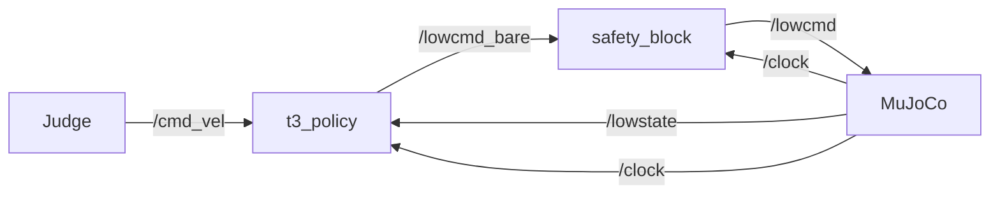

# T3. Ходьба Unitree Go1 с RL-политикой

`/entrypoint.sh T3` запускает предобученную политику [Walk These Ways](https://github.com/Improbable-AI/walk-these-ways) и Safety Block из T2. Веса и зависимости входят в образ `linux/amd64`. Инференс выполняется на CPU в NumPy. Версия весов и команда конвертации описаны в [checkpoints](checkpoints/README.md).



[`participant.py`](participant.py) читает `/cmd_vel` и `/lowstate` и запускает инференс по `/clock`. [`policy.py`](policy.py) формирует 70 признаков на шаге, хранит историю из 30 шагов и вычисляет 12 целей суставов с номинальной частотой 50 Гц. Защита ограничивает изменение каждого угла относительно последней принятой цели до 5° и проверяет траекторию перехода на самоколлизии. Порядок суставов в ROS — `FR`, `FL`, `RR`, `RL`, по `hip`, `thigh`, `calf` на ногу.

## Локальный запуск

На Linux выполняйте команды из корня Robohack. На Mac используйте виртуальную машину Lima с Docker и поддержкой образов `linux/amd64`. Первый блок открывает оболочку в настроенном профиле.

```bash
limactl start robohack
limactl shell --workdir "$PWD" robohack sg docker -c bash
```

Соберите Participant и проверьте `ping` без сети по [корневому README](../README.md#сборка-и-проверка). Используйте публичный запускатель организаторов версии `3473f086fd8a111592b4b9d822500c79f20c811a`. В текущей копии проекта он лежит в распакованном каталоге `T3/go1-simulator-public-*`. Его исходники доступны в [публичном репозитории симулятора](https://github.com/Urika000/go1-simulator-public/tree/3473f086fd8a111592b4b9d822500c79f20c811a).

```bash
sim_dir=$(find "$PWD/T3" -maxdepth 1 -type d -name 'go1-simulator-public-*' -print -quit)
sim_image=registry.cookcloud.ru/go1-hackathon-remote-stage/go1-sim:v1.0
docker pull --platform linux/amd64 "$sim_image"
```

Можно подставить в `sim_image` локальный `robohack-t2-sim-source:local`, если он уже собран из публичных исходников.

```bash
python3 T3/demo.py series "$sim_dir/run_local.py" --sim-image "$sim_image" \
  --participant-image go1-participant:t3 --speed 0.6 --count 10 \
  --output output/t3-local
```

`series` создаёт новую пару контейнеров для каждого эпизода. `--count 1` запускает один пример. Используйте значение `preferred_speed_mps` из `ping` и новый выходной каталог для каждой серии.

Наблюдатель посылает команду скорости и сохраняет траекторию из `/odom/ground_truth` и углы из `/lowstate`. Он измеряет смещение по исходному направлению после 1,5 с прогрева. Критерий успеха — 3 м за 90 с зачёта без падения. Наблюдатель также сохраняет частоту и максимальный интервал команд. Ground truth доступен в публичном симуляторе и используется только скриптом проверки. Судейские сценарии описаны в [ТЗ T3](../Docs/HACKATHON.md#source-4).

Итоговый образ прошёл 10 из 10 эпизодов при команде 0,6 м/с. Путь в 3 м занял от 7,998 до 9,342 с после прогрева. [Метрики серии](../output/t3-results.json)

Регрессионную проверку очереди команд можно запустить без ROS 2 из корня проекта с установленными NumPy и MuJoCo 3.3.7.

```bash
PYTHONPATH=T2/t2_checked python3 T3/test_controller.py -v
```

## Видео из записи эпизода

[Запись первого эпизода итоговой серии](../output/robohack-t3-walk-these-ways.mp4) показывает 3,002 м за 8,284 с зачёта. Видео включает 1,5 с прогрева.

`render` восстанавливает записанные кадры корпуса и суставов на модели MuJoCo. Команда ниже рассчитана на Linux с Docker и FFmpeg.

```bash
docker run --rm --pull never --platform linux/amd64 --network none -e MUJOCO_GL=egl \
  -v "$PWD/T3/demo.py:/tmp/demo.py:ro" \
  -v "$PWD/output/t3-local/episode-01.json:/tmp/episode.json:ro" \
  --entrypoint python3 go1-participant:t3 \
  /tmp/demo.py render /tmp/episode.json /opt/t2/model/scene.xml \
  | ffmpeg -n -f rawvideo -pixel_format rgb24 -video_size 960x540 -framerate 30 -i pipe:0 \
      -c:v libx264 -pix_fmt yuv420p -movflags +faststart output/t3-demo.mp4
```

На Mac можно выполнить часть `docker run` внутри Lima, а поток кадров передать в FFmpeg на хосте.

## Обучение

`bash T3/train.sh` подготавливает окружение на NVIDIA GPU, запускает PPO и экспортирует веса для Participant. [Инструкция по обучению](TRAINING.md) описывает запуск с архивом Isaac Gym, сборку отдельного образа и проверку в MuJoCo. В исходном образе упакованы готовые веса авторов, поэтому `self_trained_rl` в `ping` равно `false`.
